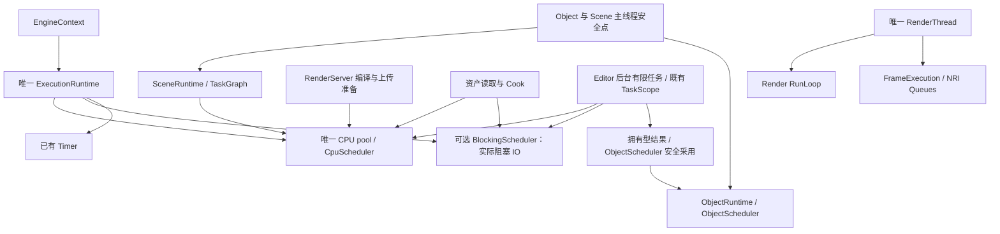

# Render 与 Engine Editor 的接线设计

本文是接线前的设计，尚未实施。当前 Render 流程见 [源码阅读文档](rendering-flow.md)，
核对基线为 `58d602a5d1448735b70895a505ba99594e4679ee`。设计遵守
[通用工程规范](../engineering-principles.md)、[Context 扩展合同](../context-extensions.md) 和
[Editor Framework v2](../editor-framework-v2.md)。

目标不是恢复旧 RenderRuntime，而是让现有 RenderServer 接入 Engine 的执行、资产和 Scene 流程，
再让 Editor 的窗口与 UI 消费结果。保留 stdexec 上传、真实 FIF、唯一设备 `cleanup_scope_`，
不增加线程池、通用 Manager、第二份 GPU 资源表或新的业务事件总线。

## 1. 调查结果：哪些可以直接复用，哪些尚不存在

| 当前事实 | 源码证据 | 接线结论 |
|---|---|---|
| EngineContext 创建一个 ExecutionRuntime，并把引用传给 SceneRuntime | [EngineContext.cpp](../../engine/context/src/EngineContext.cpp) | Render 使用该实例的 `cpu()`；不再调用第二次 ExecutionRuntime::create |
| Render 创建函数已经接收 ExecutionRuntime& | [RenderServer.cpp](../../modules/function/render/src/runtime/RenderServer.cpp) | 无需新建调度抽象或把 Render 反向链接 Engine |
| TaskExecutor 借用 ExecutionRuntime CPU Scheduler | [TaskExecutor.hpp](../../modules/core/task/include/lux/engine/task/TaskExecutor.hpp) | 整图 Sender 保留后继 CSR 和 affinity；不再创建线程 |
| Editor 配置 CPU 池一次，Scene 只指定节点预留量 | [LuxEngine.cpp](../../editor/app/src/LuxEngine.cpp) | 窗口/旧 Render 产品接线仍单列，不能由共享池推出产品闭包 |
| Editor 的 `project_tasks_` 和 `EditorContext::tasks_` 都借用 EngineContext::execution() | [LuxEngine.cpp](../../editor/app/src/LuxEngine.cpp)、[EditorContext.cpp](../../editor/context/src/EditorContext.cpp) | 已有 stdexec/TaskScope 接线保留；不增加 Editor 专用 Runtime 或后台池 |
| ObjectRuntime 是进程唯一对象线程与代际定位，不拥有业务对象 | [ObjectRuntime.hpp](../../modules/core/object/include/lux/engine/object/ObjectRuntime.hpp) | 用于 UI/业务结果采用；不搬进 RenderThread |
| ObjectScheduler 已存在，封装对象目标和安全回调 | [ObjectScheduler.hpp](../../engine/process/object_execution/include/lux/engine/process/ObjectScheduler.hpp) | 复用，不新增 Render 专用 ObjectScheduler |
| Scene 已有 MAINTENANCE/SYNCHRONIZATION/STABLE/PUBLICATION 阶段 | [SceneSystem.hpp](../../engine/scene/system/include/lux/engine/scene/SceneSystem.hpp) | 接入既有 SceneSystem 生命周期，不增加 Renderer 专用 Scene 驱动 |
| EngineContext/Scene 的 CMake 仍检测 `render_runtime` | [Context CMake](../../engine/context/CMakeLists.txt)、[Scene CMake](../../engine/scene/CMakeLists.txt) | 该 target 已淘汰；相关 rendering/render 子目录当前不存在，不能仅把 if 条件改名就算接通 |
| EditorUiScene/UiRenderSyncStage 仍消费旧 RenderRuntime、RenderResources、RenderProgramBuilder | [EditorUiScene.cpp](../../editor/app/src/EditorUiScene.cpp)、[UiRenderSyncStage.cpp](../../editor/app/src/UiRenderSyncStage.cpp) | 保留实际输入/捕获/背压合同，重写旧运输接线；不恢复兼容头 |
| UI DrawData 公开头引用旧 RTextureHandle，私有 friend 仍为 VulkanRenderer | [DrawData.hpp](../../modules/function/ui/include/lux/engine/ui/DrawData.hpp) | CPU UI 图像标识和 GPU 消费必须重新分界 |
| 当前 Target 仅 OFFSCREEN | [OffscreenTarget.cpp](../../modules/function/render/src/execution/OffscreenTarget.cpp) | 先实现真实窗口输出与 Target 消费，再接 Editor 视口 |
| Raster 当前只有单次直接/间接 Draw，scissor 来自 Pass viewport；没有公开颜色混合状态 | [Draw.hpp](../../modules/function/render/include/lux/engine/render/graph/Draw.hpp)、[RenderExecutor.cpp](../../modules/function/render/src/execution/RenderExecutor.cpp) | UI 还需要实际的动态绘制范围和 Alpha Blend，不能只替换旧 UI 句柄 |

旧 Engine/Scene/UI README 描述的一些渲染能力仍是历史模型，不作为现成实现依据。例如 `RenderResources`、
`RenderFeatureSceneBindings` 和旧 Surface 关闭回执不能从文档直接拿来使用。

## 2. 执行资源：一个 CPU 池，不强行合并不同线程的安全点

### 2.1 最终关系



共享的是计算资源和执行协议。主线程的 ObjectRuntime 与 RenderThread 的 RunLoop 属于不同线程归属，
不能为了“唯一队列”把它们混成一条队列。两者都不创建 worker。RenderThread 负责持续设备推进，也不是 CPU 池。
应用在启动任何 worker 前先建立 ObjectRuntime，确定对象线程；不能让某个首次完成的编译任务意外成为对象线程。
ExecutionRuntime 的可选 blocking workers 服务真正阻塞的 IO，与另建一套 Render CPU 池不是同一问题；
它们仍由同一个应用运行设施配置、停止和 join。

### 2.2 TaskExecutor 必须共用执行资源

`worker_count=0` 只解释当前 Editor 源码，撤回把它作为接线实施方案的建议。
正式接线必须让 TaskGraph、Render 编译/上传准备、Engine 和 Editor 计算任务使用同一个 ExecutionRuntime CPU 池。
Thread 数只在 ExecutionRuntime 配置一次；不保留 TaskExecutor 私有池作为长期兼容路径。

需要同时处理两层职责：

| 对象 | 保留的责任 | 移除的责任 |
|---|---|---|
| `ExecutionRuntime` | 应用的 CPU/阻塞 IO/Timer 执行资源、Task 准入与应用关闭 | CPU 自制 Ring、workerLoop、唤醒/偷取算法，由现成 stdexec 线程池实现接手 |
| `TaskGraphBuilder/TaskGraph` | 资源冲突、显式依赖、不可变 callable、root 与 successor CSR | 不增加线程池或运行期 TaskId |
| `TaskExecutor` | 借用 CpuScheduler，复用 DAG 执行 scratch，提供整图 Sender 和同步调用入口 | workers、worker_count、每 worker ReadyStack、sleeping_workers、worker_event、round_robin、join |
| `TaskGraphSender::Operation` | 一次图的依赖计数、子 schedule operations 和一个最终 Receiver | 不创建独立队列线程、Registry、Future 或逐节点 Scope |

TaskExecutor 的名字可以保留：它执行依赖图，并不意味着必须自己拥有线程。
TaskGraph 仍是被执行的数据，不改成内部持有 Scheduler 并自行驱动全局资源的对象。

### 2.3 ExecutionRuntime 的 CPU 路径采用现成 stdexec pool

ExecutionRuntime 使用锁定 stdexec 0.10.0 的 `exec::static_thread_pool` 替换现有 CPU 后端。
这是 **NVIDIA stdexec 的库扩展**，不是 C++20 标准库已提供线程池。
构造和最终 join 仍归 ExecutionRuntime；Render 和 TaskExecutor 只拿同一个具体 Scheduler。
现有 BlockingScheduler/Timer/CompletionWork 和 Task 的业务元信息按各自责任保留，不随 CPU 池替换机械重写。

旧 `ExecutionRuntime.cpp::submitSchedule()` 的 CPU Ring 对每次入队可能返回 CAPACITY_EXCEEDED。
如果一个 DAG 的前半已经修改 ECS，而后继 schedule 被这个 Ring 拒绝，就无法把整次执行诚实地称作“未接纳”。
在 TaskExecutor 增加重试 worker、备用队列或 caller-runs 都会引入新的调度政策或破坏亲和性。

`static_thread_pool` 的 schedule operation 自身提供就绪节点；启动时入库的队列，不需要为每个后继再申请一个
独立业务容量。它的 schedule completion 在本地版本中是 value/stopped，没有普通 queue-full error。
因此**业务背压留在工作接纳边界**：现有 Task 容量、Client 在途请求额度、上传字节额度及图运行准入，
而不是让已接受工作的每条依赖边再次争取执行资格。

必须明确这是调度合同变更：删除 CPU Ring 的 `cpu_queue_capacity`，不能悄悄保留一个失效配置；
逐一核对直接 schedule 消费者的工作来源和预算。调度队列不宣称有固定容量，其峰值由已接受工作及其真实
OperationState 存储决定，不能用一个无界 vector 缓存未接受请求来伪装有界。

`CpuScheduler` 优先作为该具体 scheduler 的语义别名，不再复制一套 CPU Sender 的启动/停止/入队状态机。
它是借用，Runtime 必须覆盖所有 started operations；原来“空 Scheduler/Runtime 消失后再 schedule 返回错误”的
消费者要迁移到真实寿命边界，不能继续向已销毁的池调度。线程创建失败仍在 Runtime factory 转成工程错误，
普通堆 OOM fatal，不增加热路径 catch。

### 2.4 整张 DAG 是一个 Sender，而不是每个节点一个顶层 Task

实际 API：

```cpp
task::TaskExecutor executor{engine.execution().cpu(), 2048};

auto work = executor.schedule(graph); // lazy；一次图运行
// 异步消费者将 work 连接到自己的已有 scope/receiver，并提供 caller scheduler。

auto result = executor.execute(graph); // 真实的同步 Simulation 边界
```

`schedule(graph)` 的内部顺序：

1. 在启动副作用前取得该 Executor 的独占运行资格、准备全部节点空间并检查初始 stop。
2. 初始化已有 prerequisite 计数；只发布 root，不逐轮扫描全部节点。
3. WORKER 节点连接 `schedule(cpu)`，节点 Receiver 执行 callable 并释放后继；CALLER_THREAD 使用接收者环境提供的 caller scheduler。
   caller scheduler 必须在整图期间保证完成，不能直接接入会因 Object 销毁而拒绝已接受节点的 scheduler。
4. 节点完成后遍历自己的 successor CSR；`fetch_sub(acq_rel)==1` 的最后前驱发布后继。
5. 节点在所有后继发布、所有图状态访问结束后报告完成；整体只调用一次最终 Receiver。

保留现有完成驱动算法，复杂度为 O(V+E)，没有按拓扑层逐层 when_all 的全图 barrier。
不能给每个节点 `spawn`，也不把运行期 DAG 展开成不断分配 `any_sender/split` 的模板拼接树。
stdexec 管调度、连接和完成合同；TaskGraph 仍需自己的运行期依赖算法，这不是重复线程池。

子 OperationState 是一个复合 Sender 的内部状态，集中在可复用、地址稳定的 workspace。
`connect/start` 每次运行重新建立，完成前绝不覆盖或重启；冷态扩容后目标是零逐节点堆分配。
这不等于另建一张拥有任意异步 Operation 的 Pending 表。TaskExecutor 不保存上层 Receiver 的所有权或删除器。
这里有真实空间取舍：具体 schedule operation 可能比原来的 index/next 数组大，须测量每节点尺寸和整图峰值。
“零逐节点分配”不等于零构造、零入队成本；先保留 O(V+E) 算法和正确性，再决定是否值得批处理短任务。
TaskCallable 的冷态类型擦除仍有运行期系统/DLL 消费者，不为追求全模板化另造一份插件图。

完成协议需要覆盖：启动时所有 root 尚未发布的保护、同步完成、多个前驱竞争及最后 Receiver 自毁。
不能仅因 terminal 节点数归零就清空 workspace，而前驱仍在遍历后继；计数的释放点必须是该回调最后一次访问图状态。
顶层完成后不再读 Operation 字段，保留实际外部 callback/code pin 的退栈合同。

### 2.5 CALLER_THREAD、停止和 Simulation 时间

同步 `execute()` 继续服务现有 `Simulation::execute()`，使用 stdexec 的同步消费边界；其 run_loop 只运行
本次图的 caller-affine 工作，替换原 `caller_ready + event.wait`。它不是新的进程线程池，也不派发 UI/Object
或任意 CompletionWork。不能让整张 Simulation 先进入 CPU worker 再阻塞等待同池后继。
适配入口将已定义错误/停止转成明确的结果值后等待，避免 `sync_wait` 的 error 通道抛出异常穿过 Lux API。

异步接入需要明确的 caller scheduler，并保证其线程持续推进；不能把 Worker 上的最后完成当作 Scene 采用点。
若以后让 Simulation 跨主循环挂起，必须相应调整 SceneDriver 的阶段与 Registry 访问合同；仅共享池不要求先进行这项改造。

当前 TaskCallable 是 `void() noexcept`，可以修改 ECS，不能在半张图后任意丢弃节点。
采用整次 Simulation step 的停止边界：**开始前可拒绝/停止；开始后把有限 DAG 清偿完，再阻止下一步**。
已开始图的内部 schedule 不继承可中断本步的 stop token；外层收到停止意图也不能覆盖已经发生的业务结果。
系统本身失败沿现有 Simulation 失败字段报告，完成所需收尾，不能宣称回滚了已写入的 ECS。

`Simulation::execute()` 当前先改 `impl_->time` 再调用 Executor，迁移时必须审查这一发布点：
未启动的拒绝保留旧时间；实际执行过的失败保留真实已采用时间和错误。可以在同步边界保存旧时间并仅在
确定未启动时恢复，不为此维护两份长期世界/时间状态。系统在本步执行期间仍读取本步时间。

### 2.6 修改与删除及资格

- `modules/core/task/src/TaskExecutorWorker.cpp`：删除私有池/偷取/睡眠实现；DAG successor 算法迁到整图 Operation。
- `TaskExecutorDetail.hpp`：删除 worker 数组与事件字段；保留实际 dependency scratch，按新职责缩小或替换。
- `TaskExecutor.hpp/.cpp`：增加整图 Sender，保留同步消费；删除 workerCount、worker 配置和 worker 创建错误。
  工厂若只剩普通内存分配就改为自然构造，不保留虚假的 ALLOCATION_FAILURE。
- `TaskGraph.hpp/Task.hpp`：保留不可变图与代码 pin；澄清 CALLER_THREAD；更新私有访问者，不添加任务注册目录。
- `ExecutionRuntime.cpp`、`Scheduler.hpp`：CPU 池采用 `exec::static_thread_pool`，删除自制 CPU RequestQueue/workerLoop/
  mutex/condition_variable 和重复 CPU Sender；保留仍被 BlockingScheduler 消费的独立 IO 代码。
- `SceneRuntime.cpp`、`SceneDriver.cpp`、`Simulation.cpp`、`EngineContext.hpp/.cpp`：注入现有 scheduler，移除独立
  worker 配置，校正未启动/实际执行的时间与失败语义。
- Render 的 CpuScheduler 消费者、资产加载、TaskScope 和安装消费者：迁移具体 scheduler 类型和有效期合同；
  不改 Render RunLoop、stdexec 上传、FIF 或 `cleanup_scope_`。
- 对应 CMake/错误目录/测试：迁依赖和真实错误；删除私有线程创建故障用例，保留亲和性、依赖与关闭有效断言。

整个执行模块完成后集中验证：混合 affinity、长链/宽图/菱形、一次执行、前驱内存可见性、同步完成、停止边界、
Scene/Render/资产同池并行、关闭退栈、分配与调度次数。性能目标是没有逐层 barrier 和逐节点堆分配，
不以使用 stdexec 预判更快。未通过这些门禁就不能把共享池接线判为完成，更不能退回 worker_count=0 交付。

设计核对使用本地 stdexec 0.10.0 的 `exec/static_thread_pool.hpp` 与 `stdexec/__detail/__sync_wait.hpp`；
[官方 Sender/Scheduler 说明](https://nvidia.github.io/stdexec/user/index.html) 只作为组合语义参考，不替代本地版本资格。

### 2.7 Editor 后台工作直接纳入同一执行体系

Editor 已经使用 stdexec，并且其执行资源来自 Engine；这里保留已有正确接线，迁移的是共享 CPU 后端及尚未统一的
TaskExecutor，不重新编写 Editor 异步框架。当前生产源码中的具体关系是：

| 消费者 | 当前入口/职责 | 统一后的处理 |
|---|---|---|
| `LuxEngine::Impl::project_tasks_` | 由 `host_.engine->execution()` 构造；接纳项目准备、保留 TaskId/请求序号 | 保留项目请求替换与取消语义，仍用同一 Runtime |
| `EditorContext::tasks_` | 构造为 `tasks_(engine.execution())`，提供项目级有限任务作用域 | 保留实际项目取消域；不创建 CPU workers，不绑定一个新的线程池 |
| `detail::prepareProject` | 在 `execution().blocking()` 上读写项目文件、准备插件等，返回拥有型准备结果 | 阻塞工作留 BlockingScheduler；发现确实独立且较重的 CPU 阶段时才转到共享 cpu() |
| `process::objectScheduler(owner)` | 将准备结果交给原 Object 线程，随后发送 ProjectPrepared 事件并按请求序号采用 | 复用原对象目标与回调保护，不增加 UI/Editor 专用 Scheduler |
| `AssetLoadSender` | 读取端口完成后 `continues_on(cpu)` 执行解码 | 使用 Engine 的同一个 cpu()，不在资产/Editor 工具中创建私有 pool |

源码入口：
[LuxEngine.cpp](../../editor/app/src/LuxEngine.cpp)、
[ProjectPreparation.cpp](../../editor/app/src/ProjectPreparation.cpp)、
[EditorContext.cpp](../../editor/context/src/EditorContext.cpp)、
[AssetLoadSender.hpp](../../engine/process/asset_loading/include/lux/engine/process/asset_loading/AssetLoadSender.hpp)。

目标调用链为：

```text
Editor/Scene 所属线程：验证意图，捕获拥有型输入
  → 既有 TaskScope.submit
    → 文件/插件阻塞阶段：Engine ExecutionRuntime.blocking()
    → 有实际需要的计算阶段：同一个 ExecutionRuntime.cpu()
    → 拥有型结果 → ObjectScheduler / 对应 Scene 采用安全点
  → 验证目标代际、请求序号/内容 revision → 采用并发送语义 Signal
```

当前 `prepareProject` 整段在 blocking scheduler 执行；上述 CPU 分段是后续按实际工作选择的边界，不能写成已经完成。
不要为了外观统一给每个小函数增加一次 `continues_on`。阻塞文件访问不能直接搬到 CPU 池，计算也不能因它来自 Editor
就永远占据阻塞 IO worker。CPU 和 BlockingScheduler 由一个 ExecutionRuntime 配置和关闭，是不同工作性质的资源，
不是 Editor/Engine/Render 各有一套 Runtime。

共享线程池不要求合并取消域：项目准备、项目任务、Render Command 各有真实业务准入/停止责任，继续使用现有 Scope。
项目关闭只取消本项目任务，不能调用整个 ExecutionRuntime 的停止/join；已接纳任务持有自己的输入、结果和代码寿命，
直到运输结算。Object 目标失效可以取消业务采用，却不能撤销已经发生的文件发布或 GPU 副作用；原结果事实先结算，
再判断是否还有可通知的对象。唯一 `cleanup_scope_` 的约束专指设备物理清理，不是删除这些必要的业务作用域。

跨模块统一验证必须在一个进程中同时运行：TaskGraph 混合 affinity、Render 编译/上传、Editor 项目准备/取消和资产解码。
核查所有 CPU scheduler 来自同一 Runtime，UI/Object 回调只在正确线程，阻塞 IO 不饿死计算，旧项目完成不污染新项目，
以及最后退出不在 Render/Editor 仍借用 CPU 资源时提前销毁池。不要用四个分别创建 Runtime 的测试代替这项集成事实。

## 3. Engine 侧只增加有实际职责的接缝

以下是拟议名称/文件，不是恢复已删除接口的兼容层。每个有实现的头与源保持同名。

| 类型或函数 | 实际职责、拥有和借用 | 拟议落点 |
|---|---|---|
| `RenderExecution` | 应用级 RenderServer 与唯一 RenderThread 的启动、失败收取、停止/join；借用 Engine 的 ExecutionRuntime | `engine/rendering/include/lux/engine/rendering/RenderExecution.hpp`、`src/RenderExecution.cpp` |
| `RenderRequester` | 一个 Client Link 的 typed 请求提交、RequestId→完成节点关联、目录缓存及 Response 消费；不拥有资源和业务状态 | 同目录 `RenderRequester.hpp/.cpp`，模板仅留必要公开定义 |
| `RenderAssets` | AssetId/内容版本到本进程 Render 句柄的实际映射、共享业务使用计数和上传输入寿命 | 同目录 `RenderAssets.hpp/.cpp`；复用现有 AssetLoadSender/资产类型，不另建 CPU 资产缓存 |
| `RenderDiagnostics` 的装配函数 | 将 RenderErrorSink 映射到应用现有诊断出口；只有这里解释 NRI/Render 回调，不让每个宿主复制一份 | 同目录 `RenderDiagnostics.hpp/.cpp` |
| `RenderSystem` | 一个 Scene 的渲染关联、ECS 增量提取、Camera/View 参数、请求结果采用 | `engine/scene/builtin_systems/render/.../RenderSystem.hpp/.cpp` |

`RenderExecution` 不是新的渲染运行框架：不拥有另一个 Command 表、Graph、Storage 或 Device；内部调用原 Server。
`RenderRequester` 的关联表只表达真实 IPC 往返。它不持有 connected OperationState 的删除器，不重复实现 Scope。
`RenderAssets` 是 **Client 业务依赖** 的落点：否则每个 Scene 都会重复实现 Asset 去重与关闭顺序。
它不能查询或操作 Storage 私有实现，也不能另存 Render 内部 Buffer/Descriptor。
RenderExecution 作为应用期装配对象拥有这些连接和一个 RenderAssets，具体发送、采用和资产关系仍由对应组件执行。
Main/Asset 可以使用不同 Link，但每条 Link 都由它约定的单一线程发送/消费；不要按资源或请求新建连接。

EngineContext 现有可选 `rendering_` 挂点改为拥有完整的 `RenderExecution`，删除旧 `RenderContext` 类型引用，
Context 仅提供访问。装配仍是显式冷态启用：先建立 ExecutionRuntime，再构造完整 Render 候选，成功后一次发布。
保留 headless `engine_context` 不链接图形的能力；可选装配和销毁函数在 `engine_rendering` 实现。
成员依赖必须保证 SceneRuntime 先结算，RenderExecution 后停止，ExecutionRuntime 最后 join。
这是一个可选领域设施的唯一拥有关系，不给每个 Native 句柄添加动态删除器。

Scene 通过现有 `SceneCapabilityProvider` 得到 `RenderRequester/RenderAssets` 等窄依赖。Editor 的工具通过实际
构造参数或其已有 ContextExtensions 借用已存在的设施；不修改已经发布的 ContextExtensions 表、不在查询时创建对象。

## 4. Client 与 stdexec 的桥接：不让业务线程占用 SPSC 的生产端

当前 `IpcRequester` 没有 ready callback 或 Sender 接口；同一 Requester 的发送/消费由一个固定应用线程负责。
不能把 Engine 多个 CPU worker 直接接到同一 SPSC producer。

`RenderRequester` 在主线程接纳 typed 请求，并提供有限 Sender 供现有 TaskScope 组合：

```text
Scene/资源流程准备拥有型批次
  → 在应用安全点开始 Command Sender
  → RenderRequester 预留关联/预算 → IpcRequester::trySend
  → RenderServer 原有 Handler/Scope/Outbox
  → 主线程 RenderRequester::consumeResponses
  → 对应 Sender 终态
  → 原业务安全点采用 / ObjectScheduler 通知
```

源码调查确认 `OperationPort` 是借用/拥有端点的通用接口，**没有现成 IPC 关联表**；`PortSender` 还要求另一套
`Operation::Value/Error`，并使用共享 endpoint。不得为了套它再为每个 Command 新建 Operation/Endpoint/expected 包装。
本次优先在 `RenderRequester` 内实现一个薄 typed Sender：节点由 connected state 提供稳定地址，连接只保存非拥有
回调与关联 ID；业务响应保留原显式 error 字段。复用库中的生命周期/同步完成模式，不复制一个通用异步框架。

该 bridge 必须保持：

| 情况 | 处理 |
|---|---|
| 入队失败 | 无远端接纳，退关联/预算；保留待发送消息，稍后由发布阶段重试 |
| 发送成功 | Request 值已转移；源 payload 的实际 owner 留在本次上传操作/Client 批次 |
| 收到 Response | 无论业务成败都结束该请求 CPU 源借用；传递原业务 error，不丢失未知副作用 |
| 用户取消 | 未发送可停止；已发送继续消费终态，不把 cancel 当 Native cancel，不提前释放源 |
| Link 关闭/Server 异常退出 | 业务结果未知；源释放必须等 Render/CPU Producer 的结算证明，不在 reset() 时立即释放 |
| 同步拒绝/完成重入 | `start()` 返回与完成回调尾栈安全；不能在回调后再次读可能已销毁的节点 |

关联容量有显式上限，满时在发送前拒绝；不建立无限待发 vector。相同 RequestId 数值可存在于不同 Link，
连接重建必须废弃旧目录 ID/关联，不能将旧结果交给新 Scene 或新一轮请求。

结果路由与安全结算不依赖 Pane 是否仍存在。TaskScope 负责已接受 operation 的寿命；项目关闭只撤销业务采用，
不丢弃仍被 Server 借用的输入。业务被撤销但创建已经成功时，Client 必须释放真实新句柄，不能只忽略 Response 泄漏资源。

### 唤醒的实际缺口

`IpcCore::notifyWork()` 唤醒的是 IPC 等待者，不会唤醒 GLFW 的 `waitEvents()`。
只在 Editor `pumpOnce()` 加 `tryReceive()` 会留下“空闲窗口永远不领回复”的风险。

拟在 RenderServer 配置增加一个**借用的回复可用通知**，仅在 Outbox 实际发布回复后调用，通知 Engine 已有
`CompletionWork::Request`。它聚合通知，回调在 ExecutionRuntime 主线程只做 `consumeResponses`，不直接改 ECS/UI。
ExecutionRuntime 和 ObjectRuntime 原有 wake 均接应用的 `LuxWindow::wakeEvents`。不增加轮询线程或第二条结果队列。
通知放在 `trySendResponse` 成功分支；现有 `flushTo()` 的返回计数还包含关闭丢弃，不能直接把该计数当作成功发布数。
无窗口应用可用同一执行设施的等待入口。通知是提示，实际领取仍检查队列，接纳/停服都遵守 producer 尾栈合同。

这份 CompletionWork 只归连接的运输完成，不能每个请求/每个 Pane 再建一份。通知目标在 Server join 之前有效，
join 后取消通知再销毁它。Server run 失败也必须唤醒应用收取失败并清偿未知请求。

## 5. LuxObject Signal 与 Scene 安全点

### 5.1 保持现有对象模型

LuxObject 的 parent 是关系，不是 C++ 删除策略。ObjectId 是非拥有代际身份；Worker 不保存跨异步的 Pane/Registry
裸引用。RenderServer、Storage、RenderPlan、GPU Buffer 不派生 LuxObject，也不登记到 ObjectRuntime。

`TSignal` 用于“项目已切换、视口状态已改变、错误已发生”等语义事实；不用于每实例 Transform 或顶点大数组运输。
`connect/emit` 在 Object 线程；保存 move-only Connection，关闭时断连。DIRECT 回调只记录意图或执行当前允许的操作，
不能从回调中销毁正在执行的接收对象。

`process::objectScheduler(target)` 可以把异步结果转回 Object 线程，但它的 FULL/closed/stopped 可能在调用线程完成。
因此不能把 error/stopped continuation 当作必然位于主线程。且目标已关闭会把交付变为 stopped：
**必须先结算 IPC/上传的原始 Response，再决定是否向对象通知**，否则可能掩盖已经成功的 GPU/资源副作用。

### 5.2 Scene 阶段接线

| 阶段 | RenderSystem 责任 |
|---|---|
| MAINTENANCE | 收取已完成的资源/创建/销毁结果，按 Entity generation、Scene 身份和 revision 采用；结构变更使用当前允许的安全点 |
| SYNCHRONIZATION | 由原 TransformSystem 完成层级/世界矩阵；RenderSystem 不再算一套 Transform |
| STABLE | 读取已稳定数据，形成必要的专业派生输入；不修改模拟业务 |
| PUBLICATION | 冻结 K 项变更及 View 参数并发送；背压保留未接纳批次，返回 PENDING，不能原地循环重试 |

RenderSystem 注册走现有 `SceneSystemRegistration/SceneSystemInstaller`，类型需求明确声明。
ECS 观察者只标脏/记录意图；建立订阅后折入存量组件。写入须走 patch/replace，on_destroy 在组件仍可读时提取句柄。
不要把旧 AGENTS 示例路径里的 DeferredCommands 当作当前 Scene API；实施使用当前
`simulation::ecs::EcsCommandBuffer` 和 Scene 的结构采用阶段。

CPU 权威是 Scene Registry；发送快照只固定本批输入，不再保存全量第二份世界。Render Storage 的已发布镜像及 FIF
脏范围仍是设备数据修复来源。revision n 的回复只确认 n；n+1 在等待期间产生时保留脏标记。
批次数组复用容量，但在 Response 前不能重写已发送 span；必要的复制发生于从活动 ECS 冻结本批 K 项的边界。

Camera 属于 Engine/Feature 配方输入，转换成 Attachment 参数；通用 RenderView 仍不认识 Camera。
没有有效 Camera 的 Scene 不暗中创建默认游戏相机。编辑观察相机、运行相机与 UI 视图分别由上层决定。

## 6. 资产到场景的完整接线

```text
资产 ID/版本（Engine）
  → 现有 AssetLoadSender / VFS / Cooked 资产
  → RenderAssets 保留本次上传输入，回主线程发送
  → Texture / Mesh / Material typed Command → 各 Storage Sender
  → RenderAssets 采用合格句柄
  → RenderSystem 创建 Instance、配置专业组和 Effect
  → Attach 到指定 Scene/View/Target → UpdateTransforms / UpdateAttachmentInputs
```

Texture、材质引用、Mesh/Instance 的先后顺序在 Client 实现；Render 不增加跨 Storage Observer 自动维护业务依赖。
多个 Scene 共用同一资产时，RenderAssets 管真实业务使用关系；独立 Instance/Attachment/参数仍属于各 Scene/View。
不是所有资源都存 Global：共享资产适合 Global，实例数据通常属于 Scene，视图参数属于 View/Attachment。

Effect 配方由选定的 Feature 描述和显式端口构造；一个场景可复用同一 Cooked 程序表。
材质分组按 mesh/submesh/程序表，不按每个 MaterialId 重复建立同组。参数/Transform 更新不重编图；
程序结构或资源合同变化才构建新 Effect 候选，成功后切换，失败保留旧值。

项目代码模块必须覆盖已注册 Handler、Feature 构建函数及所有相关 Message 的析构/回调。当前没有运行中热卸载资格。
第一闭环选择应用期固定的 Render 扩展集合；项目切换释放业务数据，但不卸载仍被 Server 借用的实现 DLL。
若产品需要任意项目插件热替换，必须另做真实注册卸载合同，不能靠关闭 EditorContext 假设已经安全。

## 7. 窗口输出与 Editor UI

### 7.1 NRI 窗口输出

在当前 Render 库内增加私有 `SurfaceTarget.hpp/.cpp`，拥有 NRI SwapChain 及 acquire/present 同步对象，
借用 Window 的平台句柄。扩展实际 `RenderTarget` 使其选择 Offscreen/Surface，保持同一 TargetId 身份；
不增加 SurfaceManager、第二个 Device 或另一套 frame loop。

公开创建描述只含明确的平台借用值（第一步 Windows HWND）、extent、输出格式/编码和呈现策略。
不暴露 `nri::SwapChain*`/VkSurface；`LuxWindow::nativeHandle()` 由装配方读取，Renderer 不调用 UI 对象。
实际 NRI 头和实现留在 Render 的私有/项目可见目录。

顺序固定为：

```text
可用 Frame slot + 有效窗口状态
  → AcquireNextTexture → 将取得的 swapchain image 绑定为本次 Target 输出
  → Graph 准备/录制；首使用等待 acquire，末写转 PRESENT
  → 最终提交 signal release semaphore
  → QueuePresent 等待 release
```

Frame slot 和 swapchain image index 是两套不同事实，不能取模混用。Acquire/release semaphore 的复用遵守 NRI
真实实现；Graph 的资源复用继续依据原 Queue 前沿。

本次检查了锁定 NRI v180 的 `Include/Extensions/NRISwapChain.h` 和 `Source/VK/SwapChainVK.hpp`：
Acquire/Present 不保证零 CPU 等待；Acquire 使用内部呈现 timeout，且持 Queue 锁。不能直接复制官方示例里的每帧
无条件 Wait，也不能宣称“一接 Present 就全速”。最小化/零尺寸窗口不 Acquire；OUT_OF_DATE 在 Owner 边界重建。
多窗口饥饿、VSync 等待位置和关闭延迟必须由真实窗口门禁决定，发现不可接受的阻塞再提出有界后端改动，不能另开呈现线程掩盖。

### 7.2 离屏 Scene 进入 UI 必须是明确的 GPU 依赖

当前 OffscreenTarget 只创建 COLOR_ATTACHMENT usage；没有可供 UI 使用的完整采样合同。
拟增加 Target 的明确采样用途和中立 Target 图像引用，让 UI 图导入同设备的 Scene 输出，不能取裸 descriptor index
穿过应用层，也不能用 CPU Readback 回传图片。

同一帧内由 FrameExecution 准备 producer Scene 图与 consumer UI 图，Target 输出作为显式写/读摘要参与依赖建立。
当前 `buildImportedDependencies` 只看 imported 摘要，**不会自动看见 transient Target producer**；必须补齐输出摘要、
实际状态与图间读写 Barrier，再允许这种接线。已有 Graph 初始/最终状态合同继续作为依据，不另造 OutputManager。

规定第一闭环读取当前帧的 producer 输出；需要“保持上一张已完成图”的 UI 行为另用明确 History，不能偷偷借上一 slot。
资源的最后使用包括 UI 采样提交，所以 Scene 提交完成不等于 Target 可覆盖/销毁。
Resize/Detach 先停止未来消费并更新关联，再把旧 Target/描述符交给原 `cleanup_scope_`；旧 UI 帧不得引用新 epoch 的目标。

### 7.3 CPU UI 和 GPU UI Feature

| 对象 | 终态职责 |
|---|---|
| `ui::Root/Pane/Element` | 输入、布局、交互；仍只在 Object/UI 线程 |
| `ui::DrawData` | 可移动拥有型顶点/索引/绘制记录，容量复用；用 UI 自己的中立 image token，不包含旧 RenderResourceHandle 或 NRI |
| `UiFramePublisher`（替换私有 EditorUiScene 运输） | 捕获帧输入、解析本帧图像引用、冻结借用、提交和消费 Response；不伪建一个空 ECS Scene |
| `UiFeature` / 专业 UI 数据实现 | Render 内的 UI Buffer 上传、clip/texture/raster Work，消费图像端口；不调用 ImGui Context 或 UI 树 |

`DrawData` 中的 token 只标识捕获的图像使用。应用在捕获边界把它解析为本帧引用表中的 Texture/Target；
GPU Command 使用该表的紧凑索引。该表是本帧数据，不是一个新的全局图像 Registry。
移除 `detail::VulkanRenderer` friend，提供仅供正式 GPU 消费端使用的窄只读 draw view，ImGui ABI 留 UI 私有。
共享的纯值格式放 `modules/resource/description/.../UiDraw.hpp`：顶点、索引范围、clip、image token；
它不依赖 UI 对象或 Render 实现。DrawData 捕获时直接转换并复用这些数组，Render 接收只读范围，避免先复制 ImDrawList
再复制一份等价中间数组。任意 ImGui UserCallback 仍拒绝，不能将 UI 线程回调交到 RenderThread。

UI 已完成的 DrawData 在对应 Response 前不可修改，复用有限数量的缓冲；队列背压时不继续积累帧。
窗口隐藏时继续维护对象、完成和资源清偿，但不无条件生成绘制数据。
颜色输入、Scene Tonemap 与最终窗口编码沿 [色彩合同](color-space.md)，只有一次最终显示转换；UI 混合在约定空间完成。

### 7.4 UI 所需的有限 Raster 能力

当前 `VDrawCommand` 只有 `DrawVertices/DrawIndexed/DrawIndexedIndirect`，不是一个可以直接录制任意 ImGui 列表的接口。
因此 UI 大模块还需要下面的明确变更，不能靠每帧重建 Pass/Pipeline 或给 Executor 安装 UI 回调绕过：

- 在 `graph/Draw.hpp` 增加纯数据的 `DrawIndexedList` 描述和 `IndexedDrawRange` 帧记录：index 范围、vertex offset、
  scissor，以及预编译参数位置所需的值。描述固定 Buffer/布局，列表内容在帧准备时冻结。
- `FeatureBinding::prepare` 提供该实际绘制输入，`RenderGraphInstance::FrameResources` 保存本 slot 的稳定数组；
  Renderer 不借用会被下一次 UI capture 覆盖的记录，也不让数据对象保存 Queue 或自行提交。
- `RenderExecutor::recordBatch` 按冻结的范围执行 scissor/必要参数和 indexed draw；Vertex/Index/Pipeline 仍按原状态缓存复用。
- `GraphicsState` 增加明确的 `ColorBlendState`，进入 Pipeline 身份与 NRI 创建；UI 使用约定的 Alpha 模式。
  不在 `Shader.cpp` 根据 Feature 名字硬编码混合，不影响现有无混合 GBuffer/Depth。

这些是通用 Raster 数据与执行能力，有真实 UI 消费者；UiFeature 负责把 UI 帧降低成它们。
实现时必须同时迁 Graph 校验、Compiler、FrameResources 和正式 UI 场景，再集中验证 clip/透明/多纹理和稳定帧分配。

## 8. 统一主循环与关闭顺序

### 主线程

沿用 `LuxEngine::run/pumpOnce` 的唯一入口，不再让 Render 创建窗口循环：

1. 采样原生窗口事件一次；收取 Execution completion 和 IPC Response。
2. 派发 Object 固定批；在主安全点采用项目/视口意图。
3. 按 SceneRuntime 原有 driveFrame 推进维护、Simulation、同步和发布；不在 UI 中再驱动同一 Scene。
4. 更新 Root、捕获 UI 帧并提交；帧资源不足时只维护，不忙重试。
5. 收取对象退休；无工作时使用已有可唤醒等待。Render/IPC/执行/Object 通知都必须能唤醒它。

不要在渲染完成回调中调用 Scene `driveFrame()`、Root `update()` 或执行任意 UI 事件，避免形成隐藏重入循环。

### 项目关闭与应用退出不同

项目关闭只撤销采用、取消有限准备、停止新 Scene/UI 发布并异步清偿它的资源；不 join 全局线程池。
Pane/EditorContext 可以先撤离，已接受运输操作仍由原 ExecutionRuntime/TaskScope 持有自己的输入。
断开的业务接收者不妨碍 Response 和资源释放结算。

应用退出按依赖顺序：

```text
停止新的 UI/Scene/资产请求；记录关闭意图
  → 继续消费 IPC/Execution/Object 完成，结算已接受源借用与 Scene 退休
  → RenderExecution 请求 Server 停止（RenderThread 继续自己推进 GPU/RunLoop）
  → Server 清偿 Command/Outbox/cleanup；Surface 安全释放；RenderThread join
  → 销毁 RenderRequester/RenderAssets/RenderExecution
  → 停止并 join ExecutionRuntime 的剩余生产者；收尾 Object 回收
  → 销毁原生 Window 和进程 ObjectRuntime
```

现有 `LuxEngine::Impl::HostResources::drainAcceptedWork()` 先 `execution.requestStop()`，不能据此推断 Render 已清偿。
实际源码中 requestStop 先请求 Task/Timer 停止，CPU pool 的 stop/join 在后续 join；Render 的 spawn 不登记到
Runtime 的 Task 表。因此必须把“停止业务生产”和“关闭共享执行资源”分开，后者放到 Render 清偿之后。
Window 必须晚于其 Surface 的真实呈现使用结束；仅普通渲染 Queue Fence 完成不自动证明 WSI 已不再使用 SwapChain。
Surface 关闭须遵守 NRI 后端实际销毁/呈现完成条件；允许关闭边界的必要等待，不把它混入稳定帧。

## 9. 文件与 target 迁移清单

这是后续实施范围，不意味着本次已经改代码。

| 文件/模块 | 保留、修改或删除 |
|---|---|
| `engine/context/EngineContext.hpp/.cpp` | 保留 ExecutionRuntime/SceneRuntime；可选渲染设施引用改为实际 RenderExecution；删除旧 RenderContext 接口 |
| `engine/context/CMakeLists.txt` | 删除不存在的 `render_runtime` 条件/旧 rendering 子目录；headless 依赖不扩大 |
| 新 `engine/rendering/` | 放 RenderExecution、RenderRequester、RenderAssets、诊断装配；一个可选 `engine_rendering` target，公开层不暴露 NRI |
| `modules/core/task/TaskExecutor*`、ExecutionRuntime CPU 路径、SceneRuntime 构造 | 按 §2 完整统一；保留 DAG/affinity，删除 TaskExecutor 私有池和 Runtime 重复 CPU 调度实现，不保留零 worker 交付路径 |
| `engine/scene/builtin_systems/render/` | 当前缺失，按现行 SceneSystem 合同实现 RenderSystem；`scene_render` 为可选业务系统 target，不是新 Renderer |
| `engine/scene/plugins/BuiltinSceneRenderExports.cpp`、项目渲染插件导出 | 迁当前 Feature descriptor/SceneSystem；删除旧 FeatureHandle/SceneBindings 合同，插件代码寿命统一由应用负责 |
| `modules/function/render/core/Target`、Commands、Runtime Target 记录 | 增加真正 Surface 描述和 Target 采样用法，保持中立 ID/错误字段；不恢复 Readback |
| Render `SurfaceTarget.hpp/.cpp`（新）、OffscreenTarget、FrameExecution、RenderGraphInstance、SubmissionQueue | 补 Present、Target producer/consumer 访问及最终状态；仍只有原 Queue/帧/清理设施 |
| Render `graph/Draw.hpp`、Work、GraphCompiler/Shader、FrameResources、RenderExecutor | 增加冻结的 indexed draw list 与显式 BlendState，复用原 typed Work/Pipeline/录制链，不增 UI 专用执行器 |
| `modules/function/render/runtime/RenderServerConfig`、Outbox 发布点 | 补一个运输唤醒借用，不改 IPC SPSC/发布/回收算法 |
| `modules/function/ui/DrawData.hpp/.cpp` 及图像控件 | 移除旧 RTextureHandle/VulkanRenderer；CPU UI 不再依赖 Render 实现 |
| `editor/app/EditorUiScene*`、`UiRenderSyncStage*`、`UiFrame.hpp` | 迁捕获/背压/输入语义到 UiFramePublisher，删除旧空 Scene/RenderProgramBuilder 运输 |
| `editor/app/LuxEngine.cpp` | 组合新设施，修正完成唤醒、单主循环和关闭顺序；保持项目安全采用/Root 挂载机制 |
| `editor/context/EditorContext.cpp`、`editor/app/ProjectPreparation.cpp`、`engine/process/asset_loading` | 保留既有 TaskScope/ObjectScheduler 与 Engine Runtime 归属；适配共享 CpuScheduler，按实际工作划分 IO/计算，删除任何新增私有池方案 |
| `editor/window/EditorWindow.cpp` | 保留 metrics revision 和唯一 input；不在窗口回调直接访问 Server，变化在主安全点发布 |
| `editor/CMakeLists.txt`、UI/项目插件 CMake | 更新实际新 target 与安装包，删除旧找包/不存在目录，不建占位目标或兼容别名 |
| 各相关 README | 与正式实现同次更新，不能继续宣传旧 RenderRuntime 已接通 |

Render 仍是唯一 `lux::engine::function::render`。UI GPU Feature 放 Render 的实际专业实现区域，不能让 Render
反向链接 Engine；CPU UI 与 Render 共用的 draw 值合同放资源描述域的 UiDraw.hpp，旧 DrawData 编码消费者同次迁完。
`engine_rendering` 解释 Engine 的资产/Scene 需求；Render 不知道 AssetVfs、LuxObject、EnTT、EditorContext。

## 10. 分模块推进与验收边界

| 大模块 | 完整成果 | 集中门禁 |
|---|---|---|
| A：Engine 执行与请求接线 | TaskExecutor/Render/Engine/Editor 计算任务共用 ExecutionRuntime CPU 池；复用 Editor 既有 TaskScope/ObjectScheduler | 先完成 §2 单进程混合工作门禁，再验证双 Client、背压、关闭/unknown、项目切换和 Object 目标失效；禁止以零 worker 替代统一 |
| B：窗口与 Target 消费 | NRI Surface、Offscreen 可采样、显式图间状态/依赖、resize/minimize/close | 真窗口图像、两窗口公平性、FIF/WSI 信号复用、GPU Validation/SyncValidation、首帧/重建颜色 |
| C：Scene/资产 | RenderSystem 注册、增量提取、资源依赖、Camera 参数、两 Scene 共用资产 | 已存在组件、K 项/连续 Transform、revision、材质表分组、混合正负缩放、Scene 关闭/上传未完成 |
| D：Editor UI/视口 | UiFramePublisher、UI Feature、Root 捕获、Scene 图像合成 | 一个输入/Scene 驱动、无空闲漏唤醒、项目切换、Pane 删除、窗口关闭、真实显示 |
| E：依赖与产品收口 | 精确 include/link/install 闭包、旧接线删除、更新使用文档 | 全量 all、独立安装消费者、GPU/ASan、窗口生命周期；历史 Root/Debug 问题报告实际结果 |

每个模块完成 API、实现、消费者和失败路径后集中测试；日常只做必要编译诊断。复用现有工作树和构建目录，
不按每个子步骤复制工程。性能专项后置，仍记录新增拷贝/分配/等待的来源，不预先宣布性能 PASS。

必须在实施前关闭的局部设计验证有四项：共享 TaskExecutor 的准入/affinity、Command Sender 的借用清偿、
NRI WSI 等待/销毁、Target 跨图消费的状态与最后使用。它们各归真实执行者，不通过新的 Manager 或广泛 shared_ptr 保活补洞。
窗口和接线正确性不等于阴影质量/1000 FPS 对齐；未归因性能保持 PARTIAL。
