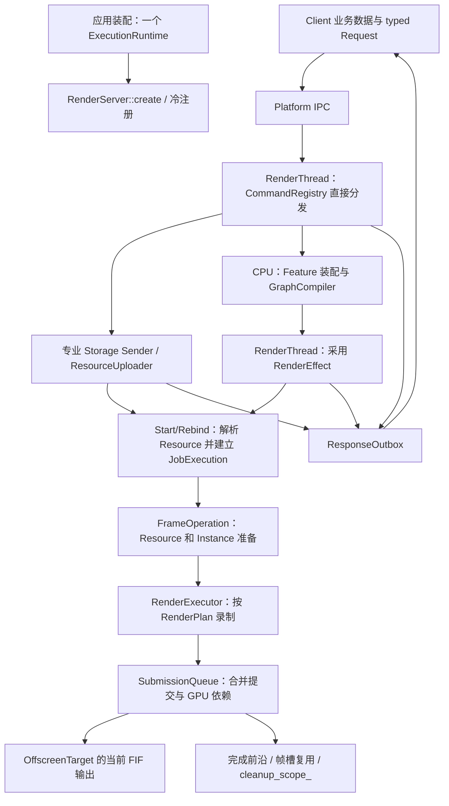

# Render 从请求到图像：当前实现与源码阅读路线

本文描述当前源码及其公开合同，不把接线方案当成已经存在的功能。版本沿本文所在 Git 修订核对。
工程约束见 [通用设计规范](../engineering-principles.md)，调用合同见
[Render README](../../modules/function/render/README.md)。后续接线另见
[Engine/Editor 接线设计](engine-editor-integration.md)。

## 1. 先明确“渲染出画面”的边界

当前 Render 能从资源、材质和 Effect 声明生成真正的 GPU 图像，支持主视图剔除、GBuffer、基础阴影、
Clustered Lighting 和 Tonemap。当前生产输出包括 OffscreenTarget 纹理和 SwapchainTarget 呈现。
两种 Target 各自拥有物理资源，JobExecution 的 GraphInstance 借用输出。Acquire 图像索引与 FIF 切片索引独立。
测试中的 Copy、映射和图片导出用于观察输出，不是生产 Readback Command。

不能把以下四件事视为同一时刻：

| 事实 | 当前含义 |
|---|---|
| 上传 Response 成功 | 源 CPU 读取结束，必要 Copy/Acquire 已接纳，资源已发布且后续使用顺序成立 |
| 图批次提交成功 | Native Queue 接纳了该批命令；GPU 可能尚未执行 |
| Queue 完成前沿推进 | 该物理 Queue 对应提交已完成，可以解除相应复用/清理条件 |
| 窗口显示图像 | SwapchainTarget 执行呈现，呈现有独立的完成条件 |

本文中的 `detail::` 是 Render 项目内实现命名空间，不是另一个模块。Render 是一个库，目标为
`lux::engine::function::render`；目录是职责分区，不能按目录理解为一串动态库调用。

## 2. 总流程和线程



| 执行位置 | 工作 | 不应做的事 |
|---|---|---|
| 应用/Client 线程 | 业务关系、请求构造、源数据有效期、Response 采用 | 直接修改 Render 的 Storage 或 NRI 对象 |
| 应用已有 CPU workers | 冷态图/Shader/Pipeline 编译、上传 CPU 准备 | 修改 Server 的可变目录或直接写 Outbox |
| 单 RenderThread | 请求派发、逻辑发布、帧准备、录制提交、完成回调 | 在依赖本线程推进的异步工作上阻塞 join |
| GPU 物理 Queue | Copy、Compute、Raster、Queue 间等待 | 决定 Client 的业务关系 |

`ExecutionRuntime` 提供 CPU 执行资源。`ManualContext` 由所属线程主动推进回程节点。
RenderThread 由应用启动并 join。Frame slot 是 GPU 数据复用单元，不是新的线程。

## 3. 装配与设备：先有真实依赖，再发布目录

主要入口：
[RenderServer.hpp](../../modules/function/render/include/lux/engine/render/runtime/RenderServer.hpp)、
[RenderServer.cpp](../../modules/function/render/src/runtime/RenderServer.cpp)、
[RenderServerImpl.cpp](../../modules/function/render/src/runtime/RenderServerImpl.cpp)。

```text
ExecutionRuntime::create（应用已有）
  → RenderServer::create(config, execution, device_options)
    → Impl::initialize
      → DeviceSession::create → DeviceBackend::initialize
      → ResourceUploader::create（配置 uploads 时）
      → FrameProgress 和每槽提交工作区（1～3 个槽）
      → ResourceRegistry + Global ResourceSet
  → Impl::registerBuiltinFeatures
    → 私有 Storages / Commands tuple → 直接登记构造入口与调用入口
  → 可选外部 registerFeature / registerStorage / registerHandler
    → 整组验证 → 发布到同一组目录（不调用实例工厂）
  → 应用线程调用 RenderServer::run
    → activateSelectedHandlers → 开始分发
```

| 类型 | 实际责任与所有权 | 关键源码 |
|---|---|---|
| `RenderServer` / `Impl` | 唯一运行对象，拥有目录、Scene、Target、Effect、Job、执行设施和回复出口 | `runtime/RenderServer{,Impl}.cpp` |
| `CommandRegistry` | Command 描述、支持绑定及当前选择；稳定 Handler 对象独占拥有，调用项借用它 | [CommandRegistry.hpp](../../modules/function/render/pinclude/lux/engine/render/runtime/CommandRegistry.hpp) |
| `BuiltinFeatures` | 私有编译期类型清单；Feature 用 tuple 声明 Storage 和 Command 依赖，不持有实例 | `pinclude/.../features/BuiltinFeatures.hpp` |
| `HandlerRecord` | 保存构造入口和唯一实例；登记时对象为空，激活后供 Command 借用 | `include/.../runtime/detail/HandlerRecord.hpp` |
| `FeatureEntry` | 稳定的 Feature 描述和构建函数；编译任务可借用已安装条目 | [EffectCompilation.hpp](../../modules/function/render/pinclude/lux/engine/render/runtime/EffectCompilation.hpp) |
| `DeviceSession` | 设备能力、NRI 设施、唯一物理 Queue 集合、DescriptorTable、唯一物理清理 scope | [DeviceSession.hpp](../../modules/function/render/include/lux/engine/render/extensions/device/DeviceSession.hpp) / [实现](../../modules/function/render/src/device/DeviceSession.cpp) |
| `DeviceBackend` | 选定后端的设备初始化及专属能力适配；不承担帧调度 | [DeviceBackend.cpp](../../modules/function/render/src/device/vulkan/DeviceBackend.cpp) |
| `DescriptorTable` | 设备级 sampled-image/sampler 索引和 Native 描述符；不拥有材质业务依赖 | [DescriptorTable.cpp](../../modules/function/render/src/device/DescriptorTable.cpp) |

普通公开合同是能力与 payload；扩展作者的声明、端口和构建合同由 render_extensions 安装。
内置依赖在私有 tuple 中声明，
`create()` 直接登记已知实现；不创建 Feature/Storage/Handler，不运行外部兼容验证或注册回退。
实际设备能力仍在冷态选择支持项，不因自动注册而擅自启用可选能力。

外部扩展通过 `extensions/Registration.hpp` 的通用模板登记，先验证完整依赖集合，再发布到同一目录。
失败不调用实例工厂、不留下部分类型或绑定。Handler 显式提供 `create(ResourceRegistry&)`，不猜测构造参数。
`run()` 创建当前选中的 Handler；首次切换到其他实现时在控制安全点创建。外部目录改动仅允许在启动前或完整停止清偿后进行；能力请求使用装配得到的准确方法，不按全局 active 重选。

Feature 的 Storage 依赖与 Effect 的资源端口连接是两件事：前者登记实现，后者决定同一张图的数据依赖。
GetOrCreateResource 或 Start 在实际作用域准备 Resource；ResourceSet 唯一拥有实例。构建函数依据已启用的分页路径冷态选定，
编译任务借用稳定 FeatureEntry，热帧不重选。新增 Handler 不抢占当前绑定，旧实例保留到异步工作清偿之后。

Command、配置和绑定选择的 C++ 身份直接使用 `cxx::type_info`。Token 比较完整类型名及 hash，
不表达序列化布局或不同 ABI 的 DLL 兼容性；定义这些类型和回调的模块必须存活到最后一个相关值/对象被销毁。

DeviceSession 不创建 CPU 线程池、不拥有 Scene、不默认安装 Texture Storage，也不负责遍历全图绘制。
运行后只允许 `stop()/stats()` 与 `run()` 并发；目录变更必须在规定的 RenderThread 安全点。

## 4. 请求与回复：业务状态和执行状态分开

`lux::render::RenderClient` 是通用客户端，拥有 IPC 请求端和 correlation→operation 借用目录。
它不拥有 GPU 对象、业务协程或线程，也不借用 RenderServer。QueryCommandIds 占用第一个固定槽位，
其他命令仍动态分配 SlotMap ID。Client 创建时一次查询通用命令名称列表，结果完整后才返回 Client；
没有 Hello、完整目录下载或直接 Server 查询回退。专业命令在异步装配阶段批量查询并保存 ID。

Server 注册完成、回复通知已接线、服务线程启动后，宿主在冷态调用 Client::create(IpcRequester)。
此时该请求端没有业务操作，create 仅等待并消费自己的引导回复，不派发 Execution。服务通知只排队，
EngineContext 发布 Client 后才推进 Main 安全交付。初始化失败不返回半成品，宿主取消通知并清偿服务线程。
运行期禁止用 create 做请求等待；专业查询使用 request<QueryCommandIds>()，失败不会发布部分 ID。

EngineContext 拥有 Client，并通过 `renderClient()` 提供稳定借用。Server 发布回复后只通知
EngineContext 的 CompletionWork；Engine 在 TaskGraph/Registry 遍历之外派发 Execution，
Client 才消费真实回复并完成 Receiver。完成前先移除 correlation，允许续执行发出下一个请求。
每次派发最多 128 条，满批再次请求同一个 CompletionWork；这是公平派发，不是帧内请求限额。
独立宿主可以直接驱动 Client，不能在等待期间阻塞唯一的回复驱动线程。

`request<C>(Request&)` 沿用移动发布、失败恢复合同；`request<C>(Request&&)` 用
`just + let_value` 持有 Request，取消不会提前释放已接纳请求的源数据。无显式 ID 的重载只接受通用命令和 QueryCommandIds，专业命令必须显式传入装配所得 ID。
两者直接完成 C::Response，
不增加一个 exec::task 转发层。Client 不自动深拷贝 span，也不隐式拥有借用的 System。
运行中的 operation 由现有 stdexec 执行状态拥有，Engine 的对象任务清偿保证业务 Owner 存活。

Client 同时最多借出两份已封存的 FrameData。`UpdateFrameData` 的回执结束 CPU 输入借用，
`RequestRenderJob` 的成功回执还确认该 Job 已被提交。物理 FIF 和资源退休由 GPU 队列前沿独立决定。

关闭时先清偿 Scene、帧载体与资产用途，再停止并 join Server。Main 调用 `serverStopped()`，先交付
已发布回复，再以不确定结果终结剩余请求；随后取消回复 CompletionWork、销毁 Client 与 Server。
Client 析构不泵事件；仍有在途请求时析构属于合同失败。Provider 的惰性析构不访问已销毁的 Context。

```text
Client RequestSender::start → IpcMessage → IpcRequester::trySend
  → Impl::run → responder.tryReceive → dispatchRequest
    → commandIdFromTag → CommandRegistry::findCommand
    → 接纳边界核对身份/请求类型/所选绑定
    → HandlerCall { invoke, object }
```

| 类型 | 责任 | 生命周期 |
|---|---|---|
| `IpcMessage` | 真实 C++ 对象构造、移动、析构和 SBO；不理解 Render | 消息转移；入队失败保留原消息 |
| `CommandBinding` | 编译期约束 Handler；生成同步或异步调用 thunk | 冷绑定后按函数指针调用 |
| `CommandDispatchContext` | 当前请求、来源路由、Outbox、Scope、ManualContext scheduler 的短期借用 | 仅派发使用 |
| `command_scope_` | `counting_scope + spawn` 管已接纳异步 Command 的 OperationState | Server 停服时请求停止并异步 join |
| stdexec 组合 OperationState | 保存异步 Response、原路由和调度操作 | 由 counting_scope + spawn 管理，交付终态后结束 |
| `ResponseOutbox` | 唯一回复出口；维持背压下的待发送值，不重跑 Handler | 发送、连接失效或关闭结算 |

同步 Handler 为 `const Request& + Response&`，在回复位置构造/填写结果，不创建 Pending/Sender。
异步 Handler 消费 Request，返回 Sender；`CommandBinding` 规约错误/停止通道，再 `spawn`。
完成可发生在 Worker；错误与停止先归一化为 Response，再由 `continues_on(renderScheduler)` 将结果转交
RenderThread，随后 `ResponseOutbox::flushTo(responder, budget)` 发布。

源码：[CommandBinding.hpp](../../modules/function/render/include/lux/engine/render/extensions/CommandBinding.hpp)、
[CommandDispatchContext.cpp](../../modules/function/render/src/runtime/CommandDispatchContext.cpp)、
[ResponseOutbox.hpp](../../modules/function/render/pinclude/lux/engine/render/runtime/ResponseOutbox.hpp)。

Response 使用显式 `RenderError error` 和业务字段，内部函数可以使用 `RenderResult`。没有“自动带回原 Request”
的合同。连接失效不能证明已接受工作被撤销；不能把 unknown 副作用伪装成确定取消。

## 5. 资源上传、专业存储和 FIF 数据来源

### 5.1 实例归属

[ResourceSet](../../modules/function/render/sinclude/lux/engine/render/resource/ResourceSet.hpp) 独占实际 Storage；
[ResourceRegistry](../../modules/function/render/include/lux/engine/render/extensions/resource/ResourceRegistry.hpp) 拥有类型目录、
ResourceInstanceId 带代际，目录提供非拥有定位。DeviceEntry、Scene 和 View 各自拥有对应域的 ResourceSet。
客户端先 CreateEffect 和 CreateRenderJob，再以 JobId 启动执行和查询帧输入布局。
普通 Client 通过 QueryResource/GetOrCreateResource 取得 ResourceInstanceId；上传创建使用该实例身份，
已有条目操作使用父 Resource 身份与本地代际。具体 Storage 和创建算法仍属于扩展及模块内部。

`StorageCreateContext` 只同步借用设备、上传、帧执行和 Registry 等构造依赖。
业务资源 ID 是不透明值；仅 Render 内部解析 Storage 和本地代际键。名称用于冷发现，不在稳定绘制中重复查询。

### 5.2 专业类逐一分工

下列实现均在 `pinclude/.../storage/` 与 `src/storage/`；公开的是描述和数据合同，不是实例实现。

| 类 | 当前数据和动作 | 不归它负责 |
|---|---|---|
| `IndexedTriangleMeshStorage` | VBO/IBO Arena、Mesh 记录、Section/Bounds；`upload/release` | 绘制分组、剔除、执行 draw |
| `RasterMeshInstanceStorage` | 代际实例、Transform/属性/存活流、分页或连续 GPU 数据；`create/update/release/prepareFrame` | Camera、灯光、每个 Feature 的 draw 算法 |
| `RasterMaterialTableStorage` | Cooked 程序布局、连续参数表、稳定槽及各 FIF 脏范围；`upload/prepareFrame` | 光照求值、自动修复 Texture 业务关系 |
| `SampledTexture2DStorage` | Image/view/descriptor 索引、Mip/BC1/Region Clone+patch；`upload/release/resolve` | 追踪所有使用它的 Material |
| `DirectLightingStorage` | 灯光 GPU 记录和增量/FIF 数据；给 Feature 提供资源输入 | 生成阴影图或执行 Cluster 算法 |
| 各 `...CommandHandler` | 从 Request 的 ResourceInstanceId 定位正确专业实例，调用其同步函数或上传 Sender，生成显式 Response | 另建资源状态机 |

入口示例：[Instance 实现](../../modules/function/render/src/storage/RasterMeshInstanceStorage.cpp)、
[Material 实现](../../modules/function/render/src/storage/RasterMaterialTableStorage.cpp)、
[Texture 实现](../../modules/function/render/src/storage/SampledTexture2DStorage.cpp)。

Client 管 Texture→Material→Instance 的业务顺序。无效 Texture 引用按当前合同使用白色默认值，
不是在 DeviceSession 自动创建一张业务白贴图，也不靠 Material 保活旧 Texture 版本。

### 5.3 上传调用链与借用结束

```text
typed CommandHandler
  → render::upload / StorageTraits 或专业 Storage 的 create/update Sender
    → 准备候选 / 验证本批身份与 revision
    → FrameProgress::acquireReplica（结构性写入需要可复用副本时）
    → ResourceUploader::writeBuffers / writeImage
      → 有界 StagingArena；必要 CPU 工作使用已有 CpuScheduler
      → BatchSender/submitReadyTransfers；Copy 和必要 Acquire 批处理
      → 或 recordFrameCopies 合入帧准备提交
    → 回到 RenderThread 采用候选/提交 revision
  → continues_on(RenderThread Scheduler) → ResponseOutbox
```

[ResourceUploader](../../modules/function/render/include/lux/engine/render/extensions/upload/ResourceUploader.hpp) 拥有 Staging 和
上传设施，不拥有专业 Storage 候选，也不拥有另一套 running-task 表。`BufferWrite/BufferCopy` 只是借用范围记录。
`StagingArena` 以真实 Queue 完成复用页；`BufferArena` 管几何区间，最终物理释放仍走 Session。

Client 必须从发送成功到收到 Response 保持源地址、范围、内容不变；FAILED/CANCELLED 同样结束 CPU 读取。
发送失败没有取得借用。abandon/断连不是借用结束；没有 Response 时由应用先清偿 Server 和生产者，再释放源。
GPU 后续读取的是 Native 管理的 Staging/目标，不能让 Client 源内存承担 GPU 物理寿命。

### 5.4 为什么当前仍有 CPU 数据镜像

FIF 并非让 Client 每帧重发完整表。Instance、Material、Light 等保留已采用数据及每个物理 slice 的脏信息；
写入当前可用 slice 后，其他 slice 在以后复用前按缺少的范围补齐。CPU 镜像是 Render 已发布 GPU 数据的修复来源，
不是上层 ECS 的第二套业务控制器。

`RasterMeshInstanceStorage::update(TransformBatch)` 有连续输入路径及脏字批处理；`prepareFrame()` 消费实际脏范围，
不是每帧全 live 表上传。地址变化会刷新相关输入/描述符，参数内容更新不重编 Pipeline。
删除镜像必须同时提供其他 slice 的确定数据来源，不能仅把镜像删掉后延长已结束的 Request 借用。

## 6. 材质与 Effect 的冷态编译

### 6.1 材质产物

作者 MaterialGraph 经已有工具链 lowering/Shader 编译产生 Cooked 程序和反射布局。对应源码：
[ShaderEmitter.cpp](../../engine/toolchain/material/src/ShaderEmitter.cpp)、
[MaterialCompiler.cpp](../../engine/toolchain/material/src/MaterialCompiler.cpp)、
[ShaderCompiler.cpp](../../engine/toolchain/material/src/ShaderCompiler.cpp)、
[SpirvReflection.cpp](../../engine/toolchain/shader/src/SpirvReflection.cpp)、
[MaterialProgramSet.hpp](../../modules/resource/description/include/lux/engine/description/MaterialProgramSet.hpp)。

当前按用途产出 Forward Unlit、GBuffer 和 Shadow coverage。已删除无消费者的旧 Forward PBR/Toon 分支。
材质图描述表面/覆盖所需数据；GBuffer 材质片段阶段写表面属性，DeferredLightingFeature 再执行灯光求值。
不是每像素运行 CPU 图解释器，也不是 Storage 按参数个数重新计算 Shader ABI。
运行期消费 Cooked ShaderInfo/ShaderBlock；最终 set/binding 仍由 PipelineLayoutPlan 决定。

### 6.2 CreateEffect 的完整链

```text
Impl::createEffect
  → 在 RenderThread 收集稳定 FeatureEntry 借用、Storage 类型名和设备事实
  → schedule(应用 CpuScheduler)
  → compileEffect
    → composeFeatures
      → describe 端口 → 按显式连接解析/排序 → build 各 Feature
      → RenderGraphBuilder::finish → analyzeRenderGraph（同一张图）
    → 核对活资源的 Storage 声明
    → GraphCompiler::compile
  → continues_on(render_loop_.scheduler())
  → effects.emplace(候选) → 真正 EffectId → CreateEffect::Response
```

编译 Worker 不查找 Server 的可变 Registry；采用失败/停止不发布候选 ID。请求独占配置，编译同步借用其内容；
Effect 留下不可变计划和 Start/Rebind 所需数据，不需要实例化一个可以逐帧动态派发的 Feature 对象。

| 类型/算法 | 责任 | 源码 |
|---|---|---|
| `EffectDefinition` | FeatureId、局部贡献键、配置、显式端口连线及输出 | [定义](../../modules/function/render/include/lux/engine/render/extensions/features/EffectDefinition.hpp) |
| `FeatureBuildContext` | 冷态构图时提供已经解析的端口/资源与贡献入口 | [实现](../../modules/function/render/src/features/FeatureBuildContext.cpp) |
| `composeFeatures` | 声明解析、连接/贡献验证、拓扑构建及唯一 Graph 装配 | [FeatureAssembly.cpp](../../modules/function/render/src/features/FeatureAssembly.cpp) |
| `RenderGraphBuilder` | 建立逻辑资源版本、typed Work、访问范围和输出 | [实现](../../modules/function/render/src/graph/RenderGraphBuilder.cpp) |
| `RenderGraphAnalysis` | 活图、执行顺序、生命周期和依赖；RAW/WAR/WAW 按访问范围建立 | [实现](../../modules/function/render/src/graph/RenderGraphAnalysis.cpp) |
| `GraphCompiler` | 将活图降低成唯一设备执行计划 | [实现](../../modules/function/render/src/graph/GraphCompiler.cpp) |
| `RenderPlan` | 拥有 Pipeline/Layout 与不可变资源、录制、批次和分配计划 | [定义](../../modules/function/render/sinclude/lux/engine/render/graph/RenderPlan.hpp) |

`GraphCompiler::compile()` 的关键顺序为：资源/输出合同 → `planLayouts` → Shader 重定位及 Pipeline 创建/复用
→ `planConditions` → `selectQueues` → `planBarriers` → `planSubmissions` → `planPhysicalResources`
→ 必要的复用 Barrier 重建 → `planRendering`。这些算法在 `src/graph/` 的同名职责文件中。

Memory Alias 与同描述对象复用依据原批次依赖和物理 Queue FIFO 证明安全，不通过添加 CPU 等待制造证明。
Imported、导出/History 等资源有各自限制；每个 FIF 实例资源独立。声明了 History 时，Instance 使用独立历史环，
实际发布/复用依据接纳和完成前沿，不能把“上一轮 CPU 调用了 render”当成历史图像已可读。

## 7. Feature 如何合作以及谁真正绘制

Feature 共享资源合同和端口，不互相调用实现。端口连线先决定资源身份；Graph 中的读写范围决定 GPU 依赖。
Storage 解决已有专业数据的供给，**不是 Feature 间所有协作的唯一通道**：GBuffer/阴影/Cluster 临时输出直接走 Graph 端口。

| Feature | 输出/责任 | 主要消费者 |
|---|---|---|
| `MeshVisibilityFeature` | 从共享 View 快照或外部阴影视图执行 Reset、Cull 和 Compact，生成间接绘制参数 | GBuffer、MeshShadow |
| `GBufferFeature` | 使用实例/几何/材质表，写 GBuffer 和 Depth | Cluster、DeferredLighting |
| `ShadowMapFeature` | 阴影视图/投影和采样参数 Buffer；CPU 派生参数由 `ShadowProjectionBinding` 准备，不创建阴影深度图 | MeshVisibility、MeshShadow、DeferredLighting |
| `MeshShadowFeature` | 按阴影视图录制 Mesh coverage 深度绘制 | 阴影图的后续读者 |
| `ClusteredLightingFeature` | 从 View 快照构造分桶，生成光源索引及溢出信息 | DeferredLighting |
| `DeferredLightingFeature` | 读取 GBuffer、光源、可选 Cluster/Shadow 端口，求值 HDR 光照 | Tonemap |
| `TonemapFeature` | HDR→约定输出编码 | Target |
| `HzbFeature` | Depth 降采样和可选 History 接缝 | 明确接线的遮挡消费者；不是所有场景默认开启 |

阴影 Depth 图由 MeshShadowFeature 声明为 Graph 输出，实际物理存储由 RenderGraphInstance 的帧资源按计划分配。
`ShadowProjectionBinding` 在 Prepare 读取同一份 View 快照，与主视图裁剪、GBuffer、Cluster 和 Deferred 共用相机来源。Tonemap 从 Effect 读取曝光。
它不是某个永久 ShadowStorage 中的隐含全局资源。ShadowMapFeature 的名称容易让人误以为它拥有这张图，审查时应按上述实际职责理解。

实现入口位于 [src/features](../../modules/function/render/src/features)，正式组合示例见
[ClusteredScene.cpp](../../modules/function/render/test/ClusteredScene.cpp)、
[ShadowScene.cpp](../../modules/function/render/test/ShadowScene.cpp)、
[DeferredScene.cpp](../../modules/function/render/test/DeferredScene.cpp)。这些是测试消费者，不是现成 Engine 场景接口。

```text
Instance/Geometry → 主视图 Visibility → GBuffer/Depth ───────────────┐
Light/View → ShadowMap 投影 → 阴影 Visibility → MeshShadow 深度 ────┤
Light + GBuffer Depth → Clustered Lighting ────────────────────────┤
                                                                  ↓
                                                     Deferred Lighting → Tonemap → Target
```

主视图通过显式的可见性端口接入 GBuffer。关闭视锥筛选时仍执行渲染资格和绕序检查，可作为对照路径。
Visibility 将同一几何视图拆成正/负行列式两个 stream，Raster/Shadow 使用对应 front-face Pipeline；
Transform 运行期变号不依赖 CPU 符号缓存。奇异变换不产生有效可见实例。

`MeshInstanceDrawGroup::material_source` 提供已安装的程序表身份。相同 Mesh、submesh 和程序表组成一组，各实例使用自己的材质槽。
多个视图借用 Scene 的 InstanceResource。各自的 GraphInstance 持有分组、可见结果和 FIF 绘制包。
图中的 GPU Compute 写入可见结果和间接命令，`RasterMeshDraws` 在 Prepare 冻结绑定，录制阶段直接编码间接绘制。
其选择/变更处理见 [RasterMeshDraws.hpp](../../modules/function/render/pinclude/lux/engine/render/features/mesh/RasterMeshDraws.hpp)
及同名源文件。`features/mesh/RasterMesh.cpp` 提供几何端口、图 Pass 声明和材质 Shader 变体组合。

## 8. Job：从逻辑配方到实际执行

[RenderJob.hpp](../../modules/function/render/pinclude/lux/engine/render/runtime/RenderJob.hpp) 记录 Scene、View、Effect 和运行资格。
[JobExecution.hpp](../../modules/function/render/pinclude/lux/engine/render/runtime/JobExecution.hpp) 按构造次序拥有 RenderPlan 和
RenderGraphInstance，以及 FrameLayout、紧凑的 Resource apply 记录和 Storage 订阅。设备、Scene 与 View 的 ResourceSet
继续独立拥有各域资源。

```text
CreateRenderJob → 校验 Scene/View/Effect，建立逻辑身份
StartRenderJob / RebindRenderJobEffect
  → 预留 Target writer，解析 ResourceTypeId 到实际域实例
  → 在 View 所在设备编译 Plan、构造 Instance、绑定输入
  → 在 Server 检查 Job 和 Target 预留仍有效，采用完整候选
StopRenderJob → 关闭未来 Run，已接纳的 Run 保留执行借用
RemoveRenderJob → 借用清偿后移除逻辑身份和关系
```

Rebind 失败时保留旧执行及 writer，已发布的 Resource 继续归实际域。输入 schema 或绑定目标发生变化时，旧 FrameData
因布局身份失配被拒绝。Stop 后仍在完成的原生调用只能清偿其自身的借用，不能撤销新 Job 的 writer。

## 9. 稳定渲染循环、FIF 和合并提交

### 9.1 Server 循环

```text
Impl::run
  → 有界接收和派发 IPC 请求
  → ManualContext::run_ready → DeviceSession::progressCompletions
  → 就绪 Job 与 Target 推进
  → 推进已采纳的输入更新和设备轮次
    → 预取 Target，选出就绪 Job，由 FrameProgress 接纳严格 FIF 槽
    → 按 Resource 通道应用更新，准备并冻结本轮输入
    → submitCurrentFrame：候选 Job 与去重后的 Resource 列表 → FrameOperation
    → 提交结果明确后 FrameCompletion；GPU 完成仍独立决定物理复用
  → progressUploads → ResourceUploader::submitReadyTransfers
  → ManualContext::run_ready → Outbox.flushTo
  → 无进展时等 IPC epoch，并在 GPU 完成轮询期限到达时复查
```

IPC、ManualContext 和停止请求共用现有通知。GPU 有在途工作时，空闲轮询期限可配置至 1 ms。
接收和回程预算限制每次推进的节点数。挂起的独占 Resource 命令只影响借用该实例的 Job；
Job 和 Target 的结构状态由各自的生命周期和实际借用决定。关闭沿用同一组步骤清偿已接纳的操作。
客户端输入借用和物理 FIF 分属不同 owner。公开输入协议在 `commands/FrameCommands.hpp`。

### 9.2 帧准备、并行录制与有序提交

Server 在 Target 预取后选出本轮就绪 Job，暂时不可用的 Target 及其依赖者留到后续轮次。
[FrameOperation.cpp](../../modules/function/render/src/runtime/FrameOperation.cpp) 为本轮取得严格 FIF 槽，
按 ResourceInstanceId 准备副本。Uploader 使用自身命令窗口提交准备拷贝。设备回程接纳后，FrameOperation
冻结每个 Job 的录制输入，并通过现有 CPU scheduler 并行录制。每个批次独占其 allocator 和 command buffer。

[SubmissionOperation.cpp](../../modules/function/render/src/runtime/SubmissionOperation.cpp) 组合编译产生的图内依赖、
实际共享导入区间以及 Job 边界，按物理队列选择已就绪批次。兼容批次合并，WSI wait 和 signal 保留独立边界。
每次 QueueSubmit 的真实回程更新接受前沿；部分失败保留前缀，尾部停发。FrameProgress 保存每槽前沿供下轮复用判断。

### 9.3 FIF 的物理含义

`FrameProgress` 保存各物理 Queue 接纳的每槽前沿；
`RenderGraphInstance::FrameResources` 保存独立动态资源和记录；Storage slice、Target image 与之对应。
FIF 复用必须同时满足 CPU 写入结束和所有实际 GPU 使用完成，不靠轮转下标、帧号或 Queue 三个提交槽猜测。
Shader/Pipeline/Cooked 布局可以共享不可变数据，不复制成每帧业务对象。

跨 Queue 使用 NRI Fence 依赖建立 GPU-GPU 顺序；同一物理 Queue 按提交 FIFO。
Graphics/Compute/Transfer 是角色，可能映射同一物理 Queue，不能按角色重复分配完成事实。

## 10. GPU 完成与释放

[SubmissionQueue](../../modules/function/render/include/lux/engine/render/extensions/device/SubmissionQueue.hpp) 拥有 Native Queue 的
提交槽、serial、完成前沿和就绪回调；`poll()` 观察，`dispatchCompleted()` 在 RenderThread 分发。
回调节点先摘除再执行，执行后不读取可能已销毁的节点。

`DeviceSession::deferRelease()` 捕获已接纳的相关物理 Queue 前沿，通过标准 Sender 等待全部条件，
在唯一 `cleanup_scope_` 中执行释放函数。只涉及一个 Queue 时有窄重载。资源是轻量 Native 句柄/数据，
实际集合/Storage/Instance 负责转移它们；不另建 RetirementQueue、Arena Scope 或公有 Ticket。

Command scope 和 cleanup scope 不能合并：前者结束意味着业务事务结算，后者结束意味着 GPU 物理使用可安全清理。
`command_scope_` 和设备 `cleanup_scope_` 分别承担这两类责任，不是重复 OperationState Owner。
前者使用 `stdexec::counting_scope`，后者使用 `stdexec::simple_counting_scope`；ResourceUploader 没有自己的上传 Scope。

## 11. 诊断与关闭

诊断入口：[RenderErrorSink.hpp](../../modules/function/render/include/lux/engine/render/core/RenderErrorSink.hpp)。
`RenderServerConfig::diagnostics` 是应用提供的稳定借用。NRI 回调经 `Impl::diagnostic` 输出结构化 severity/error/
message/file/line，保留错误计数。回调可发生在编译 worker，应用出口需线程安全；字符串要跨回调保存必须复制。
Render 不决定日志落点、不依赖 lux::log，不允许 sink 重入 Server。

该 sink **不是所有业务失败的自动广播**：Command 错误看 Response，`run()` 返回运行失败，
`QueryExecutionProgress` 查看 Job 跳过与执行原因。图、计划、物理资源和提交 dump 用于冷态诊断。

```text
停止新准入 → command_scope_.close/request_stop
  → 启动 join，RenderThread 沿用 ManualContext、Queue、上传和回程推进步骤
  → join 完成，ManualContext 节点和发布尾栈清偿
  → 最后 flush/clear Outbox → responder.reset
  → 停止并清偿全部 Job → 移交 Plan/Target/Storage 物理释放
  → device.drain（仍保有 Frame 回调节点和 Staging）
  → 销毁帧工作区与 ResourceUploader
  → DeviceSession::close：关闭 cleanup 准入、推进并 join、清 Descriptor/Queue/Device
```

应用必须让 ExecutionRuntime、诊断目标、类型/插件代码覆盖整个过程；Server 停止后再停止共享 CPU 执行资源。
Scope join 不替代外部 Producer 退栈或代码模块寿命证明。

## 12. 审查顺序与尚未闭合的边界

### 一个首次渲染场景的实际顺序

1. 应用创建 ExecutionRuntime、诊断目标和 RenderServer，安装扩展，再启动 RenderThread。
2. 创建 IpcRequester 和 RenderClient。查设备支持与能力目录。创建 Scene、View 和 Target。
3. 通过 GetOrCreateResource 获取资源实例，独立上传纹理、Mesh，等待返回可用的标识。
4. CreateEffect 采用逻辑配方并返回 EffectId。CreateRenderJob 保存 Scene、View 和 Effect，StartRenderJob 绑定 Target 并编译设备计划。
5. QueryRenderJobInputLayout 返回冷装配布局。Client 写入并封存 FrameData，以 UpdateFrameData 更新共享数据，或附在 RequestRenderJob 上明确请求一次执行。
6. Server 为就绪 Job 采样共享数据，准备、冻结并录制同一轮。持续模式独立推进，精确请求以实际提交接纳为成功回执。
7. Client 在终态回程后复用 CPU 输入槽。队列前沿控制 GPU 复用，WSI 图像索引与 FIF 槽各自独立。
8. Stop/Remove 与可见资源释放遵循实际借用寿命。Server 停止并清偿后，宿主 join 线程并交付剩余回程。

这些命令的失败由 Response 显式报告，不能跳过失败后继续使用默认空 ID。不同独立资源上传可以并发；
依赖关系由 Client 保持，不能拿上述顺序中的一次成功替代另一项资源的实际发布。

### 源码审查重点

建议按 Request → Handler → Resource/编译 → JobExecution → FrameOperation → Queue → cleanup 顺序读源码，逐段核对：

1. Source 借用何时结束，Response 是否准确，旧 revision 是否错误确认了新状态。
2. 冷态 Feature/Graph/Shader 工作是否泄入稳定帧。
3. Storage 更新事实、Feature 派生数据、Executor draw 是否各归其位。
4. 帧槽冻结、部分接纳及跨 Queue 完成是否使用同一份事实。
5. 逻辑删除、物理释放、Client 连接关闭是否被混为一谈。

当前尚未闭合：窗口输出、Editor UI GPU 消费、Engine ECS/资产接线、同设备 Target 跨图消费的产品合同。
阴影质量、真实大场景性能仍需独立工作；主视图剔除/绕序正确性通过不能推导达到 Legacy 1000 FPS。
已有 Debug `graph.edit` 和完整产品构建限制不因本文升级资格。


## Effect 输出与实例尺寸

EffectOutputDesc 只含 format、samples、kind、sampled。CreateEffect 和能力图构建不接收窗口宽高。
RenderPlan 保存该静态输出合同、尺寸规则及 Graph 显式的固定输出限制，不保存首次 Target 分辨率。
FIXED 图像保留绝对尺寸；TARGET/IMPORTED 图像在图构建时规范化掉无意义的初始宽高，保留比例、对齐和子资源声明。

Target 与 Effect 都准备好后启动 Job。Instance 根据实际 Target/导入图像创建中间资源及 view，核对 mip、
附件尺寸、Copy 容量和设备限制，并准备 Dispatch/绑定。Resize 重新准备受影响资源并沿用原 Plan。
Shadow 的固定分辨率仍来自能力配置；不是所有 Graph 图像都随窗口改变。

Swapchain 先预取图像，再为本轮选择可复用 FIF 切片。Instance 绑定本帧 image/view，Executor 录制准备好的数据。
Executor 不承担 Acquire、资源分配或退休。当前 kind/sampled 仍决定编译期输出边界状态，所以跨分辨率共享
要求输出合同兼容，不表示同一个 Plan 可以任意混用于 Surface 和可采样 Offscreen。

RenderSystem 的公开 create 接口只接收 composition、output、World、Context 和行为元信息。
CreateEffectRequest 是内部发送时构造的临时通信数据。能力选择保留 capability type_info 与 implementation ID，
Server 校验两者匹配，Engine 不再反查全量能力目录。


### Resize 候选与实际范围

Instance 的已采用规格唯一来自 TargetOutput.description，不另存 TargetDesc 镜像。
需要最终输出或 TARGET 相对资源的图拒绝空 Resize 输出；完全固定/导入资源图允许没有输出。
Surface 退出仍通过 releaseOutputReferences 显式撤销图像借用，不使用空 Resize 代替该操作。

Start/Rebind、Resize 准备及等待后的采用复核统一检查实际附件和 Resolve 尺寸，以及 CopyImage 的源/目的 mip、
区域尺寸。没有显式区域的图像复制要求对应完整子资源尺寸一致；局部复制显式声明两端区域，避免把部分写入
宣称为整个目的子资源已初始化。无效候选不会交给 Executor。

相同规格的健康 Target 直接返回现有描述和 epoch，不重建图像、不暂停输出、不清偿无关 GPU 工作。
Surface 的 Swapchain 缺失、已有 Acquire/Present 失败，或已消费 acquire 却没有提交呈现信号时仍须重建；
暂时 NOT_READY 不等于资源失效。
