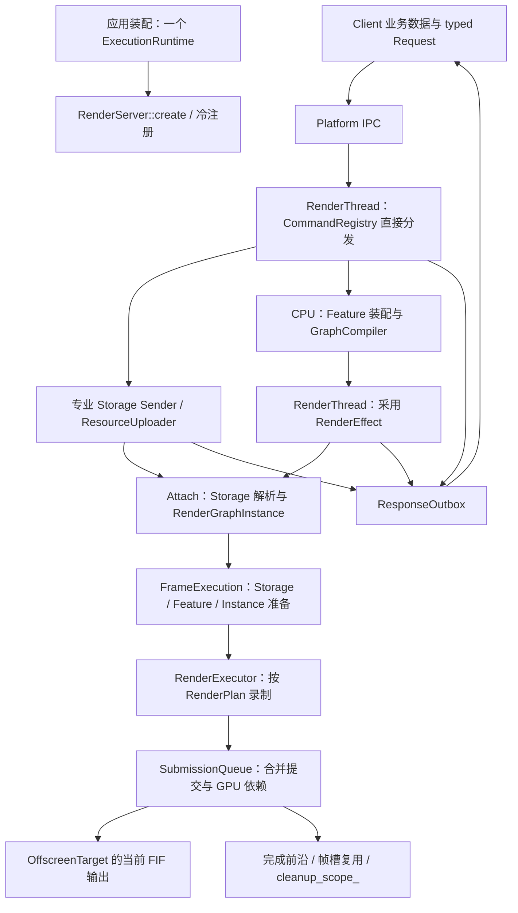

# Render 从请求到图像：当前实现与源码阅读路线

本文描述当前源码及其公开合同，不把接线方案当成已经存在的功能。版本沿本文所在 Git 修订核对。
工程约束见 [通用设计规范](../engineering-principles.md)，调用合同见
[Render README](../../modules/function/render/README.md)。后续接线另见
[Engine/Editor 接线设计](engine-editor-integration.md)。

## 1. 先明确“渲染出画面”的边界

当前 Render 能从资源、材质和 Effect 声明生成真正的 GPU 图像，支持主视图剔除、GBuffer、基础阴影、
Clustered Lighting 和 Tonemap。当前生产终点是 **OffscreenTarget 的纹理**，不是桌面窗口。
`ETargetKind::SURFACE` 虽然存在，`OffscreenTarget::create()` 仍明确拒绝它；没有生产 SwapChain/Present 路径。
测试中的 Copy、映射和图片导出用于观察输出，不是生产 Readback Command。

不能把以下四件事视为同一时刻：

| 事实 | 当前含义 |
|---|---|
| 上传 Response 成功 | 源 CPU 读取结束，必要 Copy/Acquire 已接纳，资源已发布且后续使用顺序成立 |
| 图批次提交成功 | Native Queue 接纳了该批命令；GPU 可能尚未执行 |
| Queue 完成前沿推进 | 该物理 Queue 对应提交已完成，可以解除相应复用/清理条件 |
| 窗口显示图像 | 当前尚未接入，不能由前三项推断 |

本文中的 `detail::` 是 Render 项目内实现命名空间，不是另一个模块。Render 是一个库，目标为
`lux::engine::function::render`；目录是职责分区，不能按目录理解为一串动态库调用。

## 2. 总流程和线程



| 执行位置 | 工作 | 不应做的事 |
|---|---|---|
| 应用/Client 线程 | 业务关系、请求构造、源数据有效期、Response 采用 | 直接修改 Render 的 Storage 或 NRI 对象 |
| 应用已有 CPU workers | 冷态图/Shader/Pipeline 编译、上传 CPU 准备 | 修改 Server 的可变目录或直接写 Outbox |
| 单 RenderThread | 请求派发、逻辑发布、帧准备、录制提交、完成回调 | 在依赖本线程推进的异步工作上阻塞 join |
| GPU 物理 Queue | Copy、Compute、Raster、Queue 间等待 | 决定 Client 的业务关系 |

`ExecutionRuntime` 是 CPU 执行资源；`RunLoop` 是由所属线程主动推进的就绪队列，**不创建线程池**。
RenderThread 由应用启动并 join。Frame slot 是 GPU 数据复用单元，不是新的线程。

## 3. 装配与设备：先有真实依赖，再发布目录

主要入口：
[RenderServer.hpp](../../modules/function/render/include/lux/engine/render/runtime/RenderServer.hpp)、
[RenderServer.cpp](../../modules/function/render/src/runtime/RenderServer.cpp)、
[RenderServerImpl.cpp](../../modules/function/render/src/runtime/RenderServerImpl.cpp)。

```text
ExecutionRuntime::create（应用已有）
  → RenderServer::create(config, execution, device_options)
    → Impl::initialize
      → DeviceSession::create → DeviceBackend::initialize
      → ResourceUploader::create（配置 uploads 时）
      → FrameExecution::create（1～3 个实际帧槽）
      → ResourceRegistry + Global StorageSet
  → Impl::registerBuiltinFeatures
    → 私有 Storages / Commands tuple → 直接登记构造入口与调用入口
  → 可选外部 registerFeature / registerStorage / registerHandler
    → 整组验证 → 发布到同一组目录（不调用实例工厂）
  → 应用线程调用 RenderServer::run
    → activateSelectedHandlers → 开始分发
```

| 类型 | 实际责任与所有权 | 关键源码 |
|---|---|---|
| `RenderServer` / `Impl` | 唯一运行对象；拥有目录、Scene/Target/Effect/Attachment、执行设施和回复出口 | `runtime/RenderServer{,Impl}.cpp` |
| `CommandRegistry` | Command 描述、支持绑定及当前选择；稳定 Handler 对象独占拥有，调用项借用它 | [CommandRegistry.hpp](../../modules/function/render/pinclude/lux/engine/render/runtime/CommandRegistry.hpp) |
| `BuiltinFeatures` | 私有编译期类型清单；Feature 用 tuple 声明 Storage 和 Command 依赖，不持有实例 | `pinclude/.../features/BuiltinFeatures.hpp` |
| `HandlerRecord` | 保存构造入口和唯一实例；登记时对象为空，激活后供 Command 借用 | `include/.../runtime/detail/HandlerRecord.hpp` |
| `FeatureEntry` | 稳定的 Feature 描述和构建函数；编译任务可借用已安装条目 | [EffectCompilation.hpp](../../modules/function/render/pinclude/lux/engine/render/runtime/EffectCompilation.hpp) |
| `DeviceSession` | 设备能力、NRI 设施、唯一物理 Queue 集合、DescriptorTable、唯一物理清理 scope | [DeviceSession.hpp](../../modules/function/render/include/lux/engine/render/extensions/device/DeviceSession.hpp) / [实现](../../modules/function/render/src/device/DeviceSession.cpp) |
| `DeviceBackend` | 选定后端的设备初始化及专属能力适配；不承担帧调度 | [DeviceBackend.cpp](../../modules/function/render/src/device/vulkan/DeviceBackend.cpp) |
| `DescriptorTable` | 设备级 sampled-image/sampler 索引和 Native 描述符；不拥有材质业务依赖 | [DescriptorTable.cpp](../../modules/function/render/src/device/DescriptorTable.cpp) |

公开 Descriptor 只保存类型、配置和端口合同，不再导出 `definition()`。内置依赖在私有 tuple 中声明，
`create()` 直接登记已知实现；不创建 Feature/Storage/Handler，不运行外部兼容验证或注册回退。
实际设备能力仍在冷态选择支持项，不因自动注册而擅自启用可选能力。

外部扩展通过 `FeatureRegistration.hpp` 的通用模板登记，先验证完整依赖集合，再发布到同一目录。
失败不调用实例工厂、不留下部分类型或绑定。Handler 显式提供 `create(ResourceRegistry&)`，不猜测构造参数。
`run()` 创建当前选中的 Handler；首次切换到其他实现时在控制安全点创建。运行中的外部登记也只允许在
RenderThread 安全点进行，发布后先落实选中对象再继续分发。普通请求不做实例化判断。

Feature 的 Storage 依赖与 Effect 的资源端口连接是两件事：前者登记实现，后者决定同一张图的数据依赖。
PrepareStorage/Attach 才创建 Storage；原 StorageSet 拥有关系不变。构建函数依据已启用的分页路径冷态选定，
编译任务借用稳定 FeatureEntry，热帧不重选。新增 Handler 不抢占当前绑定，旧实例保留到异步工作清偿之后。

Command、配置和绑定选择的 C++ 身份直接使用 `cxx::TypeToken`。Token 比较完整类型名及 hash，
不表达序列化布局或不同 ABI 的 DLL 兼容性；定义这些类型和回调的模块必须存活到最后一个相关值/对象被销毁。

DeviceSession 不创建 CPU 线程池、不拥有 Scene、不默认安装 Texture Storage，也不负责遍历全图绘制。
运行后只允许 `stop()/stats()` 与 `run()` 并发；目录变更必须在规定的 RenderThread 安全点。

## 4. 请求与回复：业务状态和执行状态分开

Client 可直接使用 `IpcRequester/IpcMessage`；Engine 的 `RenderRequester` 在其上保存有限输入载体、请求关联及类型化 Sender。
它不拥有 GPU 对象或 connected OperationState。当前不存在旧 `RenderClient/TypedRenderCompletion`。
Command 声明是稳定名称、Request 和 Response；目录查询得到当前 Server 的生成式 CommandId。
RequestId 属于 Requester，本身不承担跨 Link 唯一性。
当前应用在冷态用 `server.commandId<ListCommands>()` 取得 bootstrap ID，再通过 IPC 获取完整目录；
不要假定有旧 Hello/Client 自动绑定层。`SyncClient.cpp` 是消息值语义消费者，场景测试中的 `call<C>()` 是测试帮助函数，
不是生产的同步 RPC 接口。

```text
Client 构造真实 C++ Request → IpcMessage → IpcRequester::trySend
  → Impl::run → responder.tryReceive → dispatchRequest
    → commandIdFromTag → CommandRegistry::findCommand
    → 接纳边界核对身份/请求类型/所选绑定
    → HandlerCall { invoke, object }
```

| 类型 | 责任 | 生命周期 |
|---|---|---|
| `IpcMessage` | 真实 C++ 对象构造、移动、析构和 SBO；不理解 Render | 消息转移；入队失败保留原消息 |
| `CommandBinding` | 编译期约束 Handler；生成同步或异步调用 thunk | 冷绑定后按函数指针调用 |
| `CommandDispatchContext` | 当前请求、来源路由、Outbox、Scope、RunLoop 的短期借用 | 仅派发使用 |
| `command_scope_` | `counting_scope + spawn` 管已接纳异步 Command 的 OperationState | Server 停服时请求停止并异步 join |
| stdexec 组合 OperationState | 保存异步 Response、原路由和调度操作 | 由 counting_scope + spawn 管理，交付终态后结束 |
| `ResponseOutbox` | 唯一回复出口；维持背压下的待发送值，不重跑 Handler | 发送、连接失效或关闭结算 |

同步 Handler 为 `const Request& + Response&`，在回复位置构造/填写结果，不创建 Pending/Sender。
异步 Handler 消费 Request，返回 Sender；`CommandBinding` 规约错误/停止通道，再 `spawn`。
完成可发生在 Worker；错误与停止先归一化为 Response，再由 `continues_on(renderScheduler)` 将结果转交
RenderThread，随后 `ResponseOutbox::flushTo(responder, budget)` 发布。

源码：[CommandBinding.hpp](../../modules/function/render/include/lux/engine/render/extensions/CommandBinding.hpp)、
[CommandDispatchContext.cpp](../../modules/function/render/src/runtime/CommandDispatchContext.cpp)、
[ResponseOutbox.hpp](../../modules/function/render/pinclude/lux/engine/render/runtime/ResponseOutbox.hpp)。

Response 使用显式 `RenderError error` 和业务字段，内部函数可以使用 `RenderResult`。没有“自动带回原 Request”
的合同。连接失效不能证明已接受工作被撤销；不能把 unknown 副作用伪装成确定取消。

## 5. 资源上传、专业存储和 FIF 数据来源

### 5.1 实例归属

[StorageSet](../../modules/function/render/sinclude/lux/engine/render/resource/StorageSet.hpp) 独占实际 Storage；
[ResourceRegistry](../../modules/function/render/include/lux/engine/render/extensions/storage/ResourceRegistry.hpp) 拥有类型目录、
生成式 StorageId 和非拥有实例定位。Global StorageSet 在 Runtime；Scene/View/Attachment 各有自己的集合。
`PrepareStorage` 可先创建并取得 ID；Attach 也可按声明创建缺少的实例并返回逻辑资源到 StorageId 的对应。

`StorageCreateContext` 只同步借用设备、上传、帧执行和 Registry 等构造依赖。
业务资源 ID 包含 StorageId 和本地代际键；名称用于冷发现，不在稳定绘制中重复查询。

### 5.2 专业类逐一分工

下列实现均在 `pinclude/.../storage/` 与 `src/storage/`；公开的是描述和数据合同，不是实例实现。

| 类 | 当前数据和动作 | 不归它负责 |
|---|---|---|
| `IndexedTriangleMeshStorage` | VBO/IBO Arena、Mesh 记录、Section/Bounds；`upload/release` | 绘制分组、剔除、执行 draw |
| `RasterMeshInstanceStorage` | 代际实例、Transform/属性/存活流、分页或连续 GPU 数据；`create/update/release/prepareFrame` | Camera、灯光、每个 Feature 的 draw 算法 |
| `RasterMaterialTableStorage` | Cooked 程序布局、连续参数表、稳定槽及各 FIF 脏范围；`upload/prepareFrame` | 光照求值、自动修复 Texture 业务关系 |
| `SampledTexture2DStorage` | Image/view/descriptor 索引、Mip/BC1/Region Clone+patch；`upload/release/resolve` | 追踪所有使用它的 Material |
| `DirectLightingStorage` | 灯光 GPU 记录和增量/FIF 数据；给 Feature 提供资源输入 | 生成阴影图或执行 Cluster 算法 |
| 各 `...CommandHandler` | 从 Request 的 StorageId 定位正确专业实例，调用其同步函数或上传 Sender，生成显式 Response | 另建资源状态机 |

入口示例：[Instance 实现](../../modules/function/render/src/storage/RasterMeshInstanceStorage.cpp)、
[Material 实现](../../modules/function/render/src/storage/RasterMaterialTableStorage.cpp)、
[Texture 实现](../../modules/function/render/src/storage/SampledTexture2DStorage.cpp)。

Client 管 Texture→Material→Instance 的业务顺序。无效 Texture 引用按当前合同使用白色默认值，
不是在 DeviceSession 自动创建一张业务白贴图，也不靠 Material 保活旧 Texture 版本。

### 5.3 上传调用链与借用结束

```text
typed CommandHandler
  → render::upload / StorageTraits 或专业 Storage 的 create/update Sender
    → 准备候选 / 验证本批身份与 revision
    → FrameExecution::whenWritable（需要动态 slice 时）
    → ResourceUploader::writeBuffers / writeImage
      → 有界 StagingArena；必要 CPU 工作使用已有 CpuScheduler
      → BatchSender/submitReadyTransfers；Copy 和必要 Acquire 批处理
      → 或 recordFrameCopies 合入帧准备提交
    → 回到 RenderThread 采用候选/提交 revision
  → continues_on(RenderThread Scheduler) → ResponseOutbox
```

[ResourceUploader](../../modules/function/render/include/lux/engine/render/extensions/upload/ResourceUploader.hpp) 拥有 Staging 和
上传设施，不拥有专业 Storage 候选，也不拥有另一套 running-task 表。`BufferWrite/BufferCopy` 只是借用范围记录。
`StagingArena` 以真实 Queue 完成复用页；`BufferArena` 管几何区间，最终物理释放仍走 Session。

Client 必须从发送成功到收到 Response 保持源地址、范围、内容不变；FAILED/CANCELLED 同样结束 CPU 读取。
发送失败没有取得借用。abandon/断连不是借用结束；没有 Response 时由应用先清偿 Server 和生产者，再释放源。
GPU 后续读取的是 Native 管理的 Staging/目标，不能让 Client 源内存承担 GPU 物理寿命。

### 5.4 为什么当前仍有 CPU 数据镜像

FIF 并非让 Client 每帧重发完整表。Instance、Material、Light 等保留已采用数据及每个物理 slice 的脏信息；
写入当前可用 slice 后，其他 slice 在以后复用前按缺少的范围补齐。CPU 镜像是 Render 已发布 GPU 数据的修复来源，
不是上层 ECS 的第二套业务控制器。

`RasterMeshInstanceStorage::update(TransformBatch)` 有连续输入路径及脏字批处理；`prepareFrame()` 消费实际脏范围，
不是每帧全 live 表上传。地址变化会刷新相关输入/描述符，参数内容更新不重编 Pipeline。
删除镜像必须同时提供其他 slice 的确定数据来源，不能仅把镜像删掉后延长已结束的 Request 借用。

## 6. 材质与 Effect 的冷态编译

### 6.1 材质产物

作者 MaterialGraph 经已有工具链 lowering/Shader 编译产生 Cooked 程序和反射布局。对应源码：
[ShaderEmitter.cpp](../../engine/toolchain/material/src/ShaderEmitter.cpp)、
[MaterialCompiler.cpp](../../engine/toolchain/material/src/MaterialCompiler.cpp)、
[ShaderCompiler.cpp](../../engine/toolchain/material/src/ShaderCompiler.cpp)、
[SpirvReflection.cpp](../../engine/toolchain/shader/src/SpirvReflection.cpp)、
[MaterialProgramSet.hpp](../../modules/resource/description/include/lux/engine/description/MaterialProgramSet.hpp)。

当前按用途产出 Forward Unlit、GBuffer 和 Shadow coverage。已删除无消费者的旧 Forward PBR/Toon 分支。
材质图描述表面/覆盖所需数据；GBuffer 材质片段阶段写表面属性，DeferredLightingFeature 再执行灯光求值。
不是每像素运行 CPU 图解释器，也不是 Storage 按参数个数重新计算 Shader ABI。
运行期消费 Cooked ShaderInfo/ShaderBlock；最终 set/binding 仍由 PipelineLayoutPlan 决定。

### 6.2 CreateEffect 的完整链

```text
Impl::createEffect
  → 在 RenderThread 收集稳定 FeatureEntry 借用、Storage 类型名和设备事实
  → schedule(应用 CpuScheduler)
  → compileEffect
    → composeFeatures
      → describe 端口 → 按显式连接解析/排序 → build 各 Feature
      → RenderGraphBuilder::finish → analyzeRenderGraph（同一张图）
    → 核对活资源的 Storage 声明
    → GraphCompiler::compile
  → continues_on(render_loop_.scheduler())
  → effects.emplace(候选) → 真正 EffectId → CreateEffect::Response
```

编译 Worker 不查找 Server 的可变 Registry；采用失败/停止不发布候选 ID。请求独占配置，编译同步借用其内容；
Effect 留下不可变计划和 Attach 所需数据，不需要实例化一个可以逐帧动态派发的 Feature 对象。

| 类型/算法 | 责任 | 源码 |
|---|---|---|
| `EffectDefinition` | FeatureId、局部贡献键、配置、显式端口连线及输出 | [定义](../../modules/function/render/include/lux/engine/render/extensions/features/EffectDefinition.hpp) |
| `FeatureBuildContext` | 冷态构图时提供已经解析的端口/资源与贡献入口 | [实现](../../modules/function/render/src/features/FeatureBuildContext.cpp) |
| `composeFeatures` | 声明解析、连接/贡献验证、拓扑构建及唯一 Graph 装配 | [FeatureAssembly.cpp](../../modules/function/render/src/features/FeatureAssembly.cpp) |
| `RenderGraphBuilder` | 建立逻辑资源版本、typed Work、访问范围和输出 | [实现](../../modules/function/render/src/graph/RenderGraphBuilder.cpp) |
| `RenderGraphAnalysis` | 活图、执行顺序、生命周期和依赖；RAW/WAR/WAW 按访问范围建立 | [实现](../../modules/function/render/src/graph/RenderGraphAnalysis.cpp) |
| `GraphCompiler` | 将活图降低成唯一设备执行计划 | [实现](../../modules/function/render/src/graph/GraphCompiler.cpp) |
| `RenderPlan` | 拥有 Pipeline/Layout 与不可变资源、录制、批次和分配计划 | [定义](../../modules/function/render/sinclude/lux/engine/render/graph/RenderPlan.hpp) |

`GraphCompiler::compile()` 的关键顺序为：资源/输出合同 → `planLayouts` → Shader 重定位及 Pipeline 创建/复用
→ `planConditions` → `selectQueues` → `planBarriers` → `planSubmissions` → `planPhysicalResources`
→ 必要的复用 Barrier 重建 → `planRendering`。这些算法在 `src/graph/` 的同名职责文件中。

Memory Alias 与同描述对象复用依据原批次依赖和物理 Queue FIFO 证明安全，不通过添加 CPU 等待制造证明。
Imported、导出/History 等资源有各自限制；每个 FIF 实例资源独立。声明了 History 时，Instance 使用独立历史环，
实际发布/复用依据接纳和完成前沿，不能把“上一轮 CPU 调用了 render”当成历史图像已可读。

## 7. Feature 如何合作以及谁真正绘制

Feature 共享资源合同和端口，不互相调用实现。端口连线先决定资源身份；Graph 中的读写范围决定 GPU 依赖。
Storage 解决已有专业数据的供给，**不是 Feature 间所有协作的唯一通道**：GBuffer/阴影/Cluster 临时输出直接走 Graph 端口。

| Feature | 输出/责任 | 主要消费者 |
|---|---|---|
| `MeshVisibilityFeature` | 主视图或外部多视图的 Bounds→Cull→Compact→indirect/count | GBuffer、MeshShadow |
| `GBufferFeature` | 使用实例/几何/材质表，写 GBuffer 和 Depth | Cluster、DeferredLighting |
| `ShadowMapFeature` | 阴影视图/投影和采样参数 Buffer；CPU 派生参数由 `ShadowProjectionBinding` 准备，不创建阴影深度图 | MeshVisibility、MeshShadow、DeferredLighting |
| `MeshShadowFeature` | 按阴影视图录制 Mesh coverage 深度绘制 | 阴影图的后续读者 |
| `ClusteredLightingFeature` | Depth/Light 输入→Cluster 灯索引及溢出信息 | DeferredLighting |
| `DeferredLightingFeature` | 读取 GBuffer、光源、可选 Cluster/Shadow 端口，求值 HDR 光照 | Tonemap |
| `TonemapFeature` | HDR→约定输出编码 | Target |
| `HzbFeature` | Depth 降采样和可选 History 接缝 | 明确接线的遮挡消费者；不是所有场景默认开启 |

阴影 Depth 图由 MeshShadowFeature 声明为 Graph 输出，实际物理存储由 RenderGraphInstance 的帧资源按计划分配。
它不是某个永久 ShadowStorage 中的隐含全局资源。ShadowMapFeature 的名称容易让人误以为它拥有这张图，审查时应按上述实际职责理解。

实现入口位于 [src/features](../../modules/function/render/src/features)，正式组合示例见
[ClusteredScene.cpp](../../modules/function/render/test/ClusteredScene.cpp)、
[ShadowScene.cpp](../../modules/function/render/test/ShadowScene.cpp)、
[DeferredScene.cpp](../../modules/function/render/test/DeferredScene.cpp)。这些是测试消费者，不是现成 Engine 场景接口。

```text
Instance/Geometry → 主视图 Visibility → GBuffer/Depth ───────────────┐
Light/View → ShadowMap 投影 → 阴影 Visibility → MeshShadow 深度 ────┤
Light + GBuffer Depth → Clustered Lighting ────────────────────────┤
                                                                  ↓
                                                     Deferred Lighting → Tonemap → Target
```

主视图 GPU 剔除通过 GBuffer 的 `visible_capacity` 和显式端口接入；零容量是全候选参考路径。
Visibility 将同一几何视图拆成正/负行列式两个 stream，Raster/Shadow 使用对应 front-face Pipeline；
Transform 运行期变号不依赖 CPU 符号缓存。奇异变换不产生有效可见实例。

`MeshInstanceDrawGroup::material_table_source` 选择 Cooked 程序表，不表示“这个组只画这个 MaterialId”。
相同 Mesh/submesh/程序表组成一组，各实例使用自己的材质槽。按每个材质再建相同组会重复绘制。
`RasterMeshDraws` 属于 Feature 派生准备数据；Storage 不创建 indirect 命令。最终 `RenderExecutor` 才调用 Native draw。
其选择/变更处理见 [RasterMeshDraws.hpp](../../modules/function/render/pinclude/lux/engine/render/features/RasterMeshDraws.hpp)
及同名源文件；`RasterMesh.cpp` 则负责冷态声明、Shader 选择和 Work 构造。

## 8. Attach：把符号资源落实为真实输入

主要类型集中在 [runtime/Scene.hpp](../../modules/function/render/pinclude/lux/engine/render/runtime/Scene.hpp)。

| 类型 | 拥有 | 借用/关系 |
|---|---|---|
| `RenderScene` | Scene StorageSet、View 集合 | 非 Engine ECS Scene |
| `RenderView` | View StorageSet、AttachmentId 索引 | 没有通用 Camera 类型 |
| `RenderEffect` | RenderPlan、原 Graph/Analysis、Storage 要求、冷绑定数据 | 可被多个 Attachment 使用 |
| `RenderTarget` | OffscreenTarget、描述和 epoch | 当前只允许一个 Attachment 写入 |
| `EffectAttachment` | Attachment StorageSet、RenderGraphInstance、FeatureBinding、Storage 输入订阅节点 | Scene/View/Effect/Target ID |
| `RenderGraphInstance` | 每 FIF FrameResources、Descriptor/参数/条件/History 与动态绑定 | 不可变 RenderPlan、输出 Target、外部专业输入 |

```text
Attach Request
  → Impl::attachEffect：查身份/Target 兼容性
  → prepareAttachment
    → 从活图和 Feature 准备依赖求必要输入闭包
    → 按 global/scene/view/attachment 分组 StorageSet::getOrCreate
    → StorageBindingOps::resolve → 普通 ResourceInput → Instance::setResource
    → 创建 FeatureBinding（RasterMeshDraws/ShadowProjection 等实际派生数据）
    → 安装 Sampler → RenderGraphInstance::initialize
  → 完整候选采用 → 建立关联索引 → 返回 AttachmentId + Storage 对照
```

Pipeline 的位置在编译时已经确定，Attach 填入实际 Buffer/Image/参数，所以不要求编译时已创建设备资源实例。
`StorageSubscription` 是 Attachment 持有的非拥有变更关系，用于刷新内部物理地址，不是 Storage 保活或跨资源业务依赖。
它与已经删除的 `PreparedStorageBinding` 长期混合包不是同一职责。

Detach 先断开 Feature/Storage 借用，再移交 Instance 物理资源清理。Resize 创建完整 Target/Attachment 候选后采用，
失败保留旧值。当前 CPU 正在推进的提交窗口不能被途中改写；实际已提交 GPU 工作由完成条件保护。

## 9. 稳定渲染循环、FIF 和合并提交

### 9.1 Server 循环

```text
Impl::run
  → RunLoop::executeReady
  → 有限请求接纳/dispatch → Outbox.flushTo
  → progressCompletions
    → DeviceSession::pollQueues / dispatchQueueCompletions
    → FrameExecution::dispatchWrites
    → RunLoop::executeReady
  → progressUploads → ResourceUploader::submitReadyTransfers
  → progressFrame（只推进最早的完整 SubmitFrame）
    → beginFrame 取得可复用 FIF 槽
    → 分组派发子 Command，全部必需更新终态后冻结输入
    → submitCurrentFrame：活动 Instance、Storage/Feature 准备列表 → FrameExecution::render
    → 提交结果明确后 FrameCompletion；GPU 完成仍独立决定物理复用
  → RunLoop::executeReady / Outbox.flushTo
  → 无进展时：GPU 有工作则有界 waitForProgress，否则 IPC epoch 可唤醒等待
```

没有无条件每帧 sleep。当前 GPU 等待上限可配置至 1ms；无 GPU 工作的 IPC 等待也有有限复查期限，
不能把这段调度等待记为单次 IPC 队列操作成本。
请求领取批量仅用于服务公平性，不再定义帧边界。没有 SubmitFrame 不重复绘制旧状态；
主帧来源、输入借用与 `max_frames_ahead + 1` 载体和物理 FIF 分开。详见公开 `commands/Frame.hpp`。

### 9.2 FrameExecution 的职责链

[FrameExecution.cpp](../../modules/function/render/src/execution/FrameExecution.cpp) 负责决定帧槽可写、准备顺序和提交进展；
[RenderGraphInstance.cpp](../../modules/function/render/src/execution/RenderGraphInstance.cpp) 负责该实例的动态输入；
[RenderExecutor.cpp](../../modules/function/render/src/execution/RenderExecutor.cpp) 只录制已准备的批次。

```text
FrameExecution::render
  → 若已有 SUBMITTING 窗口，继续 advanceSubmissions，不重取输入
  → 选择可复用 slot；pending CPU writes 必须已结束
  → 检查实际来源的 revision；仅对未应用的 slice 调 StorageBindingOps::prepareFrame
  → FeatureBinding::prepare（按 revision 更新；真实逐帧来源继续执行）
  → RenderGraphInstance::prepareFrame（描述符、参数、条件、History 冻结）
  → prepareSubmissions：实例顺序/绑定版本改变时重建该 slot 的依赖索引
  → advanceSubmissions
    → 从每物理 Queue 的就绪堆取得批次及已累计的等待前沿
    → 同物理 Queue 且等待条件相同的可就绪批次合并
    → SubmissionQueue::recordAndSubmit
      → recordFrameCopies / Feature copies（首准备提交）
      → RenderExecutor::recordBatch × 本次可合并实例
    → acceptedBatch；完整实例 submitted；finishPreparation（仅准备 Copy 采用）
  → sealFrame；所有参与 Queue 完成后 slot 才 FREE
```

如果资源准备尚不齐但有可提交 Copy，可以只提交准备批；这不意味着整图已执行，也不推进 History。
Queue 满时保留冻结窗口及逐批实际 serial，不重新执行已接受批次。

ImportedAccess 保留消费批次与状态恢复边界。FrameSlot 按实例顺序及每 slice 的物理绑定 revision 复用依赖索引；
内容更新不重新排序或相交。绑定变化时重建这个 slot 的索引，冷态同资源组仍可能有平方级冲突比较，
并未实现只修改一个资源组的局部增量编辑。不同句柄的外部 Memory Alias 没有声明关系，当前不支持该跨实例用法。
就绪批次按实际物理 Queue 与等待条件维护；Submit 接纳只推动后继边，不从头扫描所有批次。

每个实际 CommandBuffer 共享一份 BindingState，跳过相同 Layout/BindPoint/DescriptorSet 的重复绑定。
参数是每 FIF 一份连续区；变化源按预编译反向索引标脏。没有 revision 承诺的借用参数仍逐帧读取。
Storage/Feature 的来源版本检查仍为线性遍历；相应 callback 可以跳过，不等于准备阶段完全没有循环或间接调用。

### 9.3 FIF 的物理含义

`FrameExecution::FrameSlot` 保存本帧在各物理 Queue 接纳的前沿；
`RenderGraphInstance::FrameResources` 保存独立动态资源和记录；Storage slice、Target image 与之对应。
FIF 复用必须同时满足 CPU 写入结束和所有实际 GPU 使用完成，不靠轮转下标、帧号或 Queue 三个提交槽猜测。
Shader/Pipeline/Cooked 布局可以共享不可变数据，不复制成每帧业务对象。

跨 Queue 使用 NRI Fence 依赖建立 GPU-GPU 顺序；同一物理 Queue 按提交 FIFO。
Graphics/Compute/Transfer 是角色，可能映射同一物理 Queue，不能按角色重复分配完成事实。

## 10. GPU 完成与释放

[SubmissionQueue](../../modules/function/render/include/lux/engine/render/extensions/device/SubmissionQueue.hpp) 拥有 Native Queue 的
提交槽、serial、完成前沿和就绪回调；`poll()` 观察，`dispatchCompleted()` 在 RenderThread 分发。
回调节点先摘除再执行，执行后不读取可能已销毁的节点。

`DeviceSession::deferRelease()` 捕获已接纳的相关物理 Queue 前沿，通过标准 Sender 等待全部条件，
在唯一 `cleanup_scope_` 中执行释放函数。只涉及一个 Queue 时有窄重载。资源是轻量 Native 句柄/数据，
实际集合/Storage/Instance 负责转移它们；不另建 RetirementQueue、Arena Scope 或公有 Ticket。

Command scope 和 cleanup scope 不能合并：前者结束意味着业务事务结算，后者结束意味着 GPU 物理使用可安全清理。
`command_scope_` 和设备 `cleanup_scope_` 分别承担这两类责任，不是重复 OperationState Owner。
前者使用 `stdexec::counting_scope`，后者使用 `stdexec::simple_counting_scope`；ResourceUploader 没有自己的上传 Scope。

## 11. 诊断与关闭

诊断入口：[RenderErrorSink.hpp](../../modules/function/render/include/lux/engine/render/core/RenderErrorSink.hpp)。
`RenderServerConfig::diagnostics` 是应用提供的稳定借用。NRI 回调经 `Impl::diagnostic` 输出结构化 severity/error/
message/file/line，保留错误计数。回调可发生在编译 worker，应用出口需线程安全；字符串要跨回调保存必须复制。
Render 不决定日志落点、不依赖 lux::log，不允许 sink 重入 Server。

该 sink **不是所有业务失败的自动广播**：Command 错误看 Response，`run()` 返回运行失败，
`QueryExecutionProgress` 查看 Attachment 跳过/执行原因。图、计划、物理资源和提交 dump 是冷态诊断，不应每帧请求。

```text
停止新准入 → command_scope_.close/request_stop
  → 启动 join，但 RenderThread 继续推进 RunLoop、Queue、上传和回复
  → join 完成 + RunLoop 排空 + activePublishers 尾栈结束
  → 最后 flush/clear Outbox → responder.reset
  → Detach 全部关联 → 移交 Plan/Target/Storage 物理释放
  → device.drain（仍保有 Frame 回调节点和 Staging）
  → 销毁 FrameExecution / ResourceUploader
  → DeviceSession::close：关闭 cleanup 准入、推进并 join、清 Descriptor/Queue/Device
```

应用必须让 ExecutionRuntime、诊断目标、类型/插件代码覆盖整个过程；Server 停止后再停止共享 CPU 执行资源。
Scope join 不替代外部 Producer 退栈或代码模块寿命证明。

## 12. 审查顺序与尚未闭合的边界

### 一个首次渲染场景的实际顺序

1. 应用创建唯一 ExecutionRuntime、诊断目标和 RenderServer；登记内置声明及需要的外部扩展。
2. 建立主帧与 Asset 的独立 IpcRequester，冷态 setFrameSource；再启动唯一 RenderThread。
3. 查询目录；CreateScene/View/Target、PrepareStorage 处理不改变已有可见状态的冷准备。
4. Asset Client 可独立 CreateTexture/CreateMesh；收到成功后才使用其返回 ID。
5. CreateMaterial、CreateMeshInstances、CreateDirectLights 等共享表更新放进主来源 SubmitFrame。
   初始化可以先提交 NO_DRAW 帧；需要前一条请求返回的新 ID 时，在后续完整载体中使用，不能中途改写已借出的数组。
6. CreateEffect 使用 Cooked 程序、Feature 配置及端口连接；CPU 编译，RenderThread 采用后返回 EffectId。
7. 后续 SubmitFrame 内 Attach 指定 Scene/View/Effect/Target；同一载体中的组显式表达已知数据依赖。
8. Client 先取得有限载体，再准备本帧数据和变化命令。Server 等最早完整帧的组全部结算，再冻结/录制/提交。
   活动 Target 本身不自动制造新帧；无变化也用一个空 SubmitFrame 明确请求渲染。
9. FrameCompletion 归还 CPU 输入借用；GPU 前沿独立决定 FIF 复用。失败要求重同步时，由 Client 提交恢复帧。
10. 测试消费者用显式图 Copy 检验输出；窗口呈现仍待实现，图像 index 不等于 FrameSlot index。
11. Detach/可见资源释放同样通过完整帧；随后清偿所有请求、Scope、Producer 和 GPU，最后关闭共享 ExecutionRuntime。

这些命令的失败由 Response 显式报告，不能跳过失败后继续使用默认空 ID。不同独立资源上传可以并发；
依赖关系由 Client 保持，不能拿上述顺序中的一次成功替代另一项资源的实际发布。

### 源码审查重点

建议按 Request→Handler→Storage/编译→Attachment→FrameExecution→Queue→cleanup 顺序读源码，逐段核对：

1. Source 借用何时结束，Response 是否准确，旧 revision 是否错误确认了新状态。
2. 冷态 Feature/Graph/Shader 工作是否泄入稳定帧。
3. Storage 更新事实、Feature 派生数据、Executor draw 是否各归其位。
4. 帧槽冻结、部分接纳及跨 Queue 完成是否使用同一份事实。
5. 逻辑删除、物理释放、Client 连接关闭是否被混为一谈。

当前尚未闭合：窗口输出、Editor UI GPU 消费、Engine ECS/资产接线、同设备 Target 跨图消费的产品合同。
阴影质量、真实大场景性能仍需独立工作；主视图剔除/绕序正确性通过不能推导达到 Legacy 1000 FPS。
已有 Debug `graph.edit` 和完整产品构建限制不因本文升级资格。
