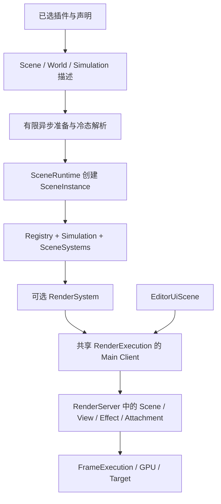

# 当前 Scene 装配、运行与 Editor UI 接入

本文说明当前源码怎样工作，供逐段审阅代码。它不是新的实施计划，也不以测试结果代替职责分析。

核对日期：2026-10-26。核对对象是 `codex/render-v2-rebuild` 当前工作区，包含尚未提交的声明式场景改造；不能把本文所述全部绑定到工作区的 HEAD `97394ef6`。源码链接使用相对本文的路径与 `#L行号`，例如 `../engine/context/runtime/src/Engine.cpp`，避免把盘符或行号当作文件名。在 VS Code 的 Markdown 源码视图中使用 Ctrl+单击，在内置 Markdown 预览中直接单击。行号按本次核对生成；后续修改源码后可能移动，链接标签保留函数/类型名以便再次搜索。目录链接同样使用相对路径。

路径解析规则见 [VS Code Markdown 文档](https://code.visualstudio.com/docs/languages/markdown#_path-completions)；源码行号链接使用 `#L` 片段，而不是 `文件.cpp:行号`。

## 阅读方式与快速入口

各节新增的“代码细读”按执行顺序列入口，不要求先从头读完全部类型。代码块中标为“摘录”的是源码关键语句，标为“顺序”的是解释性流程，不是额外实现。

| 阅读目的 | 直接入口 |
| --- | --- |
| 看产品如何装配 Engine | [EditorApplication::Impl::create](../editor/app/src/EditorApplication.cpp) |
| 看 Engine 一轮到底做什么 | [Engine::advance](../engine/context/runtime/src/Engine.cpp) |
| 看 Scene 真正何时建立 | [SceneRuntime::Impl::build](../engine/scene/composition/src/SceneRuntime.cpp) |
| 看 Scene 的分阶段推进 | [SceneDriver::publish](../engine/scene/composition/src/SceneDriver.cpp) |
| 看 ECS 到 Render 的通用分发 | [RenderSystem::publish](../engine/systems/render/src/RenderSystem.cpp) |
| 看 UI 数据如何进入一帧 | [EditorUiScene::prepareUi](../editor/app/src/EditorUiScene.cpp) |
| 看能力如何变为图贡献 | [lowerSurface](../modules/function/render/src/capabilities/RasterSurface.cpp) |
| 看关闭等待与最后释放 | [advanceCloseParticipants](../engine/scene/composition/src/SceneRuntime.cpp) → [collectRetired](../engine/scene/composition/src/SceneRuntime.cpp) |

## 1. 先区分四件不同的事

目前最容易混淆的，不是某个函数，而是“声明”“选择”“运行实例”“渲染实例”都被简称为场景或能力。

| 层次 | 主要类型 | 实际含义 | 不负责什么 |
| --- | --- | --- | --- |
| 可用声明 | [SceneSystemRegistration](../engine/scene/system/include/lux/engine/scene/SceneSystemRegistration.hpp)、组件/几何/分区声明、Render 的 Feature 注册 | 描述类型资格、依赖、构造和调用入口 | 注册本身不创建每个场景的系统、Storage 或 GPU 资源 |
| 作者选择 | [SceneDescription](../engine/scene/description/include/lux/engine/scene/SceneDescription.hpp)、[WorldDescription](../engine/domain/world/description/include/lux/engine/world/WorldDescription.hpp)、[SimulationDescription](../engine/domain/simulation/description/include/lux/engine/simulation/SimulationDescription.hpp) | 保存这个场景选择的系统、配置、几何、世界域和模拟方式 | 不是已经运行的 Registry，也不是 RenderGraph |
| Engine 场景实例 | [SceneInstance](../engine/scene/composition/pinclude/lux/engine/scene/detail/SceneInstance.hpp)，由 `SceneRuntime` 持有 | Registry、Simulation、SceneSystem、阶段执行和停止状态 | 不直接拥有窗口或所有场景共用的 RenderServer |
| Render 场景及执行关联 | [RenderScene](../modules/function/render/pinclude/lux/engine/render/runtime/Scene.hpp)、[RenderView](../modules/function/render/pinclude/lux/engine/render/runtime/Scene.hpp)、[RenderEffect](../modules/function/render/pinclude/lux/engine/render/runtime/Scene.hpp)、[EffectAttachment](../modules/function/render/pinclude/lux/engine/render/runtime/Scene.hpp) | 渲染线程上的资源作用域、编译计划和实际执行实例 | 不知道 Editor 文档、EnTT 实体或世界分区类型 |

因此至少有三种不可混用的身份：场景资产的 `AssetId`、Engine 实例的 `SceneInstanceId`、Render 的 `SceneId`。Camera 的实体身份、Render 的 `ViewId` 也不同。

一份场景资产可以创建多个 Engine 实例；编辑状态和 Play 状态可以有不同 Registry。选择 RenderSystem 的 Engine 实例再建立自己的 Render Scene。Editor UI 则直接建立 Render Scene，不需要先创建一个空的 Engine Scene。



## 2. 第一阶段：产品装配，不创建业务场景

入口是 [EditorApplication.cpp](../editor/app/src/EditorApplication.cpp) 中的 `Impl::create()`。当前顺序大致如下：

1. 创建 `EditorWindow`。
2. 创建 `Engine`。Engine 拥有唯一的共享 `ExecutionRuntime`、资产 VFS 和 `SceneRuntime`。
3. 创建 `RenderExecution`，借用同一个 `ExecutionRuntime`；创建 RenderServer、RenderThread 和独立 Asset 协议线程。
4. 创建 `VfsAssetReadEndpoint`、`RenderAssets`。阻塞文件读取使用共享 execution 的 blocking 执行设施，CPU 解码/计算使用 CPU 调度设施。
5. 创建 `EditorUiScene`，使用窗口 Surface 和字体图集。
6. 把产品的帧边界、输入、关闭、平台等待入口绑定到 `EngineAssembly`，调用 `Engine::configure()`。
7. 创建项目选择 Pane，并按启动参数进入选择或异步加载；`create()` 不自建等待循环。

这里的“共享线程池”不是“所有工作只在一种线程上执行”。共享的是同一个 `ExecutionRuntime` 及其调度资源；CPU、阻塞 IO、Main continuation 有不同执行位置。RenderThread 和 Asset 协议线程有各自的线程亲和性，它们不是额外的 CPU 计算线程池。

### 2.1 Engine 和 EditorApplication 谁拥有谁

[Engine.hpp](../engine/context/runtime/include/lux/engine/Engine.hpp) 中，Engine 拥有 `AssetVfs`、`ExecutionRuntime`、`SceneRuntime` 和已绑定的 `EngineAssembly` 值。

[EditorApplication.cpp](../editor/app/src/EditorApplication.cpp) 的 `Impl` 拥有窗口、Engine、RenderExecution、读取端点、RenderAssets、EditorUiScene、项目对象。Engine **不拥有 EditorApplication**，`EngineAssembly` 只借用产品对象。

| 对象 | 实际所有者 | 主要借用 | 释放前条件 |
| --- | --- | --- | --- |
| `ExecutionRuntime` | Engine | 供 Scene、Render、VFS、Editor 任务共同使用 | 所有依赖它的业务工作先清偿，再停止和 join |
| `SceneRuntime` | Engine | execution、注册代码及各 Scene 所需依赖 | 活跃/退休 Scene 和关闭参与者清偿 |
| `RenderExecution` | EditorApplication | Engine.execution | 两个协议线程退出并 join；析构不自行泵产品回调 |
| `RenderAssets` / 读取端点 | EditorApplication | rendering、execution、VFS | 停止新加载，完成已接受读取/上传与释放 |
| `EditorUiScene` | EditorApplication | 窗口、rendering | 停止帧采集，解除输出采样，完成渲染资源退出 |
| `EditorWindow` / `ui::Root` | EditorApplication / 窗口 | 平台窗口 | Surface 不再被 Render 使用后才销毁窗口 |

成员声明顺序使普通析构按 UI/资产/读取端点 → rendering → Engine → 窗口的方向发生。但**异步清偿仍有显式关闭过程**：C++ 析构顺序保证“最后谁先销毁”，不能代替“尚在执行的任务已经结束”。

`LuxObject::parent` 仅表示结构关系，不能从 parent 推断删除责任。顶层 Pane 由 `ui::Root` 唯一拥有，不由项目的裸指针列表或 LuxObject parent 再拥有一次。

### 2.2 EngineAssembly 是什么

[EngineAssembly.hpp](../engine/context/runtime/include/lux/engine/EngineAssembly.hpp) 是 Engine 主循环与产品之间的一组冷态函数绑定：

- `application(...)`：输入、关闭请求、错误出口，以及成对的 `closeApplication()` / `closeFacilities()` 异步边界。二者中间由 Engine 清偿 SceneRuntime；没有 begin/advance/finish 关闭轮询回调。
- `frames(...)`：消费回复、取得帧、准备产品帧、提交/放弃帧、检查帧是否可开始。
- `platform(...)`：轮询平台事件、等待和唤醒。

它保存对象借用和函数指针，不保存 UI、Scene、RenderServer 的所有权；也不逐帧发现服务。`Engine::configure()` 后使用稳定绑定。Engine 只认识 `EngineFrame { data, advance_scenes, suspend_simulations }`，不解释其中的 `FrameStorage`。

这是 Engine 能复用主循环，而不反向 include Editor/ImGui 的实际接缝。代价是这些入口必须遵守借用寿命：产品对象不能先于 Engine 的最后一次回调消失。

### 2.3 代码细读：模板装配后，运行时究竟调用什么

[EngineAssembly::application](../engine/context/runtime/include/lux/engine/EngineAssembly.hpp) 先清除旧回调，再通过 `requires` 检测本产品提供的可选入口。匹配后生成无捕获函数指针，例如源码摘录：

```cpp
close_requested_ = +[](void* p) noexcept { return static_cast<T*>(p)->closeRequested(); };
```

这里 `void*` 擦除的是**已知产品对象的借用类型**，没有转移对象所有权。编译期确定回调形状，运行时仍有一次函数指针调用，不应称为全部静态内联。

[EngineAssembly::frames](../engine/context/runtime/include/lux/engine/EngineAssembly.hpp) 的帧入口是直接绑定，不是运行期查表。Editor 在 [loop.application / frames 绑定处](../editor/app/src/EditorApplication.cpp) 把同一个 `Impl` 分别作为 application 和 frames 对象交给 Engine。

审阅生命周期时，建议并排看两个成员区：[Engine 的成员](../engine/context/runtime/include/lux/engine/Engine.hpp) 与 [EditorApplication::Impl 的成员](../editor/app/src/EditorApplication.cpp)。EngineAssembly 不负责延长 `Impl` 的寿命；产品先完成 `Engine::close()`，再让成员逆序析构。

## 3. 第二阶段：项目声明和场景选择

### 3.1 插件加载、允许内容和实际选择

[ProjectPreparation.cpp](../editor/app/src/ProjectPreparation.cpp) 准备项目文件和插件；[SceneRegistrations.cpp](../engine/context/plugins/src/SceneRegistrations.cpp) 汇集实际选中模块的组件、Simulation System、SceneSystem、几何和分区声明。

这里有两个不同的集合：

- 项目的 `SceneContentAllowance`：允许场景使用哪些内容。
- 某个 Scene 的 `SceneGeometrySelection` 等选择：这个场景实际使用哪些内容、哪个域是主域。

项目允许 Mesh，不等于每个场景都已创建 Mesh 资源；选择某个几何也不等于直接指定 Render 的内部 Storage。

`WorldDescription` 描述域、分区和已有内容的组织方式；`WorldLoadingSystem` 根据需求实际装载内容。空间划分与渲染能力选择不是同一张表。Render 模块不读取世界索引类型。

### 3.2 Editor 声明与 Engine 声明是两条依赖方向

[EditorComposition.cpp](../editor/context/src/EditorComposition.cpp) 登记 Editor 的服务工厂、UI 工厂、组件编辑器、配置编辑器和场景创建入口。

这与 Engine 的 `SceneSystemRegistration` 不相同：前者决定 Inspector/工具/Pane 怎样使用 Engine；后者决定 Engine Scene 怎样构造和执行。底层类型反射不携带 UI 最小值、最大值等展示语义；领域的生成路径负责领域需要的声明。

[EditorServices](../editor/context/include/lux/engine/editor/EditorServices.hpp) 按实际访问惰性创建服务；声明 `initializeProject()` 的服务是本次加载明确要求的初始化工作，会先构造并按依赖顺序 await。带默认场景的 manifest 必须恰有一个 `initializeStartupScene(AssetId)` 提供者，内置由 ProjectScenes 实现；没有提供者或存在歧义时返回错误。其他服务仍按需创建。初始化复用同一 Entry、实例和构造顺序，逆序关闭/恢复也使用这份记录，不增加初始化注册器。

### 3.3 创建 UI 的输出不是 GPU 对象

[SceneCreationPane.cpp](../editor/scene/tools/src/SceneCreationPane.cpp) 收集选择与配置，选择改变时更新可用内容和配置表单。它交给 `ProjectScenes` 的是作者选择，不是直接 new 系统。

[ProjectScenes.cpp](../editor/app/src/ProjectScenes.cpp) 负责场景文档操作、资产发布、实例关联和 Play/Stop 编排。通用创建流程通过 [SceneProfileRegistry.cpp](../editor/context/src/SceneProfileRegistry.cpp) 的 `createSelectedScene()` 形成 [ScenePackage](../engine/scene/asset/include/lux/engine/scene/ScenePackage.hpp)；具体预设只是生成这些值的一种入口。

`ScenePackage` 是资产包及其依赖，不是运行时 Owner。`SceneDescription`、`SimulationDescription`、`WorldDescription` 仍是输入值；此时不应把候选预校验误称为已经安装 Render 资源。

### 3.4 项目事务：首次加载与切换使用同一条路径

[EditorApplication::requestProjectLoad](../editor/app/src/EditorApplication.cpp) 准入后，既有 project TaskScope 在 Main 启动 `prepareProject()`；文件读取与插件准备切到共享 blocking 调度器，Scene 准备/构造回到 Main。没有 StartupPump 或第二个主循环。

```text
准入：SELECTING_PROJECT / RUNNING → LOADING_PROJECT
  → 阻塞 IO：manifest、插件、持久布局
  → Main：Context、服务初始化、默认 Scene readiness、Pane 候选
  → Root::replacePanes：Pane + 布局 + 项目身份一次发布
  → projectChanged（身份事实；不代表旧项目已结束）
  → 清偿旧 Context / 失败候选
  → RUNNING 或 SELECTING_PROJECT / PROJECT_CLEANUP_FAILED
  → projectLoadCompleted（每个已接纳请求一次）
```

`ProjectChange` 仅拥有本次请求、候选、旧项目和发布/错误事实，不拥有 connected OperationState。OperationState 仍由既有 TaskScope/stdexec 管理。新的 Open/Create 在加载期间同步返回 BUSY；取消只在发布前可接纳，取消终态等实际工作和候选清理结束后交付。manifest 已落盘与运行项目已发布分别记录；取消不能抹掉文件发布事实。

`transition()` 是应用模式的唯一写入口。UI 的模态/按钮状态由 ProjectCreationPane 投影，并使用 Root 已有 `deferChange()` 在内容安全点采用；不能在普通事件回调栈上直接修改已挂载 Pane 的模态性质。模式在 Main 上立即决定命令准入，UI 投影不成为第二份业务权威。

加载时保留旧 Target；EngineFrame 的 `suspend_simulations` 选择 SceneRuntime 的 SUSPENDED 推进模式：继续 completion、System publish 和退出，不执行模拟，并重置时间基准。它不覆盖每个 Scene 原本的 Play/Pause 状态，加载结束后不会错误恢复作者已暂停的 Scene，也不会补算加载期间的时间。

发布前失败保留原项目；发布后旧项目清理失败则新项目仍然有效，旧 Context 留在事务中。`RetryProjectCleanupRequest` 只重试清理，不重复发送原加载终态。EditorProject::recoverClose 先解除 Pane 借用，再进入 Context/服务恢复；未开始关闭的 Context 走正常关闭入口。不把所有恢复错误转成 terminate，也不在恢复失败时删除旧 Owner。

## 4. 第三阶段：有限准备、资格检查与实际构造

这是当前装配链最值得逐段审阅的部分。

```text
ProjectScenes::prepareCreation / 打开已有 ScenePackage
  → prepareInstance
  → prepareSceneSystems（仅选中的 System）
  → SceneRuntime::Builder::setPreparations
  → Builder::validate
  → 发布作者资产（新建场景路径）
  → EditorContext::createScene / Builder::build
  → SceneRuntime::Impl::build
  → SceneInstance::prepare + System 安装
  → 项目关联被接受，发布实例身份
  → Builder::whenReady(instance)
  → 建立/公开 SceneDocument
```

### 4.1 为什么不能直接从配置一路调用构造函数

有些系统的构造依赖必须异步取得。例如 RenderSystem 需要查询实际 RenderServer 支持的能力，并确定配置、Payload 和 ECS 投影是否匹配；WorldLoading 需要与本次 ScenePackage 相符的数据源。

[ScenePreparation.cpp](../engine/scene/composition/src/ScenePreparation.cpp) 先解析被选系统的 `preparation_requirements`，再调用专业 `prepare`。缺失依赖、类型不符或多个匹配不会通过“取第一个”消歧。

准备和构造使用同一套冷态需求解析规则；显式绑定指定提供者，无显式绑定时必须有唯一相容提供者。通用准备代码不识别 Mesh 或 Camera。

### 4.2 几个名字相近的类型实际不同

| 类型 | 保存什么 | 寿命/所有权 |
| --- | --- | --- |
| `SceneSystemRegistration` | 类型、配置 Codec、依赖、install/prepare/动态输入回调 | 注册声明；代码模块必须覆盖调用寿命 |
| [SceneSystemDescription](../engine/scene/description/include/lux/engine/scene/SceneDescription.hpp) | 本次所选系统的实例身份和配置视图 | 借用描述数据，不是系统对象 |
| [ResolvedSceneDependency](../engine/scene/system/include/lux/engine/scene/ResolvedSceneDependency.hpp) | 名称、能力、C++ 类型资格、值指针 | **非拥有依赖借用**，不是 RenderCapability |
| [PreparedSceneSystem](../engine/scene/system/include/lux/engine/scene/PreparedSceneSystem.hpp) | 专业准备对象、来源身份、代码保活、可选 readiness | Builder 拥有的有限候选；不拥有 connected OperationState |
| `SceneRuntime::Builder` | 输入描述、准备候选、provider 借用目录、缓存解析结果 | 创建期间存在；不是长期运行场景 |
| [detail::SceneConstruction](../engine/scene/composition/pinclude/lux/engine/scene/detail/SceneConstruction.hpp) | 已解析的构造和数据依赖结果 | validate 生成，build 消费；不是第二个 Registry |
| `SceneInstance` | Registry、Simulation、实际 SceneSystems 和阶段钩子 | SceneRuntime 唯一持有实际实例 |

Builder 的相关输入 setter 会清除旧候选和解析结果。不能在更换 World/配置/注册集合后继续使用旧准备成功的布尔结论。来源还包括实际注册项和 System 实例身份，而不是仅比较配置类型。

### 4.3 Render 的有限准备

[RenderSystemPreparation.cpp](../engine/systems/render/src/RenderSystemPreparation.cpp)
保存实际配置、查询到的实现和前置能力顺序。配置解码、声明资格与依赖检查在冷态完成；
准备本身不注册观察者或创建 GPU 资源。Scene 采用后，
[RenderScene](../engine/systems/render/sinclude/lux/engine/systems/render/RenderScene.hpp)
负责远端 Scene、固定组合与初始化/关闭操作，RenderSystem 拥有本场景的行为对象。
没有 RenderBindingPlan 或按输入 schema 补选行为的第二套目录。

### 4.4 创建成功与初始化完成分开

`SceneRuntime::Impl::build()` 预留代际身份，创建实例、安装系统、建立执行条件，调用关联入口。关联失败不能发布成一个成功加入项目的 Scene。

Engine 的 `sceneCreated` 表示实例已经建立并被接受，不表示所有异步 System 已经完全就绪。`ProjectScenes::buildInstance()` 还等待 `Builder::whenReady(instance)`；RenderSystem 的 readiness 要等它的 Render Scene/能力安装和连接完成。

如果 readiness 失败，调用方请求关闭候选实例并等待退出，不把一个半初始化 SceneDocument 公开给用户。

新建场景的文件发布和运行实例采用也是两个操作。已经成功写入的资产不会因后续实例构造失败就自动获得“从未发生”的语义；错误应按实际阶段理解。

### 4.5 代码细读：候选如何避免用错配置、用错来源

按下面顺序跳转可以看到一次准备的完整边界：

1. [resolveSceneDependencies](../engine/scene/composition/src/ScenePreparation.cpp)：外层遍历 requirement，内层遍历 provider。显式绑定先按名称匹配，再核对 capability/type；隐式绑定按 capability/type 匹配。第二个匹配立即报歧义，不采用注册顺序优先。
2. [prepareSceneSystems](../engine/scene/composition/src/ScenePreparation.cpp)：先建立声明名称索引，核对所有选择的类型/版本/配置 Schema，再解析全部准备依赖。只有这些检查通过，才依次 `co_await selected[i]->prepare(...)`。目前不是并行启动所有准备。
3. [PreparedSceneSystem 构造器](../engine/scene/system/include/lux/engine/scene/PreparedSceneSystem.hpp)：独占专业准备对象，按真实类型保存删除器；`dataInputs/configuration/whenReady` 是可选的编译期检测入口。配置借用要求返回左值引用，不允许返回临时配置。
4. [PreparedSceneSystem::matches](../engine/scene/system/include/lux/engine/scene/PreparedSceneSystem.hpp)：比较描述对象地址、SystemInstanceId、实际注册项地址。类型相同不等于准备结果可以跨候选使用。
5. [Builder::setPreparations](../engine/scene/composition/src/SceneRuntime.cpp)：移动拥有候选，生成 provider 借用数组，汇总是否需要帧准入。这里的 `owned_providers_` 拥有的是**借用记录数组**，实际值仍由 `preparations_` 中的对象拥有。
6. [Builder::validate](../engine/scene/composition/src/SceneRuntime.cpp)：已经有 `prepared_` 时复用，否则调用 `SceneInstance::resolve()`。[clearPreparations](../engine/scene/composition/src/SceneRuntime.cpp) 是更换输入时使缓存和候选失效的位置。
7. [ProjectScenes::buildInstance](../editor/app/src/ProjectScenes.cpp)：创建后暂停编辑实例的模拟，再等待候选 readiness；失败或项目正在关闭时 `co_await discardInstance(...)`。

这部分是冷态解析，不是每帧成本。当前 requirement/provider 匹配有嵌套遍历，不能描述成已经全部 O(1)。好处在于解析结果被采用后，热态不重复进行这些服务选择。

**准备对象的析构顺序**可查看 [PreparedSceneSystem 私有成员](../engine/scene/system/include/lux/engine/scene/PreparedSceneSystem.hpp)：值对象先析构，定义删除器的代码保活最后释放。它仍使用独占擦除指针持有候选，并不是一个纯 span；这是源码当前的真实形状。

## 5. SceneSystem 安装和 ECS → Render 接线

[RenderBindingDeclaration](../engine/systems/render/include/lux/engine/systems/render/RenderBindingDeclarations.hpp)
只描述能力类型、install 函数和明确的稳定借用。模板检查具体依赖类型，运行期按用户已选能力
调用一次安装函数。安装函数直接接收既知 Effect/能力项/作用域；Command 由 Client 冷态资格化，PerFrameData 序号由公开 tuple 在编译期确定，并组合
Reaction、Collector 和实际状态对象。通用 RenderSystem 不含 Mesh/Light/Camera/UI 成员。

[RenderSystem.cpp](../engine/systems/render/src/RenderSystem.cpp) 持有行为和连接，
[RenderScene.cpp](../engine/systems/render/src/RenderScene.cpp) 持有远端 Scene 和共享 Effect；创建输入只移动传递一次，运行时保留能力类型序列。
Scene/View/Attachment 安装按实际作用域组织；不把逐 View 的关闭回调复制到 Scene 目录。
部分安装失败断开候选连接、逆序销毁候选对象，不替换已经采用的集合。

[BuiltinRenderBindings.cpp](../engine/systems/render/src/BuiltinRenderBindings.cpp)
是专业 ECS 转换声明。EnTT 连接时折入存量；on_construct/on_update/on_destroy 记录意图。
异步资源使用共享 ExecutionRuntime 和独立 Asset Client，结果在可编辑安全点采用。
作者修改用 patch/replace；不在信号栈中销毁实体或等待加载。

[MeshRenderBinding.cpp](../engine/systems/render/src/MeshRenderBinding.cpp) 和
[DirectLightBinding.cpp](../engine/systems/render/src/DirectLightBinding.cpp) 保存真实事务。
私有结果组件按能力实现代际 ID 保存资源表示；帧 Collector 只收集变化，不负责重新装配能力。

[CameraViewReaction.cpp](../engine/systems/render/src/CameraViewReaction.cpp) 创建/撤销 View
和 Attachment；[OffscreenTargetReaction.cpp](../engine/systems/render/src/OffscreenTargetReaction.cpp)
负责实际 Target 生命周期。两者由 RenderSystem 拥有，源意图在隐藏组件中，实际句柄在影子组件中。

[CameraCollector.cpp](../engine/systems/render/src/CameraCollector.cpp) 是每 Scene 一个对象，
从当前 Camera/Transform 与已采用 Target 直接生成参数。通用逐 View/Attachment 安装与退出归
[RenderScene.cpp](../engine/systems/render/src/RenderScene.cpp)，不是相机的能力或资产逻辑。
关闭先断来源并清偿 Scene 根/帧借用，再退出资源；真实失败保留必要句柄供重试。

## 6. 第五阶段：一次 Engine 运行循环

入口见 [Engine.cpp](../engine/context/runtime/src/Engine.cpp)。`step()` 与 `run()` 复用同一推进逻辑，不是 Editor 另写一套场景循环。

```text
平台事件
  → Render 回复 + Main continuation + Task 事件 + LuxObject 待派发事件
  → 关闭请求 / 输入采样
  → acquireFrame（完整主帧准入）
  → prepareFrame（当前 Editor 在这里生成 UI 输入）
  → SceneRuntime::driveFrame
  → submitFrame（移交载体；未移交载体由作用域退出时 discardFrame）
  → LuxObject 安全回收 / 关闭推进
  → 有工作继续；无工作进入可唤醒等待
```

### 6.1 场景内部不是简单的“每帧调用所有 update”

[SceneRuntime.cpp](../engine/scene/composition/src/SceneRuntime.cpp) 的 `driveFrame()` 顺序为：关闭参与者 → 转入退休 → 活跃维护 → 退休维护 → Simulation 推进 → 活跃发布 → 退休发布 → 回收 → 安排下一次时间唤醒。

[SceneDriver.cpp](../engine/scene/composition/src/SceneDriver.cpp) 将单个 Scene 分为：

| 阶段 | 作用 | 等待时怎么办 |
| --- | --- | --- |
| MAINTENANCE | 接收异步结果、初始化、清偿、形成发布需求 | 返回 PENDING，下一次继续维护 |
| SIMULATION | 按该 Scene 的时钟执行 Simulation/TaskGraph | 前一轮阶段未完成时不覆盖它 |
| SYNCHRONIZATION | 按已解析顺序同步数据，允许约定的结构变化 | 保存阶段游标，不重跑已完成的前置钩子 |
| STABLE | 结构稳定后准备输入，例如 RenderSystem.prepareInputs | 不再把这里当任意 ECS 结构修改点 |
| PUBLICATION | 发布当前状态，例如向 FrameWriter 写 PerFrameData | 无可用帧时延后，继续推进必要完成工作 |

维护每轮有必要执行；稳定准备和发布是否发生还受 `publication_needed` 与专业声明控制。不能声称当前代码完全事件驱动、没有逐轮遍历，也不能把这些钩子误称为逐帧重建 Feature。

这里也不要把 `requestClose()` 误读为立刻从本次循环返回。当前 Engine 在记录输入/准备错误并请求关闭后，仍可能继续本轮维护和已取得帧的交付，以便清偿已接受的工作；未移交载体才由作用域退出路径释放。

编辑场景暂停 Simulation 后，作者修改仍能经过维护、同步和发布显示出来。`MAINTENANCE` 模式只阻止需要帧准入的 Scene 推进模拟；声明不依赖帧准入的 CPU 场景仍有自己的时钟推进条件。

### 6.2 一帧、领先帧数和 FIF 不同

`RenderExecution::beginFrame()` 决定能否取得新的主帧载体；`submitFrame()` 接管载体，即使返回失败调用方也不能再次使用它。载体在全部相关回复清偿后才能复用。

- 完整 FrameStorage：把一轮主线程数据作为明确的输入边界。
- 最大领先帧数：限制开始下一轮主帧的距离。
- Render FIF：已经接纳的 GPU 帧使用独立可复用切片，按真实 GPU 进度回收。

当前 Editor 启动配置是 `frames_in_flight = 3`、`max_frames_ahead = 1`；二者不是同一个数字或同一个完成条件。主帧不以 1024 条命令截断；独立 Asset 请求准入容量也不能解释成主帧命令预算。

### 6.3 Main Client 与 Asset Client

主线程发场景控制和帧输入；固定 Asset 协议线程使用独立 SPSC Client 发资源请求。资源加载的 CPU 工作仍使用共享 execution，而不是让多个 Worker 直接并发写同一个 SPSC Client。

大致链路为：

```text
组件/作者变化
  → 专业 Engine 接线与资产流程
  → VFS 阻塞读取 / CPU 解码
  → Asset 协议线程提交
  → Render Handler → 专业 Storage Sender → ResourceUploader
  → 资源采用并回复
  → Engine 安全点采用资源身份
  → 后续帧发布使用该身份的数据
```

这里的 Response 成功遵守该上传命令的发布合同，不等同于整个 GPU 已空闲。GPU 已提交工作的清理仍由设备的唯一 `cleanup_scope_` 配合真实完成条件处理。Command 的异步执行 scope、Scene 任务和物理清理 scope 管的是不同寿命，不能互相代替。

### 6.4 代码细读：阶段游标不是“整轮重试”

[SceneDriver::tick](../engine/scene/composition/src/SceneDriver.cpp) 只有在维护已就绪且上一轮阶段为 NONE 时开始 Simulation；成功后将 `publication_needed = true`，阶段设为 SYNCHRONIZATION，游标清零。

[SceneDriver::publish](../engine/scene/composition/src/SceneDriver.cpp) 中的关键顺序摘录：

```cpp
auto result = hooks[state.stage_cursor].invoke(context);
// 失败或 PENDING 在这里返回；此时尚未增加游标。
++state.stage_cursor;
```

外层阶段完成后才重置游标并进入下一阶段。因此等待中的 hook 会在下一次继续被调用；已经完成的前置 hook 不随这一等待重跑。**这是 Scene 阶段 hook 的粒度**，不表示某个 hook 内部遍历的每条专业绑定都有自己的断点游标。

SYNCHRONIZATION 之后若没有 `publication_needed`，直接回 NONE；否则依次进入 STABLE、PUBLICATION。PUBLICATION 完成后更新完成步号。源码中的 `publication_wait` 从进入发布阶段开始累计，可能包含跨轮等待，不能当成纯发布函数 CPU 成本。

[SceneInstance::Impl 字段](../engine/scene/composition/pinclude/lux/engine/scene/detail/SceneInstanceImpl.hpp) 集中保存 `stage_cursor`、`maintenance_ready`、`publication_needed`、`advancing`。[SceneInstance::Impl 析构](../engine/scene/composition/src/SceneInstance.cpp) 先清四类 hook，再逆序删除系统；成员中 Registry 在系统之后释放，代码保活最后释放。

要检查“没有帧时还能完成什么”，联读 [Engine::advance](../engine/context/runtime/src/Engine.cpp) 与 [SceneRuntime::advanceSimulations](../engine/scene/composition/src/SceneRuntime.cpp)：停止新模拟和停止完成推进不是一回事。Engine 仍派发回复/continuation，退休实例仍需要维护。

## 7. 第六阶段：Render 内部怎样得到可以执行的图

这一节是理解 Feature/Capability 的必要背景。

| 时点 | 操作 | 产生的东西 |
| --- | --- | --- |
| Server 冷态注册 | tuple 遍历 Feature 的 Storage/Command 依赖 | 类型、Factory、Handler 调用入口、Feature 图贡献及能力声明 |
| 能力查询 | `ListCapabilities` | 该 Server 实际可用的能力实现、配置/Payload/端口/目标约束 |
| 作用域安装 | `InstallCapabilities` | 在实际 Global/Scene/View 等 StorageSet 落实需要的实例，返回逻辑输入目的地 |
| Effect 创建 | capability lowering → Feature 装配 → Graph 分析/编译 | `RenderEffect` 拥有 Graph、Analysis 和 RenderPlan |
| Attach | 绑定 Scene/View/Target/Effect、资源与参数 | `EffectAttachment` 拥有 `RenderGraphInstance` 及实际关联 |
| 每帧 | 准备数据、选择 FIF 切片、记录与提交 | 使用已编译计划，不重新进行能力发现和全图编译 |

源码入口：[FeatureRegistration.hpp](../modules/function/render/include/lux/engine/render/extensions/FeatureRegistration.hpp)、[CapabilityInstallation.cpp](../modules/function/render/src/runtime/CapabilityInstallation.cpp)、[CapabilityCompilation.cpp](../modules/function/render/src/runtime/CapabilityCompilation.cpp)、[EffectCompilation.cpp](../modules/function/render/src/runtime/EffectCompilation.cpp)。

Render 端所有权可直接对照 [runtime/Scene.hpp](../modules/function/render/pinclude/lux/engine/render/runtime/Scene.hpp)：

- `RenderScene` 拥有 Scene StorageSet 和 View 表；`RenderView` 拥有 View StorageSet。
- `RenderEffect` 拥有编译计划；它保存的 Storage 依赖是创建值/解析结果，不是另一份实际 Storage Owner。
- `EffectAttachment` 拥有附件 StorageSet、GraphInstance、输入订阅和 FeatureBinding；解除订阅后才能释放被借用对象。
- `RenderTarget` 拥有实际 Offscreen/Surface 输出；consumer 列表是非拥有的采样关系。
- `StorageSet` 拥有专业 Storage，Registry 负责定位；实际物理使用结束仍按 GPU 完成条件清理。

当前 `FeatureBinding` 是 Attachment 持有的专业派生状态，可以有帧准备回调及切片 revision。它不是另一个 Command OperationState Owner，也不意味着每帧实例化 Feature。**“Feature 注册类型不实例化”不等于“专业算法没有任何运行状态”。**

### 7.1 代码细读：Effect 编译的线程切换和发布点

[compileGraphEffect](../modules/function/render/src/runtime/RenderServerImpl.cpp) 在 RenderThread 上取得稳定 FeatureEntry 借用、Storage 类型快照和设备事实，然后构造 Sender。实际主链是：

```text
schedule(cpu_scheduler)
  | then(compileEffect)
  | continues_on(render_loop_.scheduler())
  | let_value(检查候选与 stop，再采用到 effects 表)
```

不是把整个 Server 的可变注册表交给 Worker。Worker 接收请求拥有值、注册项借用和创建所需设备事实，[compileEffect](../modules/function/render/src/runtime/EffectCompilation.cpp) 返回候选 `RenderEffect`。

[EffectId 发布位置](../modules/function/render/src/runtime/RenderServerImpl.cpp) 只有在 RenderThread 端候选成功且 stop 未请求时才执行。编译成功但尚未采用，不是已向 Client 发布 EffectId。初始资格失败走同一函数末尾的 `just(error response)` 分支，不启动实际编译。

查看物理与逻辑 Owner 时可以直接跳转：[RenderEffect](../modules/function/render/pinclude/lux/engine/render/runtime/Scene.hpp) → [EffectAttachment](../modules/function/render/pinclude/lux/engine/render/runtime/Scene.hpp) → [RenderTarget](../modules/function/render/pinclude/lux/engine/render/runtime/Scene.hpp)。Attachment 的 `storage_inputs/feature_bindings` 是实际关联/派生状态；Effect 的 `storage_dependencies` 是创建与解析数据，两者不能当成重复拥有同一 Storage。

## 8. Editor UI 与普通场景使用同一帧

[EditorUiScene.cpp](../editor/app/src/EditorUiScene.cpp) 创建一个属于应用、跨项目存活的 UI
Engine Scene。该 Scene 用正常 RenderSystem 装配 ImguiCapability，不伪造 Camera 实体。
Editor 明确注入 UI 来源；Engine 不 include ImGui/Editor，也不发现整个 Application。

每帧的真实链路：

1. EditorApplication 调用 EditorUiScene::prepareUi，Root 完成 ImGui::Render。
2. [DrawView](../modules/function/ui/include/lux/engine/ui/DrawView.hpp) 短期借用本次 ImDrawData。
3. 普通 RenderSystem 发布时调用当前 Attachment 独占的 ImguiCollector。
4. [captureImguiFrame](../editor/app/src/ImguiFrameCapture.cpp) 将本地分支的真实顶点、索引、
   ImDrawCmd 数组直接一次快照进 FrameWriter 的稳定块，没有 CloneOutput 或 UiDrawCommand 中转。
5. 与所有 Scene 输入一起发送一次 SubmitFrame。
6. [UiInputHandler](../modules/function/render/src/capabilities/UiInputHandler.cpp) 在可写 FIF 槽采用
   绘制范围，通过既有 stdexec ResourceUploader 上传。只保留绘制所需参数和范围，不保留 CPU 帧借用。

DrawView 在下一次 Root update 或 Context 销毁后失效。跨线程包不带实时 Context/Viewport；
任意用户回调被拒绝，ResetRenderState 对应已声明的绘制状态。字体和 Target 图片使用逻辑 token，
逻辑图片表在帧输入采用时解析为实际纹理/Target 读取，进入同一资源依赖算法；GPU 录制层不查业务名称。

UI 创建方持有真正的 SceneCloseReceipt 回执，正常退出和初始化失败都等待其完成；Collector 析构不修改 Scene 身份。

UI 没有独立的 appendFrame/SubmitFrame、完成队列或 Scope。窗口 Resize、图像变化仍沿实际事件
更新；Detach 前断 Collector 并清偿帧借用，Engine Scene 退休完成后才能销毁借用的 Editor 状态。

## 9. 能力和实现的职责

[CapabilityDescription](../modules/function/render/include/lux/engine/render/capabilities/CapabilityDeclaration.hpp)
只有类型、离散 Commands、PerFrameData 和前置能力。声明不描述 Storage、图资源端口或实现版本。
普通目录 [CapabilityCatalog.hpp](../modules/function/render/include/lux/engine/render/capabilities/CapabilityCatalog.hpp)
返回能力、实现配置资格与最终输出名称，不返回 Graph 资源 schema。

[CapabilityRegistry](../modules/function/render/include/lux/engine/render/extensions/CapabilityRegistry.hpp)
用 sparse set 保存能力与实现；成员关系是唯一能力归属依据。实现不重复保存能力声明或 CapabilityId。
注册模板通过 Implementation::Capability 提供静态声明，通过 Features/Storages/Bindings/FrameBindings
登记实际工厂和方法；外部注册先验证后发布，内置使用同一声明直接登记。

实现可以包含多个 Feature。Lighting3d 的实现包含阴影投影、阴影栅格、Clustered Lighting、
延迟光照及 Tonemap；这些算法不再伪装为独立公开能力。参数和算法开关由实现配置表达。
[DeferredLighting.cpp](../modules/function/render/src/capabilities/DeferredLighting.cpp)
将它们连接进同一 EffectDefinition，复用原 Feature 算法，不建立第二份运行图。

[CapabilityGraph.hpp](../modules/function/render/include/lux/engine/render/extensions/features/CapabilityGraph.hpp)
保留扩展作者和编译器实际需要的资源端口、相容性与连接算法。
[CapabilityCompilation.cpp](../modules/function/render/src/runtime/CapabilityCompilation.cpp)
检查类型/依赖并降低为既有 Graph/Analysis/RenderPlan。普通 Editor 选择能力及实现配置，
不从底层端口列表拼出一套影子调度器。

## 10. 关闭、信号与 stdexec：三种完成不能混为一谈

### 10.1 关闭一个 Scene

当前 `SceneRuntime` 的路径为：

```text
请求关闭
  → 发送 sceneClosing 通知
  → 按已声明依赖启动 SceneCloseParticipant 的异步关闭工作
  → 参与者成功结束
  → Scene 从 active 转入 retiring，requestStop
  → 持续调用系统维护，清偿绑定/上传/远端退出
  → maintenance complete
  → 销毁 SceneInstance：清钩子、逆序系统、Simulation、Registry
  → 释放代码保活，完成退休结果，发送 sceneClosed
```

`sceneClosing` 是事实通知，不是任意 Signal listener 的自动等待屏障。需要阻止 Scene 被销毁的外部借用者，注册 [SceneCloseParticipant](../engine/scene/composition/include/lux/engine/scene/SceneCloseParticipant.hpp)，返回 Sender；例如视口和查询资产消费者。失败会保留失败状态，不按“回调调用过”视为清偿。

`SceneCloseReceipt` 表达退出结果的观察寿命，不是允许外部继续访问已经退休 Registry 的资源租约。

### 10.2 LuxObject 信号与 Sender 是互补接缝

| 问题 | 当前使用方式 |
| --- | --- |
| 已创建/正在关闭/已关闭，需要告诉多个工具 | LuxObject 信号 |
| 读取、解码、上传、关闭参与者，需要等待成功/失败/停止 | stdexec Sender |
| 回调要改 Registry | 返回约定主线程/场景安全点，遵守 EnTT 延迟修改规则 |
| 已提交 GPU 对象何时可释放 | GPU 完成条件和 DeviceSession 的 cleanup scope |

可以由信号触发 Sender，但信号派发结束不等于 Sender 已完成；scope 完成也不自动等于所有外部回调尾栈已经退栈。这些是实际寿命差异，不应为了外观统一而删除。

### 10.3 关闭整个 Editor

`Engine::closeDependencies()` 按三个明确边界执行：

1. `EditorApplication::closeApplication()` 停止项目工作、清偿事务与当前 Context。项目 Pane 先撤出；服务逆序关闭；Scene 真实退休后结束 Context 的任务与 IO 借用。模态 UI 仍可绘制，以便处理关闭失败和重试。
2. `SceneRuntime::closeAsync()` 清偿不属于 Editor 项目的其余 Engine Scene，同样复用已有退休回执。
3. `EditorApplication::closeFacilities()` 结束 UI 输出和资产工作，关闭共享 RenderExecution、等待线程退出，随后清理全局 Pane。最后 Engine 停止并 join ExecutionRuntime，窗口按成员顺序最后释放。

业务/设备失败独立于“物理清偿成功”保存。发生设备失败时，先清偿读取任务并取得 Render 停止证明，再解除无法通过普通回复解除的资源引用。CLOSE_FAILED 保留 Owner 和事件推进，显式重试成功后仍返回此前实际发生的错误。读取回复失败不阻断 Main 完成派发。

`run()` 是产品的显式外层驱动，Engine::step 用于嵌入式驱动/测试，结束时仍需完成 Engine 的最终 join。EditorApplication 析构只检查最终清偿条件并释放普通成员，不再启动关闭任务或泵事件；工厂未发布的失败由工厂显式清偿。

### 10.4 代码细读：退出结果和对象实际释放的位置

[advanceCloseParticipants](../engine/scene/composition/src/SceneRuntime.cpp) 遍历当前关闭实例。参与者只有在声明的 predecessors 全部 COMPLETE 时才能启动，状态从 WAITING 变 RUNNING，再在 Sender 完成时写为 COMPLETE/FAILED。工作通过共享 execution 的 Main scheduler 接入。

有失败且正在运行的其他参与者尚未结束时，不立即宣称 Scene 已关闭；失败结果与“仍需清偿”可以同时存在。全部成功后才请求进入 Scene 退休路径。

[beginRetirements](../engine/scene/composition/src/SceneRuntime.cpp) 先把记录移出 active 表，再调用 `requestStop()`，避免 stop 回调重入时仍在遍历同一活跃容器。[maintainRetired](../engine/scene/composition/src/SceneRuntime.cpp) 继续驱动退出；[collectRetired](../engine/scene/composition/src/SceneRuntime.cpp) 只取已完成维护的记录，先移出容器，再 `scene.reset()`，随后标记 completed 并通知。

整个 Editor 的产品关闭入口是 [closeApplication / closeFacilities](../editor/app/src/EditorApplication.cpp)，编排位于 [Engine::closeDependencies](../engine/context/runtime/src/Engine.cpp)。每个返回的 Sender 表示本边界的真实完成，不再通过多个 bool 轮询推断。

[RenderExecution::consumeResponses / completeClose](../engine/systems/render/src/RenderExecution.cpp) 在正常回复消费安全点推进已开始的关闭：Client 请求清偿及 Asset 协议结束，关闭 Main Client、join Asset 线程，再停止 Server，并等待 RenderThread join。`whenStopped()` 通知该事实；调用它本身不启动关闭。RenderAssets 和 EditorUiScene 的 closeAsync 复用各自已有完成通知，不增加队列或 Scope。

## 11. 建议按这个顺序审阅源码

| 关心的问题 | 首先阅读 | 然后阅读 |
| --- | --- | --- |
| 谁创建共享资源 | [EditorApplication::Impl::create](../editor/app/src/EditorApplication.cpp) | [Engine::create](../engine/context/runtime/src/Engine.cpp)、[RenderExecution::create](../engine/systems/render/src/RenderExecution.cpp) |
| UI 如何装入项目 | [registerUiFactory](../editor/context/src/EditorComposition.cpp) | [ProjectUiMount::unmount](../editor/app/src/ProjectUiMount.cpp)、[EditorProject.cpp](../editor/app/src/EditorProject.cpp) |
| Scene 从配置到对象 | [ProjectScenes::prepareInstance](../editor/app/src/ProjectScenes.cpp) | [prepareSceneSystems](../engine/scene/composition/src/ScenePreparation.cpp)、[SceneInstance.cpp](../engine/scene/composition/src/SceneInstance.cpp) |
| Scene 运行/退出 | [SceneRuntime::Impl::driveFrame](../engine/scene/composition/src/SceneRuntime.cpp) | [SceneDriver::publish](../engine/scene/composition/src/SceneDriver.cpp)、[Engine::advance](../engine/context/runtime/src/Engine.cpp) |
| ECS 到渲染数据 | [RenderSystem::publish](../engine/systems/render/src/RenderSystem.cpp) | [CameraViewReaction](../engine/systems/render/src/CameraViewReaction.cpp)、[MeshRenderBinding.cpp](../engine/systems/render/src/MeshRenderBinding.cpp) |
| 能力与 Feature | [CapabilityDescription](../modules/function/render/include/lux/engine/render/capabilities/CapabilityDeclaration.hpp) | [lowerSurface](../modules/function/render/src/capabilities/RasterSurface.cpp)、[CapabilityCompilation.cpp](../modules/function/render/src/runtime/CapabilityCompilation.cpp) |
| UI 到画面 | [EditorUiScene::prepareUi](../editor/app/src/EditorUiScene.cpp) | [captureImguiFrame](../editor/app/src/ImguiFrameCapture.cpp)、[FrameExecution.cpp](../modules/function/render/src/execution/FrameExecution.cpp) |
| GPU 侧实际所有权 | [EffectAttachment](../modules/function/render/pinclude/lux/engine/render/runtime/Scene.hpp) | [RenderGraphInstance.hpp](../modules/function/render/sinclude/lux/engine/render/execution/RenderGraphInstance.hpp)、[DeviceSession.hpp](../modules/function/render/include/lux/engine/render/extensions/device/DeviceSession.hpp) |

下一步讨论最有价值的三个边界是：**能力合同与实现入口是否表达清楚；有限准备对象是否只活到构造/readiness；异步退出是否有明确完成证明。** 这些比单看函数长短更能判断当前设计是否仍然职责清晰。

本文未重新执行构建、Editor 或性能测试；它记录源码事实和设计判断，不新增功能或性能资格。
