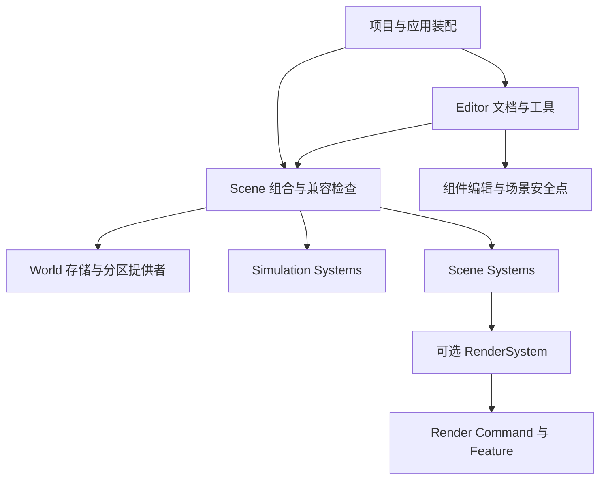

# Scene 编辑 运行与产品装配设计

本文设计项目创建、场景组合、相机与视口、资产导入、组件编辑、保存和运行的完整关系。
本文包含已落地的组合、文档与视口 API，以及资产编辑和 Play 的后续目标；未实现部分仍明确标注。

设计遵守 [工程原则](engineering-principles.md)、[Editor Framework](editor-framework-v2.md)、
[Editor 质量规则](editor-quality.md) 与 [AGENTS.md](../AGENTS.md)。
现有 [Engine 与 Render 执行设计](render-v2/engine-editor-integration.md) 继续规定 stdexec、
Main/Asset Client、完整帧、真实 FIF 和关闭合同；其场景选择、单相机和项目视口目标以本文为准。

正式游戏编译与发布不属于这轮实施。本文保留其输入和依赖边界；Headless 基础构建、编辑器运行预览
属于本轮。打包文件、复制 DLL 或打开启动 Scene 都不能冒充正式游戏编译器。

## 1 统一模型与依赖方向

### 1.1 三种场景身份

| 对象 | 拥有的事实 | 不拥有的事实 |
|---|---|---|
| Scene 资产 | World/Simulation 引用、Scene System 实例和配置、依赖与绑定 | ECS 地址、Render 句柄、窗口 |
| Engine Scene 实例 | 一份运行 ECS、时钟、Simulation 和 Scene Systems | Editor Pane、项目资产目录、图形设备 |
| Render Scene | 某个运行实例的资源与渲染关联 | World 分区、编辑文档、Simulation 规则 |

同一 Scene 资产允许有编辑实例、Play 实例和多个独立游戏实例。它们各有自己的运行身份；不能用
AssetId 直接替代 SceneInstanceId 或 Render SceneId。

安装 RenderSystem 的 Engine Scene 实例通常产生一份 Render Scene；不安装则没有该投影。
Editor 的独立 UI Render Scene 属于窗口，不创建空 World/Simulation，也不成为项目 Scene 的父对象。

### 1.2 保留两类 System 的区别

- Simulation System 承担按模拟时钟执行的逻辑、物理、脚本等；沿既有 TaskGraph 和访问声明调度。
- Scene System 承担实例维护、外部数据采用、稳定点派生和发布。RenderSystem 是其中一个可选系统。
- SceneRuntime 组合并驱动两者，复用同一个 ExecutionRuntime；它不懂具体渲染配方或 Editor 操作。
- World 描述负责存储和分区；分区器、索引编码不是 RenderSystem 的输入。



上层装配可以同时看见各域。底层只声明自己所需的输入，不 include 上层的产品、World 配置或
Editor 类型。无须新增 CompatibilityManager、SceneManager、TaskManager 或通用服务容器。

## 2 Camera View Target 与视口

### 2.1 各自职责

| 类型或概念 | 责任与身份 |
|---|---|
| `scene::Camera` | ECS 作者组件：投影参数；姿态由 Transform 提供，不保存 ViewId |
| 运行相机引用 | SceneInstanceId 加实体代际；持久引用使用 WorldObjectId，不保存 EnTT 数值 |
| Render View | 本次观察所需的渲染状态与 View Storage，由 RenderSystem 维护 |
| Attachment | 将 Effect、Scene、View 与 Target 关联；仍由现有 Render 合同控制 |
| `CameraTargetsComponent` | CameraMan 的运行期输出意图；Target、实际描述/epoch、viewport 和参数，不拥有 Render 对象 |
| 私有 `RenderViewComponent` | 该实体唯一的 View/Effect/Attachment 派生绑定；不安装、不持久化 |
| `SceneViewportPane` | 拥有视口输入与显示控件，借用 ProjectScenes 的 SceneViewportId；不持有 GPU 清理状态 |
| `ProjectScenes` 的视口记录 | 独占 Target 的删除责任及 UI 图像关系，存活到撤销、观察退役和 RemoveTarget 完成 |

相机不是视口。无人使用的 Camera 不必产生 Render View；同一 Camera 可以被不同视口选择。
每个实际观察关联使用稳定的局部身份，RenderSystem 内部记录对应 View/Attachment 和参数版本。
首次按每个请求独立 View 实现，不提前共享 View Storage 或添加相机缓存管理器。

游戏主相机选择可以保留 `Camera.primary` 作为默认策略；Editor 的显式选择优先。切换相机只更新
实际观察记录，不重建整份 Scene 资产投影。同一 Scene 的 Mesh/Material/实例数据仍共享。

### 2.2 Editor 自由相机

自由相机也是 Scene Registry 中的普通 CameraMan：Camera + Transform3D，WorldTransform3D 由已有
TransformSystem 生成。ProjectScenes 在安全段创建它，不加入 WorldEntityMap 的作者集合，保存/Undo/Play
作者快照不包含它。Pane 保存操作控件和选择意图，不保留另一份作为渲染来源的相机姿态。

Primary 与作者 WorldObjectId 的选择属于 ProjectScenes；Camera 信号使选择失效，RenderSystem 只消费
已经解析的 ECS 实体。拾取与 Gizmo 读取同一个实体的 Camera/WorldTransform 和实际采用的图像尺寸。
缺失或多个 Primary 明确报告错误；不会自动选择别的相机。Edit/Play 各自解析作者身份，自由相机各自创建。

### 2.3 输出与 UI

Editor 视口创建可采样的 Offscreen Target，RenderSystem 为它准备 View/Effect/Attachment。
生产者准备成功后才加入 `EditorUiScene` 的 imported target 图像关系；UI Scene 输出到窗口 Surface。
二者仍通过 Render 的资源依赖排序，不让 Scene Feature 知道 UiRasterFeature。

Target Resize 在现有 Owner 安全点准备并采用完整候选：更新实际 extent、viewport 和相机宽高比，
失败保留旧输出。位置变化只改变 viewport，不能无条件重新编译配方。最小化可以暂停该观察，
不意味着卸载整个 Scene。

关闭顺序：停止该视口的未来帧输入；撤销 UI 对它的采样并等待真实采用；解除观察关联并等待应答；
删除 Target。旧帧物理引用仍由真实 FIF、Queue 前沿和唯一 `DeviceSession::cleanup_scope_` 保护。
Pane 从 Root 移除不允许提前销毁尚被清理过程借用的状态。ProjectScenes 在 Pane 销毁后继续保留必要记录并推进清偿；
SceneDocument 不反向依赖 Render。这不是新的 GPU 清理 Scope。

### 2.4 观察输入 API

`RenderSystem::addCameraTarget/updateCameraTarget/removeCameraTarget` 只在 Main 的 Scene 编辑安全段
patch CameraTargetsComponent。CameraTargetId 在该 Scene 内单调生成，不复用，不是 vector 下标。
调用方按 SceneInstanceId + Entity generation + CameraTargetId 路由，实际运行绑定只在该实体的
私有 RenderViewComponent 中。`attachment(camera, id)`、`cameraTargetError(camera, id)` 为只读查询；
移除意图后等待 `cameraTargetRetired(camera, id)` 再释放 Target。

观察者只记录变更；实体删除时把仍可读的绑定移动到 RenderSystem 的退出记录，不再活动查找。
创建/编译 coroutine 仅保留身份与值，回 Main 后重新定位，不跨挂起借用组件或 vector 元素。
零变化不重新计算相机参数；变更实体只准备自身输出。近远面配方判断不求整个逆矩阵。
RenderAssetInput 单独提供稳定资产域和一起发布的 revision/VFS snapshot，不再混入相机集合。

纯尺寸 Resize 保持实例、Feature/Storage 订阅、计划、Pipeline、DescriptorPool 和固定资源。
成功回复后目标暂停，下一完整帧同时发布新参数和 `SetTargetActive{target, true, epoch}`。
启用必须匹配实际 epoch，排在回复前的旧帧不能重新激活新尺寸。失败回复保留实际描述和
output_available；关闭旧 SwapChain 后失败不会伪装旧输出仍可用。物理回收仍归唯一 cleanup_scope_。
子视口按实际 framebuffer scale 一次换算到像素；旧图像保持同一个 token 并按旧宽高比 fit，留边不接受拾取。

内置配方为 `lux.scene.deferred` 与 `lux.scene.clustered`，版本 1。阴影采用统一数组分辨率，
由 Scene 的 `shadow_resolution` 指定；Light 的 `cast_shadow`、级联划分和偏移参与实际投影。
当前配方不实现每灯混合分辨率，不把 Light 的旧 `shadow_map_size` 当成已生效。
阴影可见性读取 ShadowMapFeature 的 views 端口，主视图可见性读取观察参数；二者不是同一种输入。

## 3 不反向依赖的兼容约束

### 3.1 为什么不能沿用世界类型白名单

旧 `supported_world_types`/`supportsWorldType()` 按分区器名称或 `*` 判断，已经删除。该方式不能
区分数据维度与分区算法，也不能证明一个组合真正拥有所需输入。
把 quadtree/octree/single 等名称继续加入 RenderSystem 会制造不应存在的耦合。

通用 System 使用下述数据合同。真正需要特定 World 编码或索引的实现，在
World/Spatial 集成模块验证自己的格式合同；不能删掉这种验证后宣称任何索引都能使用。

### 3.2 四种检查必须分开

| 检查 | 声明者 | 检查点 | 例子 |
|---|---|---|---|
| 数据 schema | 实际消费者 | Scene 冷态组合 | 需要 Camera 和 Transform3D schema；不要求每个实体具有它们 |
| 派生结果可用性 | 生产者与消费者 | 组合阶段解析生产者和阶段顺序 | WorldTransform3D 在渲染投影之前准备完成 |
| 运行服务 | 实际消费者 | 现有 `SceneCapabilityProvider` 类型化绑定 | RenderSystem 借 RenderRequester/RenderAssets；加载系统借读取接口 |
| 格式与硬件限制 | 格式实现或 Render Backend | 实际解码/设备/图编译边界 | 索引版本、Shader 输出格式、Descriptor/Queue 能力 |

System 的 READ/WRITE 访问声明用于竞争分析；可选组件查询也会有 READ，不能自动推成必需组件。
某个系统 WRITE 某字段也不等于提供了“每帧该数据均已准备好”的语义保证。

### 3.3 推荐的最小声明扩展

保留现有 `SystemTypeDescription` 的身份、版本、配置和 multiplicity。提供两组只读数据声明：
`data_inputs` 与 `data_outputs`，元素为中立值 `SystemDataContract`：

- 稳定语义名称和显式合同版本；持久数据不保存 C++ 函数地址或 `TypeToken`。
- 区分 `SCHEMA` 与 `PREPARED_DATA` 两种实际语义，不引入任意条件表达式语言。
- SCHEMA 输入由本 Scene 允许的作者 schema 和已选生产者声明的派生 schema 提供，并通过
  ComponentSchemaSet 验证定义/版本。插件“注册过某个组件”不等于本 Scene 选择了它。
- PREPARED_DATA 输入由已选 System 的明确输出提供。
- 输出的生产阶段和输入的消费阶段由对应 Simulation/Scene 注册描述附带，不由字符串猜测。
- 可选能力通过实际配置决定是否加入本次 requirements，不用一长串永久 optional 标志掩盖缺失输入。

这一值类型位于 `engine/domain/system/description`，只含中立身份和版本，不 include World、Render、
ECS 组件或 Editor。具体 schema 身份到中立声明的投影由现有 schema/插件生成器完成。
拥有声明的组件和算法域定义版本，不能由 Editor 随意编造一个同名 capability 使检查通过。

`SceneCompatibility.hpp/.cpp` 作为 `engine/scene/composition` 的纯解析算法，复用已选系统表、
ComponentSchemaSet、阶段与依赖图；没有长期实例、线程、注册目录或运行期轮询。
输出是一次构建所需的已解析顺序和结构化诊断。随后沿现有 Installer 构造对象，不在每帧重新解析。

`SceneSystemRequirementSpec` 继续处理实际对象借用；不能为每个数据事实伪造一个 void* Provider。
`SystemAccessSpec` 继续处理调度读写，不合并成万能合同。

### 3.4 组合算法

1. 解析完整名称、版本、配置和实例身份；建立本次构建的紧凑索引。
2. 从选中 schema 和 System 输出建立声明索引。没有生产者、版本不匹配、来源歧义均给出具体诊断。
3. 多个候选生产者时要求显式绑定；禁止取第一个注册者。可重复写入组件不等于有多个 readiness 生产者。
4. 对 PREPARED_DATA 建立必要的先后关系，与用户显式依赖合并，复用既有拓扑算法检测环。
5. 依赖可以在合法阶段内排序；如果要求“Scene 发布先于本帧 Simulation”，拒绝阶段倒置，不能靠
   额外 wait、第二次全场景遍历或静默读取上一帧值补齐。跨步数据必须另有明确的历史语义。
6. 验证运行服务与实际配置，再发布本次构建。Provider 借用只在构造边界解析。

构建复杂度目标为索引建立 O(N log N)、依赖处理 O(V+E)，不比较所有系统对。不在编辑每个字段时
重跑完整组合；只有 System/schema/配方配置等结构变化才重新解析。

### 3.5 World 与渲染的具体例子

RenderSystem 声明需要 Transform3D/Camera 等数据和世界变换准备结果，不知道存储采用 single、
quadtree 还是 octree。WorldLoading/Spatial 集成方根据 World 选择实际读取与索引实现，提供它
承诺的已加载 ECS 数据或窄查询接口。

Physics2D 声明自己的 2D schema/服务合同，不限定 Renderer。如果场景使用 2D 物理配合 3D 表现，
必须显式选中真实的坐标投影生产者；没有实现就诊断缺少 Transform3D 来源，不能自动转换。

“2D 模板”是上层经过验证的选择集合，不是引擎底层禁止混合维度的总开关。渲染配方表达自己真正
支持的输入和材质用途，不知道 World 索引。只有 Render Backend 检查图形设备限制。

### 3.6 元数据只有一份来源

插件导出的真实注册描述产生可供 Editor 读取的元数据。Editor 离线读取目录用于筛选，选定后由
Engine 同一解析算法做权威检查。不能让 UI 与运行时各维护一套兼容矩阵。

删除 `PluginCatalog::systemsForWorld()` 及其按分区器维护的索引，迁为基于已选数据合同的冷态查询。
索引属于已有目录的派生数据，不新增 Registry。升级受影响的插件声明/schema 版本；旧声明明确
报告需重新生成，不能把旧 `*` 自动翻译为“满足一切”。

## 4 场景选择与渲染配方

项目选择插件和可用功能，Scene 选择具体 World/Simulation/Scene Systems 与渲染配置。
项目可以给新 Scene 提供默认模板；模板只负责生成初始声明，保存后 SceneDescription 是权威。
同一项目允许多个不同类型的 Scene，不能用一个 Project.render_mode 限制全部 Scene。

扩展现有 `SceneProfileRegistration` 输入，接收经过验证的选择与具体配置。`SceneProfile3D`
保留为预设生成函数，移除其“只能 single World、固定空 Simulation、固定三个 SceneSystem”的限制。
新增 2D/headless 预设前，必须有对应真实消费者；无 Sprite/Tile 等渲染实现时不展示可用的完整 2D 渲染。

`RenderSystemConfiguration` 保存配方语义身份、版本与实际参数，不另建同义的 Recipe Owner，也不保存运行期 FeatureId。Engine 渲染装配通过当前 Render 目录解析 FeatureId，
沿现有 Feature 端口生成 Effect。内置延迟配方接入现有 GBuffer、主视图剔除、光照、阴影、Clustered
和 Tonemap；这些 Feature 继续独立，不互相调用。

`RenderSystem::Impl` 仍承担 ECS 到专业输入的增量投影；将具体配方组装保留在 `SceneEffect.cpp`
及同主题文件，不能把多个 Shader/后端算法塞进 System。配置声明可被不依赖 NRI 的工具读取。

## 5 项目 文档与编辑权威

### 5.1 Project 和 SceneDocument

现有 `EditorContext` 继续拥有项目目录、VFS、插件、注册数据和项目服务。`SceneDocument`
承接一个打开 Scene 的作者状态、revision、保存基线、选择和撤销历史。它不是第二个 SceneRuntime；
实际 ECS/System 仍由 SceneRuntime 唯一拥有。

同一项目可打开多个文档。`ProjectScenes` 作为现有 EditorServices 中唯一的已打开文档集合，
独占 SceneDocument；它不复制 ProjectManifest 场景目录，不驱动 Runtime、不拥有第二份 ECS。
Pane 借文档或使用 ObjectId 连接。这个类型有实际多文档所有权，不能与“全局 Scene 管理器”混同。

**保留现有 EditorContext 的唯一 SceneInstanceLease 拥有位置。** SceneDocument 只保存编辑/Play
实例身份；构建得到的 Lease 一次交给 `adoptScene()`。配对的 `retireScene()` 让 ProjectScenes 关闭文档时可以
取得 InstanceRetirement 值并等待，Context 保证项目退出时剩余实例全部清偿。退休回执是完成事实，
不拥有第二份执行状态。文档及其输入在对应退休完成前不得释放。

ProjectScenes 与 EditorContext 的冷态装配沿现有项目操作完成；文档不保存整个 Context 作为热态
服务定位器。应用关闭项目时先撤销项目 UI 的采样关系，再由 Context 退休剩余实例，最后释放文档服务和插件。
不为了减少一个容器把 Lease 从 Context 与文档之间来回迁移，也不增加文档级物理清理 Scope。

### 5.2 作者数据的唯一可变来源

- 已加载且可编辑的分区：编辑 Scene 的 ECS 是当前作者组件值的唯一可变来源。
- 未加载分区：当前保存基线的分区数据是来源，不创建另一份全量 ECS 镜像。
- 脏分区在本轮保持驻留，直到保存或关闭；不能被世界流送直接替换或驱逐。只 pin 实际编辑分区，
  不把这个原则扩大成全世界常驻。未来脏分区溢写属于独立容量策略。
- WorldTransform、GPU 句柄等 runtime-derived 数据可重新计算，不写入作者文件。
- 保存快照和 Inspector 草稿都是有 revision 的不可变输入，不能成为第二个 current。

加载现有场景时由 WorldEntityMap 恢复稳定 WorldObjectId。UI、拖放、撤销和持久引用使用该身份；
短期执行在安全点解析为带代际的 Entity，不能在异步任务里保存 ECS 裸地址。

### 5.3 统一编辑入口

`SceneEdit` 值请求描述创建/删除对象、组件增删/替换、关系修改；`SceneDocument::apply()`
完成一次事务。Inspector、拖放和 Gizmo 使用这一入口，不各自发 Render Command。

1. 捕获 `based_on` 文档 revision、稳定对象身份及草稿值。
2. 使用现有 ComponentSchema、Decoder、引用遍历完成整次操作的身份/范围/关系校验。
3. 在 SceneRuntime 安全点取得短期修改资格。使用 `SceneRuntime::editInstance()`，沿现有 BUSY/
   借用规则同步执行，不创建长期编辑队列或与模拟并发写 Registry。
4. 预备全部可恢复失败；提交段只采用已验证值。普通堆 OOM 仍 fatal，不假承诺跨任意回调回滚。
5. 替换现有组件经 `replace/patch` 或已存在的 `notifyUpdated` 发出正常通知；结构观察者只记录意图。
6. 成功后一次增加 revision，记录撤销数据并发出既有 LuxObject signal；通知失败不能重做已提交事务。

`DecodedComponent` 当前主要提供 emplace，应增加经验证的替换采用入口；不能通过 erase+emplace
伪装普通属性修改，导致下游误判为对象销毁/重建。反射用于字段展示/草稿编辑，具体类型负责校验，
不允许 Inspector 按 offset 直接覆写 live ECS。

撤销重做也走同一采用路径，产生新的单调 revision；保存基线不会因 Undo 数值回退而错误匹配。
未知扩展数据保留为不透明数据，缺少引用重写能力时禁止危险的删除/Save As，而不是猜测身份。

### 5.4 编辑与文件 IO 的依赖边界

`editor/scene/document` 的 `lux_editor_scene_document` 提供文档和事务；依赖真实
SceneRuntime 与 WorldResidency，不链接 Render/UI。ProjectScenes 位于 `editor/app`：它是项目打开、
运行服务与视口的实际装配点，独占文档和视口记录，但 Scene Lease 仍归 EditorContext。`scene_asset` 提供 ScenePackage 文件 IO，使用 Platform 的 `AtomicFileWriter`，不链接
ExecutionRuntime、Context 或 Render。纯持久化工具不因编辑器新增能力而被迫加载运行系统。

组件替换由 `DecodedComponent::replaceInto()` 发出 on_update；构造、删除仍使用原有 WorldResidency
准备/提交算法。组件成员增删在事务尾部同步驻留统计，下一次编辑不依赖下一帧才能正确检查容量。
历史需要的分区使用已有 PartitionRetention；不再维护另一份实体表或作者数据树。

`SceneRuntime::editInstance()` 拒绝重入和非结构安全点；只读借用仍允许在等待发布时查询稳定数据。
当前 Simulation 的 execute 在返回前已等待其 TaskGraph 完成，Runtime 的驱动标记阻止执行中的借用。
不能把“待发布”误认成“Worker 仍在写 Registry”，也不能让可写借用跳过结构安全点。

### 5.5 产品创建与视口调用

`ProjectCreationPane` 发送原有 typed Project Event；`SceneCreationPane` 从项目的不可变注册表列出
作者 schema、Simulation 与 Scene Systems。配置默认值来自原有 Codec/profile；Render 配方与阴影
选项写入真实 RenderSystemConfiguration。选择产生 SceneCreateSelection，仍由同一 SceneCompatibility
解析，不另建 UI 兼容矩阵。当前新建 World 限 single；其它索引必须有实际生成算法，不能偷偷替换。

`ProjectScenes::create()` 使用现有 TaskScope 跟踪用户任务：CPU 准备/编码，blocking 发布 Scene 文件与
项目根目录，Main 采用目录并打开实例。一个项目同时只有一个目录写入者。取消只能发生在发布前；
SceneCreationFailure 明确说明 Scene 文件是否已发布，根目录失败不删除已发布文件或伪造回滚。
`open()` 则只读取、解码、验证并采用已有包。所有工作借用在 ProjectScenes 的关闭清偿结束后释放。

`addViewport/updateViewport/closeViewport` 只提交观察意图。正常 Main 维护点创建或 Resize Target；
对应 RenderSystem 已采用 Attachment 后，才将 Target 加入现有 EditorUiScene。`viewport()` 区分真实
错误与尚未就绪；尺寸候选未采用时不能报告 ready。失效相机撤销采样，恢复有效相机后重新加入。

关闭项目先停止新文档输入，撤下 UI 采样、清偿视口，再用 Context.retireScene 退休实际实例。
Scope 任务完成、Runtime 实例数为零、ProjectScenes 清空各表达不同事实；重开不能用其中一个代替
其它清偿条件。产品 Pane 被 Root 移除后，这些记录仍由项目服务拥有。

## 6 资产导入与拖放

### 6.1 不混淆三份不同信息

| 实际对象 | 唯一责任 |
|---|---|
| `ProjectAssets` | 源文件、导入设置、稳定 AssetId、子资产映射、Cooked 版本与导入诊断 |
| `AssetVfs` | 按已发布目录读取资产字节，不拥有导入 UI 或 GPU |
| `RenderAssets` | 已实际使用资产版本到 Render 逻辑句柄的投影，不成为项目资产数据库 |

ProjectAssets 是实际导入记录的所有者，位于 `editor/assets`，通过现有服务构造；不新增通用
AssetManager。索引可重建，稳定 ID/导入配置必须持久化，移动源文件不重新生成全部资产身份。

### 6.2 导入链

阻塞池读取源及其依赖 → CPU 执行已有 `cookModel`/材质/纹理编译 → 阻塞池写候选产物 →
校验源版本与当前导入请求 → 原子发布目录 revision → Main 采用并通知资产浏览器。

复用 `ModelCooker` 已有 `ModelSourceRequests`：缺失依赖回到 blocking 读取，再回 CPU 尝试；
不在 CPU 池使用路径重载做隐式阻塞 IO。取消检查位于发布前，已经发布的结果不能报告确定未发生。
失败保留上一版可用产物；所有子资产候选就绪后才更新唯一目录引用，不能留下半套模型。

当前目录是项目下 `.luxassets/catalog.json`，每次导入写入一个独立的不可变 LUXPAK，然后原子更新
目录。子资产身份复用 ModelCooker 的源名称映射；重名/缺少可判别身份时拒绝重导入，不按新 ordinal
覆盖旧身份。目录记录保留源路径、具体 Cook 配置、版本和产物 ID。已经发布的历史产物暂不自动回收，
避免破坏仍持有旧 VFS 快照的读者；后续磁盘整理必须以实际引用为依据。

`VfsAssetReadEndpoint` 在接纳时捕获挂载表。材质与后续纹理读取共同借用本次发布的同一快照，
不能在读取中途重新选择最新目录。`RenderAssetVersion::source` 区分项目代次；相同 AssetId 和
revision 不会误用另一项目的 GPU 缓存。后台文件/Cook 工作只拥有输入，采用回到 Main 并解析现有
ObjectId；项目已经关闭时不采用迟到结果，也不回滚已经完成的文件发布。

现有工具若尚缺某一种输入格式/材质用途，则本轮明确拒绝并展示诊断；不伪造占位 Mesh/材质通过闭环。

### 6.3 拖放进入 Scene

资产浏览器只发送 AssetId/版本意图。视口确认模型用途、落点和当前 Scene revision，准备完整的
作者对象/Parent/Transform/Mesh/Material 引用，作为一次可撤销 SceneEdit 提交。

RenderSystem 观察真实组件变化，RenderAssets 经独立 Asset Client 读取、解码并上传。作者引用
可以先存在而 GPU 数据尚未到位，此时展示加载状态；实际 Response 后采用 Render 句柄。
不由拖放工具等待 GPU，也不让 Render 推断模型之间的业务依赖。

重新导入发布新资产版本，由 Client 侧 RenderAssets 更新引用。RenderSystem 保留已采用绑定，先
准备候选 Mesh、Texture 和 Material；未采用的候选失败不会撤销旧实例。成功时先让各观察的配方
接受旧、新两组资源，再用一次完整帧 UpdateMeshInstances 切换现有实例，最后移除旧组并释放旧引用。
这避免了提前删除和临时双重绘制；DeviceLost/结果不确定仍保留实际错误，不承诺设备失败后画面可用。

RenderSystem 的待处理实体集合按完整 Entity 代际去重。连续撤销/重做可让一个槽位的两代实体同时
等待投影；它们不能存入只允许一个活代际的组件 sparse set。
原 stdexec 上传源借用终点、FIF 数据隔离和唯一物理清理合同保持。

内置 ModelCooker 实际输出 BC7 颜色、BC5 法线、RG8 金属/粗糙度和 R8 遮蔽数据。Render 上传与图像
描述直接消费这些格式，不能把成功上传结果默认描述成 RGBA8，也不在导入时偷偷降级成替代材质。
Editor 启动请求实际使用的 BC 能力，不支持的设备或像素格式明确失败。

## 7 Inspector Hierarchy 保存与运行

### 7.1 工具分工

- `SceneHierarchyPane`：展示稳定对象/父子关系和当前选择，不拥有另一份对象树。
- `SceneInspectorPane`：消费 ComponentSchema/反射元数据，维护带 based_on 的字段草稿。
- `AssetBrowserPane`：显示 ProjectAssets，不读取 Render Storage。
- `SceneViewportPane`：画面、相机操作、拾取与变换；选择通过 SceneDocument，Pane 互不互相持有。

当前工具的组件草稿使用已有 `ComponentSchema` 编解码与 `TTypeStaticInfo` 成员指针；字段显示名、
编辑速度、只读标注由同一 Meta 生成器输出。Inspector 不按 byte offset 写 live ECS，也不另建字段目录。
Transform、Camera、Mesh/Material 资产引用和 Light 具有实际编辑器；其它组件保留并明确显示无字段编辑器。
材质引用编辑不等于已经提供 MaterialGraph 编辑产品。Parent 由 Hierarchy 的关系编辑入口处理。

Hierarchy 只在作者对象/Parent 的结构 revision 改变时重建展示行；Transform 内容改变不重扫整棵树。
Inspector 草稿不会被后台刷新自动改写 based_on。只有 SceneRuntime 的 BUSY 允许重试同一拥有型编辑，
其它错误终结本次意图；重试不补最新 revision。视口拾取借用 WorldResidency 的唯一身份映射，而不是
假设 Registry 中还有第二份 WorldEntityMap。

平移轴柄用双精度 picking ray 与世界轴的最近点求位移，再通过父变换的逆线性部分转换到局部空间。
拖动预览通过 SceneDocument 的正常组件替换发出更新，结束合并为一次 Undo，Escape 恢复起始值。
未结束的拖动不能成为保存或 Play 快照。工具关闭时保留最后已采用的值并结束历史记录；不留下悬空
草稿或锁住文档。当前轴柄提供平移；旋转/缩放使用 Inspector，更多 Gizmo 形式不是已有能力。

MeshQuerySystem 仍拥有实际空间索引，结构重建提供缺失的 Mesh 身份。ProjectAssets 在共享执行资源上
读取 Mesh、解码并构造不可变 BVH；ProjectScenes 在 Scene 安全点采用结果。同一项目多个观察复用几何，
不从 GPU Readback 生成选择数据。没有 MeshQuery 的组合可以通过 Hierarchy 选择，界面准确报告拾取不可用。

这些工具位于 Editor 的纵向主题目录，使用现有 Pane/Root、LuxObject signal 和路由事件。
删除无消费者的 `SceneToolRegistry` provisional match/factory 接口；工具可用性从实际 Scene
组合和公开合同确定，不再读取任意 WorldDescription 去猜“应该是什么工具”。

### 7.2 保存

在安全点捕获作者组件快照和 revision R；CPU 编码既有 ScenePackage，blocking 写临时文件并
原子替换；Main 只将已发布的 R 记录为保存基线。如果期间出现 R+1，文档仍为 dirty。
当前 `writeScenePackageAtomic()` 混合编码与写文件的内部调用需要拆清，保留真实原子写算法，
不能因此创建第二种场景文件格式。

保存对象包含 World/Simulation/Scene 配置、作者实体和资产引用，不含 RenderId、编辑相机、
临时视口及 GPU 状态。多文件提交采用候选代次目录加单个可原子发布的根引用；不能声称跨多个
rename 是原子事务。新 Scene 文件写好后再发布 ProjectManifest，失败候选可回收。

重开必须恢复相同稳定身份、作者值与所选 Systems，并重新生成派生值。Save As 遇到目前不支持
重写的索引/扩展时保留明确错误，不能把简单 single 分区能力写成任意 World 都已支持。

实际文件保存由 ProjectScenes 调度；SceneDocument 只负责快照和已发布 revision 的采用。每份文档
同一时刻最多一个文件写入者。关闭文档等待已接纳的保存完成，迟到结果核对文档 ObjectId；普通停止
不能覆盖已经发布的文件结果。撤销重做、保存和 Play 使用现有 UI Command 路由，没有第二个命令目录。

### 7.3 Play 与停止

Play 从 revision R 的作者快照创建独立运行实例；共享不可变资产和 ExecutionRuntime，ECS 可变状态
不与编辑实例共享。编辑实例暂停模拟但仍可维护/显示；游戏 Camera 与编辑 Camera 独立。

停止先撤销 Play 输出引用、退休运行 Scene，持续推进现有维护帧直到清偿，再销毁运行实例。
Play 的变化不自动写回作者文档；“应用运行变更”延期，未来也必须是显式 SceneEdit。
为避免本轮双向合并复杂度，Play 期间该文档的作者编辑默认只读；异步保存已捕获快照可以完成。

Headless 预览使用显式运行选择，排除已声明为可选呈现的 RenderSystem，并再次验证剩余依赖。
如果业务 System 实际依赖被移除的输出，则报不相容，不静默跳过。Editor 自身的 UI 继续渲染。

ProjectScenes 通过 `startPlay(document, ESceneRunMode)` 装配运行实例，复用同一个 Builder 创建路径。
`ESceneRunMode` 仅表达 GRAPHICAL/HEADLESS 两个实际选择。RenderSystem 的输入保存在该实例的稳定记录中；
唯一 SceneInstanceLease 仍归 EditorContext。Play 视口使用自己的 Target，停止先撤下 UI 引用和观察，
再退休运行 Scene。编辑实例及作者数据保留，Play 中的更改不自动写回。目录发布的新资产版本可以更新
两种实例的只读资产投影，这不会共享它们的可变 Registry。

## 8 Headless 构建与未来发布边界

### 8.1 三种产品组合

| 组合 | 必须具备 | 不应具备 |
|---|---|---|
| Editor | EngineContext、窗口、UI Render、工具和 Cook 能力 | 第二个 CPU 池 |
| 图形运行预览 | Engine Scene、RenderExecution、选定呈现配方 | Editor 工具依赖进入底层 |
| Headless 核验程序 | EngineContext、Scene/Simulation、所选 CPU 插件/IO | Render/NRI/Vulkan/窗口查找、链接或装载 |

EngineContext 保持无图形成员。项目包含 RenderSystem 不会让基础 Engine 强制链接 Render；
图形模块由应用组合根明确选择。装载插件前从数据目录选择允许的依赖闭包，不为了发现 System
先加载所有 DLL。缺少必需渲染能力时失败，不安装空 RenderSystem 代替。

本轮为根构建提供明确的 CPU-only 选项组合，确保 `modules/platform`、`modules/function`、
`engine/rendering` 和 `scene_render` 不被配置。选项控制真实源/target，不用全局宏遮蔽实现。
使用安装后的 Engine SDK 独立构建 Headless 消费者，并检查传递 find_package、链接、动态依赖。
仅不打开窗口不足以通过；无 Linux/无桌面环境实测时保留该环境 NOT_RUN。

### 8.2 游戏编译接口 本轮仅设计

正式游戏发布必须由后续真实编译管线处理：

```text
版本锁定的项目与场景声明、脚本/程序源、资产、平台配置
  → 闭包解析与语义检查
  → 程序编译与优化
  → 材质/Shader/渲染配方的编译、专门化与合法优化
  → 资产 Cook 与布局
  → 平台链接、装配和部署产物
```

未来输入至少包含源 revision/digest、Scene/System/插件版本、渲染配方与材质用途、目标平台/后端、
图形或 Headless 选择、编译设置和工具链版本。输入使用稳定身份和拥有型值，不依赖 EditorContext、
live Registry、Render FeatureId 或设备地址。

后续输出是可运行程序、编译后的资源/配方、依赖清单、诊断与可复现摘要。程序段消除、特化、链接
优化以及渲染 Pass/Shader 变体/资源优化需要保持可观察语义，不能因名称相似就删除一个 System。
现有 Renderer 的 Graph 编译只是这条管线的一部分。

本轮保证现有声明/编码可成为这些输入，记录版本并分离工具链依赖；不新增无人调用的编译器壳、
返回成功的 BuildGame API 或把复制目录命名为 release。正式 Headless 发布同样属于该后续工程。

## 9 帧顺序与异步寿命

沿现有执行机制保持下列安全点，不新增 Manager、完成队列或清理 Scope：

1. 推进 Main 完成和已接纳的退休；采用项目/资产候选。
2. 处理 UI 意图，安全点提交已验证的 SceneEdit；不能在 EnTT 观察者中递归改世界。
3. 获得完整 FrameInput 才推进需要呈现的模拟；没有载体时继续 MAINTENANCE，不忙等。
4. SceneRuntime 执行 Simulation、同步/稳定阶段，各 RenderSystem 追加本 Scene 与各观察的增量输入。
5. UI 捕获使用本轮合法图像引用，追加同一个 FrameInput，再进行唯一 SubmitFrame。
6. Render 完成上传采用、Frame 准备、真实 FIF 录制/提交；GPU 清理只使用既有 cleanup_scope_。

无图形应用以自己的时钟驱动 SceneRuntime，不等待一个不存在的 FrameInput。Editor Headless Play
不能因为视口最小化而失去逻辑推进；它的时钟驱动资格与 UI 帧背压分开。扩展现有 driveFrame 的
窄输入，Builder 为每个实例设置 `setFrameAdmissionRequired`。无图形实例为 false，在全局
MAINTENANCE 下仍按自己的时钟推进；图形实例为 true。随后仍遍历一次现有实例集合；
不以全局 UI 帧资格暂停全部 Scene，不增加第二个驱动循环或长期调度目录。

存储读取在 bounded blocking 资源，解码/Cook 在同一 ExecutionRuntime 的 CPU Scheduler，业务
采用回 Main。独立 Asset Client 只拥有其 Link/通信亲和性；stdexec 继续拥有 connected operation。
关闭顺序覆盖 Scene/视口、Asset 输入、Producer 尾栈、Outbox 和 Device 清理，Scope join 不替代后两者。

## 10 类型与文件的主要处置

下表列出实际实现的主要边界。阶段顺序与历史验证材料保存在源码树外。

| 类或文件 | 目标处置 |
|---|---|
| `SystemTypeDescription.hpp` | 删除 World 类型白名单；加入中立数据输入/输出声明 |
| `SceneInstance.cpp` / `SceneSystemInstaller.cpp` | 复用构建流程解析数据来源、阶段和具体服务，删除分区器名称对 System 的筛选 |
| `PluginCatalog.hpp/.cpp`、插件描述生成/格式 | 由真实声明导出兼容元数据；删除 `systemsForWorld` 索引 |
| `SceneProfileRegistry.hpp` / `SceneProfile3D.cpp` | 接收真实组合选择；3D 保留为预设，移除固定创建形状 |
| `RenderSystem.hpp/.cpp` | 多观察记录、相机正确发布、明确配方配置；不认识 World 索引 |
| `SceneEffect.hpp/.cpp` | 从明确配方和数据组合 Feature，保留端口协作 |
| `Camera.hpp/.cpp` | 保留中立 Camera/姿态算法；删除注释中不必要的 Vulkan 身份，保留准确坐标约定 |
| `CameraTargetsComponent / RenderAssetInput` | 输出意图与资产版本分开；旧 SceneRenderInputs、SceneViewRequest 和来源 variant 已删除 |
| `SceneDocument.hpp/.cpp` | 作者 revision、编辑/Play 实例身份、保存/撤销、选择和关闭；不拥有重复 Lease |
| `ProjectScenes.hpp/.cpp` | 项目内已打开文档的唯一集合；沿现有 EditorServices 持有，不复制 SceneRuntime |
| `SceneEdit.hpp` | 事务输入值；实际采用由 SceneDocument 执行，不引用 Runtime 来自行调度 |
| `ProjectAssets.hpp/.cpp` | 导入记录与原子版本发布；复用 VFS、Cooker 与执行资源 |
| 新增四个 Pane | 视口、资产浏览、Hierarchy、Inspector 的各自 UI；不互相持有业务指针 |
| `EditorContext::adoptScene/scenes_` | 保留唯一 Lease 所有权，增加配对 retireScene；文档不再另持一份 Lease |
| `SceneToolRegistry.hpp/.cpp` | 已删除 provisional World match/factory 通路；真实工具直接消费文档与 Schema |
| `ScenePackageFile.cpp` | 分离纯编码和 blocking 原子写，保留格式与错误事实 |
| `LuxEngine.cpp` | 装配/帧安全点/关闭，不承接 Inspector、导入或具体配方算法 |

文件按功能使用 include/sinclude/pinclude/src，非平凡类与其 `.hpp/.cpp` 同名；模板、纯值头可没有
源文件。SDK 扩展接口安装，Editor 私有工具不因测试方便公开。不存在新的万能 Installation/Provider 层。

## 11 可观察的完成标准

完整闭环至少包括：创建项目与 Scene → 选择相容系统/配方 → 导入真实模型 → 拖入 Scene →
修改 Transform/材质/Camera → 多视口看到正确结果 → 保存 → 关闭重开 → Play → 停止恢复编辑。

必须额外证明错误组合被明确拒绝、相机变更改变实际画面、资产失败保留旧版本、保存 R 不确认 R+1、
已删除对象不因迟到结果复活、关闭期间没有悬空借用。Headless 消费者从安装 SDK 构建并运行，
没有图形依赖。UI 的 GPU 测试不能替代 Headless 资格，Headless 测试也不能替代真实窗口闭环。

性能专项后置；保留增量复杂度与分配边界检查。文档选择/兼容/名称解析均在冷态。稳定帧只处理
活跃观察与实际脏数据，不因新增 Inspector 每帧编码全 Registry 或扫描项目资产。未归因性能保持 PARTIAL。

## 12 实施前值得继续讨论的设计决策

1. **数据约束粒度。** 推荐 SCHEMA 与 PREPARED_DATA 两种明确含义；不采用任意 capability 字符串
   就能放行的规则引擎。若实际消费者不需要某项声明，应删除该项而不是填空值。
2. **World 支持验证归属。** 推荐彻底移出通用 System 描述，放在读取/索引实现及 Scene 装配边界；
   底层 RenderSystem 不维护“允许的世界”列表。
3. **视口相机来源。** 推荐明确的 ECS Camera/Editor Camera 值 variant，避免在作者 ECS 创建隐藏假实体。
4. **编辑权威。** 推荐已加载编辑 ECS 为 current，脏分区暂不驱逐；不同时维护可变 Document Object 树。
5. **运行隔离。** 推荐独立 Play 实例、作者编辑暂只读；不在本轮增加双向同步或自动应用运行变化。
6. **发布边界。** 本轮实现 CPU-only 构建和运行预览；真正编译、优化、链接和游戏发布另行设计与授权。

这些是有具体落点的推荐方案。更改其中一项时，应同步修改它影响的身份、调用顺序和验收，不靠
额外长期状态或运行期补偿掩盖两种相互矛盾的合同。
